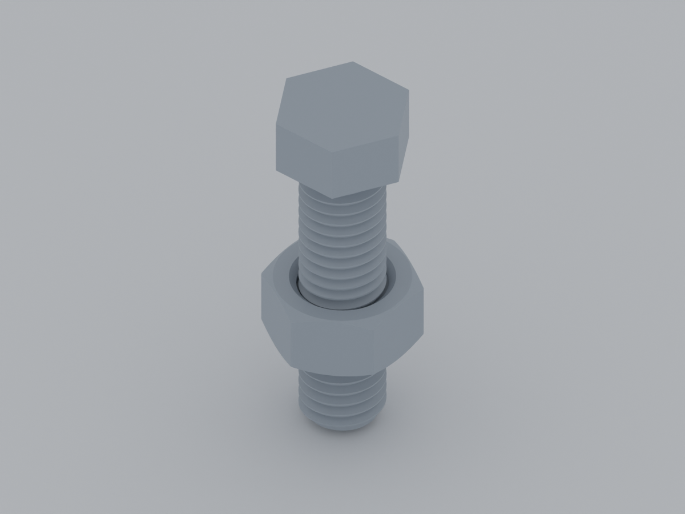
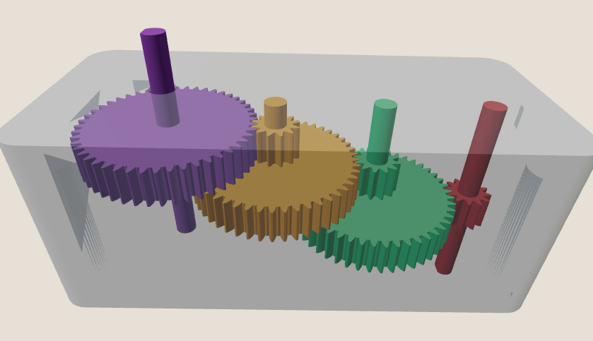
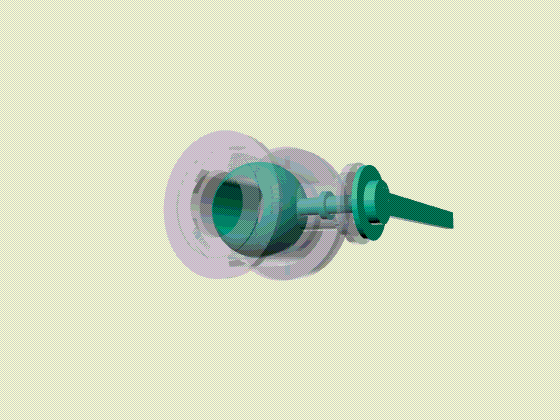
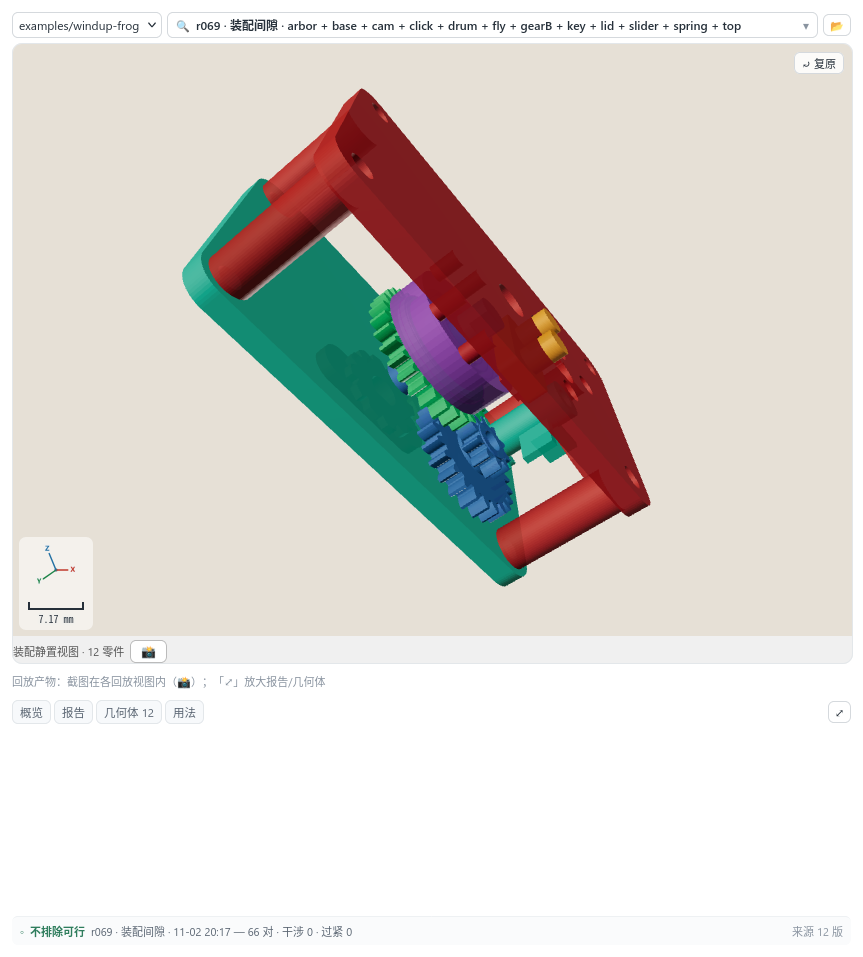

<div align="center">

# Yingzao (营造) · dsh-cad-harness

**The agent generates. The plugin closes the loop.**

A dsh plugin for mechanical CAD — fit, motion and manufacturability checked before you accept a model, and the final call left to you.

[](LICENSE)
[](docs/en/user/install.md)
[](docs/en/user/limits.md)
[](https://www.npmjs.com/package/dsh-cad-harness)
[](docs/en/user/preview.md)

[中文](README.md) · [Quick start](#quick-start) · [Verification](#verification) · [Documentation](#documentation)

</div>

| Part | Assembly | Motion |
|---|---|---|
|  |  |  |
| Real **M8×1.25** thread, about **5.2 turns** engaged | 24 instances / 276 pairs, **0 interference**, ratio **64.000** | **0→90°** travel, 24/24 poses, **0 interference** |

```bash
dsh plugin --profile <your-profile> add dsh-cad-harness
```

## Contents

- [Who it's for, and who it isn't](#who-its-for-and-who-it-isnt)
- [About the project](#about-the-project)
- [Examples](#examples)
- [Technology stack](#technology-stack)
- [Quick start](#quick-start)
- [Usage](#usage)
- [Verification](#verification)
- [What's new](#whats-new)
- [Known limits](#known-limits)
- [Documentation](#documentation)
- [Contributing](#contributing)
- [License](#license)

## Who it's for, and who it isn't

Yingzao's role is to provide a venue for the agent: a standard, stable way to produce mechanical parts, with channels for reviewing, recomputing and delivering them. It does not take on the job of improving the agent's 3D capability. Geometry ability depends on the model itself; that is not something a single plugin can take responsibility for.

### It fits

- You already have a design intent and acceptance criteria, are willing to describe them in words, and accept that the agent writes parametric code rather than dragging features.
- You need parts or assemblies that can be manufactured, assembled and made to function, not merely renders that look plausible.
- You work mainly on assemblies, at a complexity within the agent's ability. The benefit usually grows with complexity: not because objects that could not be designed become designable, but because cases that can be designed yet cannot be manufactured, assembled or made to function are corrected and caught before delivery.
- You are willing to judge from evidence: versions, numerical reports, interference and stroke checks; and you accept that the final judgement remains with the human.
- You care about the floor: fewer of the agent's worst outcomes, rather than relying on occasional high-quality output.

### It does not fit

- You want a "one sentence, one picture" demo, or treat 3D generation itself as the selling point.
- You need native CAD interaction: sketch constraints, feature trees, drag editing.
- You need certified precision: industrial tolerances, engineering drawings, precise FEA/CFD, production BOMs. This provides trend judgements and numbers within its boundaries, not certification.
- You expect the plugin to reduce token consumption; see the next section.

These are usage expectations, not admission criteria. If your need falls into the second list, a professional tool is usually a better fit.

### On tokens: not cheaper, but more predictable

(Internal measurement, small sample.) On the same task, average token consumption with the plugin is not lower than without it; it is slightly higher. The variance, however, is significantly smaller: the cost of a run can be estimated in advance and is less likely to fluctuate widely.

Reducing token consumption is planned, but it ranks below capability: we will not cut verification or necessary checks to save tokens. The reasonable expectation is predictable cost and effective investment, not lower cost.

## About the project

Geometry generation is no longer the bottleneck; **knowing whether the result is correct** is. A system that can generate but cannot verify produces things that only "look right".

Yingzao closes the loop **generate → verify → iterate → deliver**:

- **Generate**: the agent writes parametric code (OpenSCAD) and compiles it into immutable versions.
- **Verify**: dimensions, volume, wall thickness, clearance, interference, motion stroke and fluid trends are numbers from the engine, not the language model "eyeballing" it.
- **Iterate**: every version can be browsed, pinned and compared; old versions and old runs are never overwritten.
- **Deliver**: export a single version, or the whole project (every part STL + assembly manifest + notes); a whole-machine STL can also be merged from assembly poses.

It is not aimed at the chat-box demo of "draw me a part". The **multimodal LLM** reads and writes SCAD, looks at renders and decides the next step; the **DSH plugin** provides CAD tools, immutable versions, numerical verification and the delivery gate. It does not pursue fully automatic modelling: repeated generation and checking go to the agent, design judgement stays with you.

## Examples

Three examples, one per layer: a basic part, an assembly, and a motion simulation.

### Basic part: M8 bolt and nut


> Make an M8×30 hex bolt and an M8 hex nut; thread M8×1.25, nut across-flats 13, thickness 6.5; real threads, not plain holes.

| Check | Result |
|---|---|
| Thread | **M8×1.25**, nut 6.5 mm high, about **5.2 turns** engaged |
| Nut across-flats / height | **13.00 / 6.50 mm** |
| Bolt | M8×30, hex head across-flats 13 |
| Bounding box | 13.00 × 14.88 × 35.50 mm |
| Volume | **2.44 cm³** (measured from STL) |
| Thread geometry | real threads generated by BOSL2 `threaded_rod` / `threaded_nut`, not plain holes |

Source: [docs/readme-models/m8-bolt-nut.scad](docs/readme-models/m8-bolt-nut.scad). Render script: [docs/readme-models/render.py](docs/readme-models/render.py).

### Assembly: three-stage 64:1 spur gear reducer


Three spur-gear stages in series, 48:12 tooth ratio, overall ratio 64.000; six gears, four Ø5 shafts, eight 685ZZ bearings, a 106×48×42 mm housing in FDM nylon, with input and output on opposite sides.

| Check | Result |
|---|---|
| Overall ratio | **64.000** (three stages, exact) |
| Centre distance | 24.0 mm (identical across stages) |
| Gears | 3 × z12 / 3 × z48, m0.8, face width 8 |
| Assembly size | 24 instances, **276 pairs** |
| Static interference | **0 interference, 0 too tight** |
| Assembly contract | **23/23 interfaces pass**, 0 hard conflicts |

The assembly check answers static interference and interface fit only; it does not answer tooth loads, efficiency or noise.

### Motion simulation: DN100 ball valve


The valve travels from fully open to fully closed over a 90° stroke, sampled at 24 poses.

| Check | Result |
|---|---|
| Stroke | **0→90°** |
| Sampling | **24/24** |
| Interference | **0** |
| Joint drift | 0 |

The motion check answers whether it moves, collides or runs out of stroke; it does not answer sealing, torque or pressure drop.

> Examples demonstrate capability; material strength, wear, noise and print orientation still need separate verification.

## Technology stack

| Layer | Used |
|---|---|
| Geometry kernel | **OpenSCAD** + **Manifold** backend; optional **CadQuery** (B-rep, separate pack); BOSL2 is an optional **OpenSCAD modelling library** (threads/gears/screws), not the standard-parts catalogue |
| Standard-parts catalogue | **99 specs / 14 families** shipped, pre-generated STEP/STL (fit/visual); **no tool entry in 0.1.2-preview.1** — see [library/README](dsh-cad-harness/library/README.md) |
| Numerical checks | Python, trimesh, manifold3d, numpy, shapely |
| Host | **DeepSeek Harness** plugin; Node.js ≥ 20, TypeScript |
| Panel | React + WebGL viewport, running inside the DSH Web GUI |
| Evidence | immutable versions, JSON reports, six evidence rows, claims / policy / delivery audit |

## Quick start

`setup --openscad=auto` prepares OpenSCAD (2021.01 works but `doctor` reports `degraded`; 2025.06+ / Manifold is recommended). An existing 2025.06+ system install is used as-is; otherwise the official snapshot is tried first and the OSS mirror is used only when the official source is unreachable or stays below 256 KB/s.

**The version is a capability, not a preference**: on the same `plate.scad`, 2021.01 (CGAL) measured **2467 ms** against **69 ms** on a Manifold build — 36x, and the gap grows with model complexity. Below 2025.06, `doctor` reports that number and `compile.ts` warns once when it first resolves an older binary.

Network and offline (three switches; none of them changes how the package is distributed):

| Variable | Effect |
|---|---|
| `CAD_OPENSCAD_BIN` | Use an existing binary; skip the download |
| `CAD_OPENSCAD_MIRROR` | Override the mirror base (intranet or regional mirror); the pinned SHA-256 still decides |
| `CAD_OPENSCAD_ARCHIVE` | Local offline archive, same as `--from`; no network at all |

`LICENSE.GPL-2.0`, `SOURCE-OFFER.md` (GPL-2.0 §3(b) written offer) and `manifest.json` (per-file SHA-256) are published next to the binaries under the same mirror prefix; only the latter two are tracked here, so the repository keeps a single license file and automated SPDX detection stays unambiguous. See [dsh-cad-harness/mirror/](dsh-cad-harness/mirror/).

> OpenSCAD is prepared during `setup`; the Python runtime is about 400 MB and is installed on first calculation. Neither is shipped in the tarball.

### Install (recommended: npm)

```bash
dsh plugin --profile <your-profile> add dsh-cad-harness
```

Then run the one-time setup so the preset and OpenSCAD are in place:

```bash
npx dsh-cad-setup --openscad=auto   # preset + OpenSCAD
npx dsh-cad-doctor                  # kind=ok, or an explained degraded
```

> pnpm 12 prints `Agent skills awaiting approval: dsh-cad-harness` on first install. That is its approval prompt for the skills shipped in the package, not a failure; `pnpm approve` reviews them.

Behind a Chinese network, point npm at npmmirror so the package comes from the registry mirror; OpenSCAD still comes from the official snapshot or this project's mirror (the three switches above).

### Alternative: source checkout (contributors)

```bash
git clone https://github.com/songsenand/yingzao.git
cd yingzao/dsh-cad-harness && pnpm install && npm run build
dsh plugin --profile <your-profile> add -w "$PWD"
node scripts/setup.mjs --openscad=auto
npx dsh-cad-doctor
```

### Turn on Yingzao mode

1. Start a new session and choose the **营造模式 (Yingzao mode)** preset; normal sessions do not see CAD tools, on purpose.
   - **If you work in Yingzao mode most of the time, make it the default**: Settings → **Agent presets** → on the **营造模式** card, click **"Set as new task default"**. New sessions then start in Yingzao mode — no per-session pick, and no risk of the choice applying only to the current blank session.
   - The trade-off: every new session carries the CAD tool table. If you only need it occasionally, keep the default **Standard mode** and switch per session; to undo, set Standard mode as the new-task default the same way.
2. Open the **CAD Preview** tab on the right. If the tab is missing, restart dsh and start a new Yingzao mode session.
3. Describe what you need:

> Make a 60×40×8 mounting plate, four M3 countersunk holes, one 20 mm through hole in the centre.

This is what it looks like (windup-frog assembly, 12 parts / 12 versions):



The panel gives you:

- **Version history**: `v001`, `v002`, … every generation/modification is an immutable version; open, compare, pin, revisit.
- **3D viewport**: orbit, zoom and pan, with bounding-box numbers.
- **Whole-machine preview**: assembles the manifest's part@version nodes directly (no run needed); an **exploded view** slider moves parts outward from the assembly centre.
- **Measure and annotate**: two-point distance, wall thickness, section cuts, red-box annotations, and send the annotation back to the session.
- **Run playback**: motion, rigid-body and fluid timelines; pause on a frame.
- **Verification state**: assembly checks, printability and delivery audit results, including "needs review".
- **Theming**: the panel's surfaces, text and buttons follow the DSH Web GUI light/dark setting, including the tool chips and playback controls over the viewport. The 3D viewport ground stays a studio preset from **Background**; pick Graphite or Midnight for a dark ground.
- **Export**: single-version STL/3MF/OBJ/OFF/WRL, or a project ZIP; a blocked delivery audit asks for confirmation.

> The panel is a **read-only viewport plus the human's pointing channel**: it does not replace the agent writing code or the engine producing truth; it lets you see, measure and point at the problem.

Next: read [From description to delivery](docs/en/user/workflow.md) or [Verification](docs/en/user/verification.md).

## Usage

A typical conversation has five steps:

1. You describe the requirement, constraints and acceptance criteria.
2. The agent generates parametric SCAD and registers it as `v001`.
3. The engine runs dimension, wall thickness, clearance, printability and assembly checks, and writes the results into reports.
4. The agent reads the renders and reports, finds problems and generates `v002`.
5. After you confirm, export a single version (STL / 3MF etc.) or the assembly, or hand it to a downstream process.

Versions are immutable: `v002` never rewrites `v001`; a report is bound to the version it actually checked, and an old version's report does not automatically become evidence for the current version.

## Verification

```bash
# after tarball install
npx dsh-cad-verify /path/to/project --advisory
npx dsh-cad-verify /path/to/project --block --strict

# source checkout
cd dsh-cad-harness
node scripts/verify.mjs /path/to/project --advisory
```

`verify` is read-only: it checks the six rows `requirements / model / fit / make / review / delivery`, reports missing/stale evidence and claim witnesses, and never runs CAD, writes a run, or judges the design.

- Default advisory (exit 0); `--block`: pass 0 / warn 1 / blocked|fail 2 / usage 3; `--strict` turns warn into 2.
- Claims: `<project>/claims.json` or `--claims <file>`; policy: `<project>/evidence-policy.json` or `--policy <file>`. No policy means advisory.
- Project-specific criteria live in `<project>/checks/<id>/`: register with `check-register`, enable with `--checks`. Registration runs the negative samples; a check whose negative sample passes is refused. Every check must account for each criterion with a finding or `skipped`, and a check must not write to the project.
- Details: [docs/en/llm/verify.md](docs/en/llm/verify.md).

### DSH version compatibility (local container matrix)

The supported DSH range is declared in `dsh-cad-harness/package.json` under
`engines.dsh`: `>=0.2.1-rc.2 <0.3.0`. All 13 versions inside that range have been
tested one by one, so you can pick from this table directly:

| Status | DSH version |
|---|---|
| ✅ Works (9 rc versions, covered by the support promise) | `0.2.1-rc.2` `0.2.1-rc.3` `0.2.1-rc.4` `0.2.1-rc.5` `0.2.2-rc.1` `0.2.2-rc.2` `0.2.2-rc.3` `0.2.2-rc.4` `0.2.2-rc.5` |
| ✅ Passed (3 alpha versions; prereleases, not promised) | `0.2.2-alpha.2` `0.2.2-alpha.3` `0.2.3-alpha.2` |
| ❌ Unusable (upstream bug, not the plugin) | `0.2.3-alpha.1` |

`0.2.2-rc.1` is the baseline pinned by CI and by the checked-in preset. The 8 versions
below the floor (`0.2.0-rc.1/2`, `0.2.1-alpha.1–5`, `0.2.1-rc.1`) and `0.3.0+` are
outside the tested range: neither promised nor ruled out. Every row ran the same
T0–T2 assertions (install → regenerate the preset from that version's own
`standard.patch.yml` → compose → activate → the 9 CAD tool surfaces → one real
`cad_session` call); the full table and failure reasons are in
[docs/dev/DSH-MATRIX.md](docs/dev/DSH-MATRIX.md). The repository also ships a local
matrix that uses [kern](https://github.com/getkern/kern) (rootless, no daemon)
to run each version in a throwaway container: **regenerate the preset for that
version → composition → activation → the 9 CAD tool surfaces → one real
`cad_session` call**. It never installs dsh globally and never writes to `~/.dsh`.

```bash
cd dsh-cad-harness
node scripts/accept-dsh-matrix.mjs          # 0.2.1-rc.2 + 0.2.2-rc.5 by default
node scripts/accept-dsh-matrix.mjs --json
node scripts/accept-dsh-matrix.mjs --engine local   # debug: same assertions on the host
```

Install [kern](https://github.com/getkern/kern) first (rootless single binary, no daemon):

```bash
curl -fsSL https://raw.githubusercontent.com/getkern/kern/main/install.sh | sh
```

To avoid installing into `~/.local/bin`, put the binary at `<--state>/bin/kern`
(the script checks `PATH` first, then that path; `KERN_BIN` also works).

Without a container runtime, `--engine local` runs the same assertions on the host,
but it uses the host's Node and is not evidence of version compatibility.

The test box uses `--privileged` (so DSH's nested bwrap can start) and `--memory 4g`.
It is still rootless and daemonless, and only the repo and the version volume are
mounted. Installation uses `--net host`; the test phase uses `--net none`, with
model traffic on loopback only.

The first run installs DSH into a named volume (about 1.2 GB per version) and
later runs reuse it; results go to `dsh-cad-harness/verification/dsh-matrix/`.
The cache defaults to `~/.cache/yingzao-dsh-matrix`; `--state` can point it at a
throwaway directory inside the repo, and the whole directory can be deleted.
Containers cover Linux x64 only; the native Windows/macOS paths remain covered
by CI.

> Run this from a normal terminal: kern needs the systemd user bus and cannot
> start inside DSH's own bwrap sandbox.

## What's new (0.2.0-preview.1)

- **Four measurement families + history**: distance, three-point angle (measured AT the middle point), section area, and bore diameter; entries can be renamed, deleted, and travel with the screenshot caption.
- **Viewport navigation**: iso/top/front/right plus six-way axis snapping, perspective↔orthographic, Home; **per-part hide / isolate / highlight** in the assembly preview.
- **Audit view**: the machine page answers "which step has not been run", ordered by judgement, and a row jumps to the run or version it names.
- **Fluid**: the flow axis comes from the cavity (a stubby part is no longer driven across its own wall); a long run shows "steps done / total" and can be cancelled (cancelling stops the solver process); a wall under two cells is refined or refused; particles that cross the wall are held at it (penetration 7,098 → 0).
- **Checks can be re-run**: `run.json` now records the request, so manufacturing/assembly re-run in one click and stress can be replayed with the version re-pinned; runs that never saved their inputs are **refused with the missing list**, not re-run on defaults.
- **BOM CSV export**: seven columns (part, version, qty, material, process, source, stock id), with unconfirmed processes marked.
- Full details, evidence and known issues: [0.2.0-preview.1 release notes](docs/dev/RELEASE-NOTES-0.2.0-preview.1.md).

> This is a **preview**: **11 of the 13 gate items are closed**. The remaining two (Q1's token A/B, U21's tab switch on a real machine) are marked **"implemented, not signed off"**: the machine-side evidence is complete and re-runnable, but each needs one human observation. This version ships as **11/13** and does not present them as done; the sign-off steps are in the release notes §1/§4 and the checklist.

## Known limits

- **Not native CAD**: no feature tree, sketch constraints or drag editing; the source of geometry is code, and STEP can come in and be exported per part (round-trip and full audit are still pending).
- **Started as a personal tool**: documentation and acceptance were added after the results exceeded expectations; the early commit history is messy.
- **No formal benchmark baseline**: `examples/bench` has only one N=1 exploratory run; none of the 6 tasks passed the machine checks, and 03 was left unfinished because of the server-side quota (429). It is not a comparable benchmark.
- **Uneven tool maturity**: printability and assembly checks are relatively mature; CNC, EDM, sheet metal, turning and die casting remain `partial`; dynamic simulation is limited by the solver.
- **Not every example is one-command rerunnable**: `examples/*/cad-data/` is gitignored; historical examples keep only documentation, source and renders.
- **Current examples follow "new in, old out"**: when new examples enter the current table, an equal number of older ones move to the history table; directories, corpora and evidence are never deleted, only no longer shown as current.
- **Long tasks**: background jobs still cover OpenSCAD compilation only; rendering and simulation remain synchronous (unchanged in 0.1.2).
- **English is machine-translated**: the English user docs, `docs/en/llm` and `HARNESS.en.md` have not been human-polished; the client UI is in English, but model-side output may still be Chinese.
- **Not cheap**: that exploratory run consumed 81.41M tokens; the context cost of long tasks is real.

## Documentation

| Document | What it covers |
|---|---|
| [docs/en/user/](docs/en/user/) | User guide: install, workflow, verification, limits, troubleshooting |
| [docs/en/llm/](docs/en/llm/) | Agent reference: engine boundaries, traps, delivery discipline |
| [docs/dev/](docs/dev/) | Maintainer entry: architecture, design, decisions, plans, audits (Chinese) |
| [examples/README.md](examples/README.md) | Examples index: current / historical / fixtures / benchmark / sandbox |
| [HARNESS.en.md](HARNESS.en.md) | What it is, what it is not, boundaries and trade-off principles |
| [DESIGN.md](DESIGN.md) | Current design: architecture, modules, interfaces, full environment-variable list (Chinese) |
| [docs/README.md](docs/README.md) | Documentation map and "one authority per fact" (Chinese) |

The English **user** and **agent** documentation is complete for this preview. Maintainer docs (`docs/dev`, `DESIGN.md`) remain Chinese until preview.2. The Chinese [README.md](README.md) is the authoritative entry point.

## Contributing

- Full rules are in [CONTRIBUTING.md](CONTRIBUTING.md): every commit must be signed off with `git commit -s` (DCO 1.1); DCO is not a CLA.
- Commit messages follow [AGENTS.md](AGENTS.md): `Why` / `Verified` / `Risk` (plus `Decision` when a direction was chosen). `Verified` must name a falsifiable observation.
- Directional decisions go to [docs/DECISION-LOG.md](docs/DECISION-LOG.md) (append-only).
- Third-party assets in the benchmark corpus are materialised at use time, never committed (see [examples/bench/ATTRIBUTION.md](examples/bench/ATTRIBUTION.md)).

## License

Apache License 2.0. The full text is in [LICENSE](LICENSE), third-party notices in [NOTICE](NOTICE), and the audit detail in [docs/THIRD-PARTY-AUDIT.md](docs/THIRD-PARTY-AUDIT.md).

Commercial use, modification, closed-source redistribution and sale are permitted; the conditions are to include a copy of the license with any distribution, keep the copyright and NOTICE notices, and mark modified files. It also contains an explicit patent grant and a patent-retaliation clause.

BOSL2 (BSD-2-Clause) is **not distributed with this repository**: download it yourself into `lib/BOSL2/` (gitignored).
