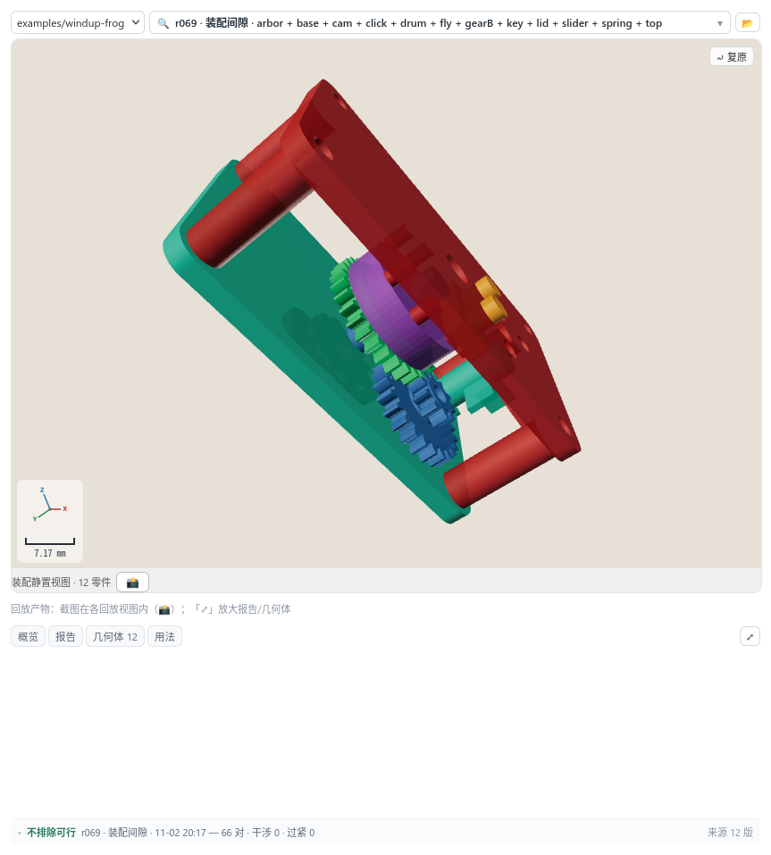

# Yingzao (营造) · dsh-cad-harness

[](LICENSE)
[](docs/en/user/install.md)
[](docs/en/user/limits.md)
[](docs/en/user/preview.md)

[中文](README.md) | English

> **Yingzao (营造) — describe a part in natural language; a multimodal LLM drives CAD tools through a DeepSeek Harness plugin to produce a verified, deliverable model.**

This is not a modelling UI. Geometry generation is no longer the bottleneck; **knowing whether the result is correct** is. A system that can generate but cannot verify produces things that only "look right". This plugin closes the loop **generate → verify → iterate → deliver**, and keeps the judgement calls with the human.

- The **multimodal LLM** writes code, compiles, renders, and **reads the images itself** before presenting a result
- The engine returns **numbers**: dimensions, volume, wall thickness, clearance, interference, motion stroke, fluid trends
- Every revision is an **immutable version** you can browse, pin and compare
- Third-party geometry (STL / STEP / 3MF / DXF) enters the same checks and assemblies
- Export a **single version** (STL/3MF/OBJ/OFF/WRL) or the **whole project**: a ZIP with every part STL + assembly manifest + README, plus an optional placed whole-machine STL

**Docs have three audiences**: users → [docs/user/](docs/user/) and [docs/en/user/](docs/en/user/), agents → [docs/en/llm/](docs/en/llm/) (English) or [docs/llm/](docs/llm/) (Chinese), maintainers → [docs/dev/](docs/dev/) (Chinese).

## Quick start

`setup --openscad=auto` prepares OpenSCAD: an existing 2025.06+ system install is used as-is; otherwise the official snapshot is tried first and the OSS mirror is used only when the official source is unreachable or too slow. 2021.01 works but `doctor` reports `degraded`; 2025.06+ is recommended for Manifold.

**A. Tarball (preview release; no build)**

```bash
tar -xzf dsh-cad-harness-0.1.0.tgz
dsh plugin --profile <your-profile> add -w "$PWD/package"
cd package
npx dsh-cad-setup --openscad=auto   # preset + OpenSCAD
npx dsh-cad-doctor         # kind=ok, or an explained degraded
```

**B. Source checkout (development)**

```bash
dsh plugin --profile <your-profile> add -w /path/to/dsh-cad-harness
cd /path/to/dsh-cad-harness && pnpm install && pnpm run build
node scripts/setup.mjs --openscad=auto
npx dsh-cad-doctor
```

Then read the [0.1.0 preview notes](docs/en/user/preview.md), start a session with the **营造模式 (Yingzao mode)** preset, open the **CAD Preview** tab on the right, and describe the part:

> Make a 60×40×8 mounting plate, four M3 countersunk holes, one 20 mm through hole in the centre.

This is what it looks like (windup-frog assembly, 12 parts / 12 versions):



The panel gives you:

- **Version history** — `v001`, `v002`, … every generation/modification is immutable; open, compare, pin, revisit.
- **3D viewport** — orbit, zoom, pan; top/front/side/iso views with bounding-box numbers.
- **Measure and annotate** — two-point distance, wall thickness, section cuts, red-box annotations sent back to the session.
- **Run playback** — motion, rigid-body and fluid timelines; pause on a frame.
- **Verification state** — assembly checks, printability and delivery audit, including “needs review”.
- **Export** — single-version STL/3MF/OBJ/OFF/WRL, or a project ZIP; a blocked delivery audit asks for confirmation.

> The panel is a **read-only viewport plus the human's pointing channel**: it does not replace the model writing code or the engine producing truth. It lets you see, measure and point at the problem.

CAD tools are only visible to the **营造模式 (Yingzao mode)** preset; standard coding sessions intentionally do not pay the tool-catalog cost.

Next:

- Full workflow and the decisions you own → [workflow](docs/user/workflow.md) (Chinese)
- What each verification layer answers → [verification](docs/user/verification.md) (Chinese)
- What it cannot do yet → [limits](docs/en/user/limits.md)
- Install, first run, troubleshooting → [install](docs/en/user/install.md) / [troubleshooting](docs/user/troubleshooting.md) (Chinese)

## Evidence verification (V1)

```bash
cd dsh-cad-harness
node scripts/verify.mjs /path/to/project --advisory
node scripts/verify.mjs /path/to/project --block --strict
```

`verify` is read-only: it checks the six rows `requirements / model / fit / make / review / delivery`, reports missing/stale evidence and claim witnesses, and never runs CAD, writes a run, or judges the design.

- Default advisory (exit 0); `--block`: pass 0 / warn 1 / blocked|fail 2 / usage 3; `--strict` turns warn into 2.
- Claims: `<project>/claims.json` or `--claims <file>`; policy: `<project>/evidence-policy.json` or `--policy <file>`. No policy means advisory.
- Project-specific criteria live in `<project>/checks/<id>/`; register with `check-register`, enable with `--checks`. Negative samples must pass the gate; write to the project invalidates the check.
- Details: [docs/llm/verify.md](docs/llm/verify.md) (Chinese).

## Documentation map

| Document | What it covers |
|---|---|
| [README.md](README.md) | Chinese entry point; authoritative for the project |
| [docs/en/user/preview.md](docs/en/user/preview.md) | 0.1.0 preview scope and known limits |
| [docs/en/user/install.md](docs/en/user/install.md) | Install, setup, first run |
| [docs/en/user/limits.md](docs/en/user/limits.md) | Known boundaries |
| [HARNESS.en.md](HARNESS.en.md) | What it is and is not; positioning |
| [docs/en/llm/README.md](docs/en/llm/README.md) | Agent reference: engines, assembly, manufacturing, delivery, traps, verify |
| [DESIGN.md](DESIGN.md) | Current design and module map (Chinese) |

The English **user** and **agent** documentation is complete for this preview. Maintainer docs (`docs/dev`, `DESIGN.md`) remain Chinese until preview.2.

## Contributing

- Every commit must be signed off (`git commit -s`, DCO 1.1); DCO is not a CLA.
- Commit messages follow [AGENTS.md](AGENTS.md): `Why` / `Verified` / `Risk` (plus `Decision` when a direction was chosen). `Verified` must name a falsifiable observation.
- Directional decisions go to [docs/DECISION-LOG.md](docs/DECISION-LOG.md) (append-only).
- Third-party assets in the benchmark corpus are materialised at use time, never committed (see [examples/bench/ATTRIBUTION.md](examples/bench/ATTRIBUTION.md)).
