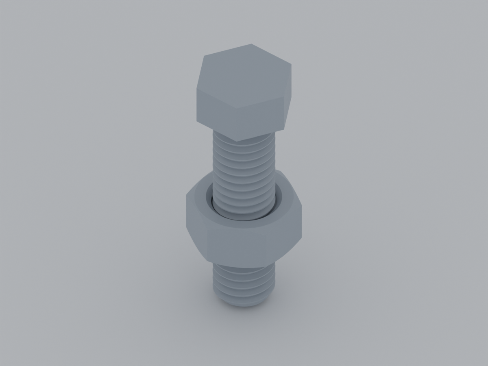
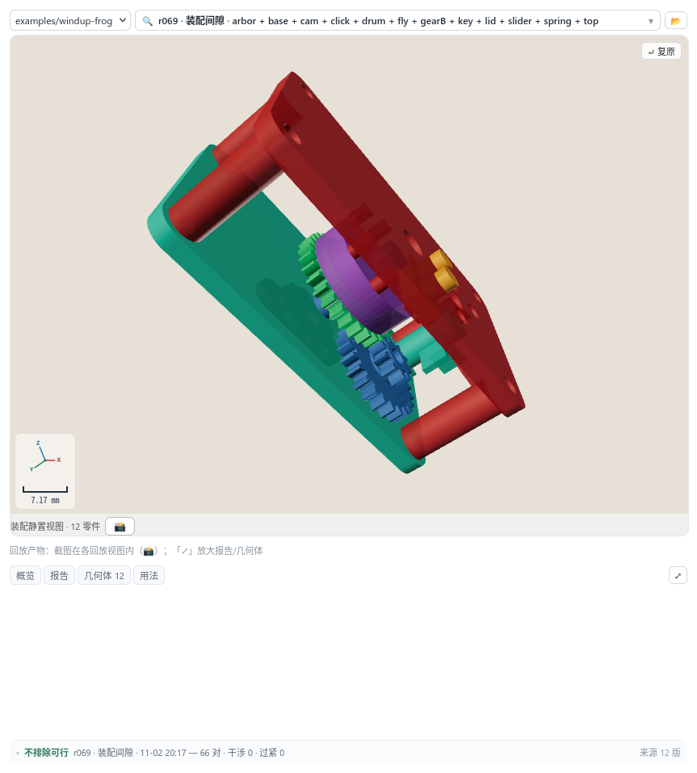

<div align="center">

# 营造 · Yingzao

**用自然语言描述零件；多模态大模型通过 DeepSeek Harness 插件调用 CAD 引擎，得到经过验证、可交付的模型。**

[](LICENSE)
[](docs/user/install.md)
[](docs/user/limits.md)
[](docs/user/preview.md)

[English](README.en.md) · [快速开始](#快速开始) · [验证](#验证) · [文档](#文档)

</div>

## 目录

- [关于本项目](#关于本项目)
- [示例](#示例)
- [技术栈](#技术栈)
- [快速开始](#快速开始)
- [用法](#用法)
- [验证](#验证)
- [已知边界](#已知边界)
- [文档](#文档)
- [参与贡献](#参与贡献)
- [许可证](#许可证)

## 关于本项目

几何生成已经不是瓶颈，**确认结果是否正确**才是。能生成但无法验证的系统，只能产出“看起来对”的结果。

营造把「生成 → 验证 → 迭代 → 交付」做成闭环：

- **生成**：Agent 编写参数化代码（OpenSCAD），编译成不可变版本；
- **验证**：尺寸、体积、壁厚、间隙、干涉、运动行程、流体趋势由引擎给出数值，而不是由语言模型“目测”；
- **迭代**：每一版都能浏览、钉住、对比；旧版本和旧运行不会被覆盖；
- **交付**：导出单个版本，或整个项目（每个零件的 STL + 装配清单 + 说明）；也可按装配位姿合并成整机。

它不是聊天框里“画一个零件”的 demo：**多模态大模型**负责读写 SCAD、看渲染图、判断下一步；**DSH 插件**提供 CAD 工具、不可变版本、数值验证和交付门。需要判断的环节保留给人——它不是“全自动建模”，而是把重复的生成和检查交给 Agent，把设计判断留给你。

## 示例

下面两个例子刻意选得简单：**螺纹、齿轮这些基础几何，最容易被“看起来像”糊弄过去。** 图由仓库里的 `.scad` 源文件导出 STL
后渲染；尺寸、体积、中心距都能从源文件复算。



### M8 螺栓与螺母

> 做一个 M8×30 六角螺栓和 M8 六角螺母；螺纹 M8×1.25，螺母对边 13、厚 6.5；要真实螺纹，不要光孔。

| 检查项 | 结果 |
|---|---|
| 螺纹 | **M8×1.25**，螺母 6.5 mm 高，约 **5.2 圈**啮合 |
| 螺母对边 / 高度 | **13.00 / 6.50 mm** |
| 螺栓 | M8×30，六角头对边 13 |
| 外形包围盒 | 13.00 × 14.88 × 35.50 mm |
| 体积 | **2.44 cm³**（STL 实测） |
| 螺纹几何 | BOSL2 `threaded_rod` / `threaded_nut`，不是贴图，也不是光孔 |

源码：[docs/readme-models/m8-bolt-nut.scad](docs/readme-models/m8-bolt-nut.scad)

### 20T / 10T 齿轮组

> 20 齿和 10 齿直齿轮，模数 1.5，厚 6，轴孔 5；按实际中心距啮合，不要只是两个圆柱摆在一起。

| 检查项 | 结果 |
|---|---|
| 齿数 / 模数 | **20T / 10T**，m = **1.5** |
| 传动比 | **2.00 : 1** |
| 分度圆直径 | 30 / 15 mm |
| 实际中心距 | **23.07 mm**（10T 自动变位后的中心距，不是名义 22.5） |
| 齿宽 / 轴孔 | 6.0 / 5.0 mm |
| 体积 | **5.10 cm³**（STL 实测） |
| 实体干涉 | 两轮在中心距下 `intersection()` 为空 |

源码：[docs/readme-models/gear-pair.scad](docs/readme-models/gear-pair.scad)

> 这两个例子用于展示几何与结果，不是完整证据链样本；材料强度、磨损、噪声、打印方向仍要单独验证。渲染脚本同样是仓库内的可复跑工具，不是运行时依赖：
> [docs/readme-models/render.py](docs/readme-models/render.py)。
>
> 早期示例里的螺钉/螺母有不少是光孔或简化圆柱，优先验证装配关系；本页不再沿用那种示意件。

## 技术栈

| 层 | 使用 |
|---|---|
| 几何内核 | **OpenSCAD** + **Manifold** 后端；BOSL2 提供螺纹、齿轮等标准件 |
| 数值检查 | Python、trimesh、manifold3d、numpy、shapely |
| 宿主 | **DeepSeek Harness** 插件；Node.js ≥ 20、TypeScript |
| 面板 | React + WebGL 视口，随 DSH Web GUI 运行 |
| 证据 | 不可变版本、JSON 报告、六行 evidence、claims / policy / delivery audit |

## 快速开始

`setup --openscad=auto` 会准备 OpenSCAD（2021.01 可运行但 `doctor` 报 degraded；推荐
2025.06+ / Manifold）：已有 2025.06+ 系统版本就直接用；没有则从**官方快照优先**下载，官方不可达或持续低于 256 KB/s
时才切到 OSS 镜像。也可以用 `--openscad=off` 手动准备，或用 `CAD_OPENSCAD_BIN` 指定已有二进制。

> OpenSCAD 在 `setup` 时准备；约 400MB 的 Python 运行时装在首次计算时准备。两者都不随 tarball 分发。

### 方式 A：tarball（预览版，不需要构建）

```bash
tar -xzf dsh-cad-harness-0.1.0.tgz
dsh plugin --profile <你的 profile> add -w "$PWD/package"
cd package
npx dsh-cad-setup --openscad=auto   # 预设 + 自动准备 OpenSCAD
npx dsh-cad-doctor                  # kind=ok，或有解释的 degraded
```

### 方式 B：源码 checkout

```bash
dsh plugin --profile <你的 profile> add -w /path/to/dsh-cad-harness
cd /path/to/dsh-cad-harness && pnpm install && pnpm run build
node scripts/setup.mjs --openscad=auto
npx dsh-cad-doctor
```

### 开启营造模式

1. 新建会话时选择预设 **「营造模式」**；普通会话看不到 CAD 工具，这是有意的。
2. 在右侧打开 **CAD 预览** 标签页。如果标签页不存在，先重启 dsh，再新建一个营造模式会话。
3. 直接描述需求：

> 做一个 60×40×8 的安装板，四角 M3 沉头孔，中心一个 20 mm 通孔。

打开后是这样（示例为发条青蛙装配，12 个零件 / 12 个版本）：



面板里能看到：

- **版本历史**：`v001`、`v002`……每次生成/修改都是不可变版本，可以点开对比、钉住、回看；
- **三维视口**：旋转、缩放、平移；按顶/前/侧/等轴查看，旁边给包围盒数字；
- **测量与标注**：两点距离、壁厚、剖切、红框标注问题，再把这些指认带回会话；
- **运行回放**：机构运动、刚体物理、流体趋势的时间线，可以停在某一帧；
- **验证状态**：装配检查、打印性、交付审计的结果和“待复核”提示；
- **导出入口**：单版本 STL/3MF/OBJ/OFF/WRL，或整个项目 ZIP；被交付审计拦住时会弹窗要求确认。

> 面板是**只读视口 + 人的指认通道**：它不替代 Agent 写代码，也不替代引擎给真值；它让人能看见、能量、能指出问题。

4. 下一步看 [从描述到交付](docs/user/workflow.md)，或 [验证能力](docs/user/verification.md)。

## 用法

一次典型的对话不是“一句话出图”，而是：

1. 你描述需求、约束和验收标准；
2. Agent 生成参数化 SCAD，登记为 `v001`；
3. 引擎运行尺寸、壁厚、间隙、打印性、装配等检查，并把结果写成报告；
4. Agent 读渲染图和报告，发现问题后生成 `v002`；
5. 你确认后导出 STL / 3MF / 整机装配，或交给下游。

版本不可变：`v002` 不会改写 `v001`；检查报告绑定到它实际检查的那个版本。旧结果不会“自动变成当前版本”的证据。

## 验证

```bash
# tarball 安装后
npx dsh-cad-verify /path/to/project --advisory
npx dsh-cad-verify /path/to/project --block --strict

# 源码 checkout
cd dsh-cad-harness
node scripts/verify.mjs /path/to/project --advisory
```

`verify` 只读：检查 `requirements / model / fit / make / review / delivery`
六行，报告缺失/过期的证据和 claim witness；不跑 CAD、不写 run、不判设计。

- 默认 advisory（exit 0）；`--block` 时 pass 0 / warn 1 / blocked|fail 2 / 用法错误 3；`--strict` 让 warn 也返回 2。
- claims：`<project>/claims.json` 或 `--claims <file>`；policy：`<project>/evidence-policy.json` 或 `--policy <file>`；没有 policy 就是 advisory。
- 项目特定判据写成 `<project>/checks/<id>/`，先 `check-register` 注册，再用 `--checks` 启用；负样本先过门，逐判据对账，写项目即作废。
- 详见 [docs/llm/verify.md](docs/llm/verify.md)。

## 已知边界

- **不是原生 CAD**：没有特征树、草图约束和拖拽编辑，几何源头是代码，STEP 能进不能出。
- **起点是个人自用**：效果超出预期后才补文档和验收，早期提交历史比较乱。
- **题库没有正式基线**：成本问题，`examples/bench` 只有一轮 N=1 探索运行（81.41M tokens，已跑 6 题 P 列全 0，03 因 429 未完成），不是可比较的 benchmark。
- **工具成熟度不齐**：`check_printability` / `check_assembly` 相对成熟，CNC、EDM、钣金、车削、压铸等仍是 `partial`，动态仿真受求解器限制。
- **示例不能全部一键复跑**：`examples/*/cad-data/` 被 gitignore，历史示例只保留文档、源码和渲染。
- **英文是机器翻译**：英文用户文档、`docs/en/llm`、`HARNESS.en.md` 未经人工润色；客户端 UI 已英文化，host 模型侧输出仍可能中文。
- **不便宜**：一轮 N=1 题库探索消耗 81.41M tokens；长任务的上下文成本是真实成本。

## 文档

| 文档 | 讲什么 |
|---|---|
| [docs/user/](docs/user/) | 用户指南：安装、流程、验证、边界、排错 |
| [docs/llm/](docs/llm/) | Agent 参考：引擎边界、陷阱、交付纪律 |
| [docs/dev/](docs/dev/) | 维护者入口：架构、设计、决策、计划、审计 |
| [examples/README.md](examples/README.md) | 样例索引：当前 / 历史 / 夹具 / 题库 / 沙箱 |
| [HARNESS.md](HARNESS.md) | 它是什么、不是什么、边界与取舍原则 |
| [DESIGN.md](DESIGN.md) | 当前设计：架构、模块、接口、环境变量全集 |
| [docs/README.md](docs/README.md) | 文档地图与“同一事实一个权威”的规则 |

## 参与贡献

- 完整规则见 [CONTRIBUTING.md](CONTRIBUTING.md)：每次提交都要 `git commit -s` 签名（DCO 1.1）；DCO 不是 CLA。
- 提交信息按 [AGENTS.md](AGENTS.md) 写 `Why` / `Verified` / `Risk`（有方向取舍时加 `Decision`）；`Verified` 必须能指名一个可证伪的观察。
- 方向性决策写进 [docs/DECISION-LOG.md](docs/DECISION-LOG.md)（append-only）。
- 题库里的第三方素材一律物化使用、不入库（见 [examples/bench/ATTRIBUTION.md](examples/bench/ATTRIBUTION.md)）。

## 许可证

Apache License 2.0 —— 全文见 [LICENSE](LICENSE)，第三方声明见 [NOTICE](NOTICE)，审计明细见 [docs/THIRD-PARTY-AUDIT.md](docs/THIRD-PARTY-AUDIT.md)。

允许商业使用、修改、闭源再分发与售卖，只需保留版权与许可声明；另含显式专利授权与专利报复条款。

BOSL2（BSD-2-Clause）**不随仓库分发**：自行下载放到 `lib/BOSL2/`（已 gitignore）。
