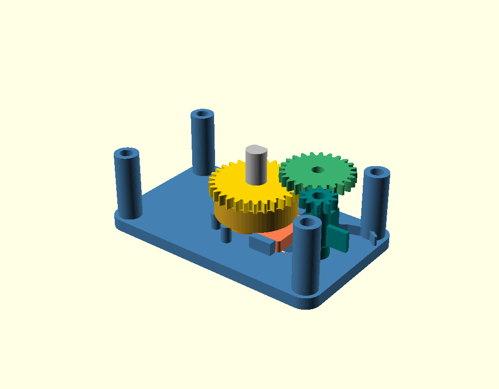
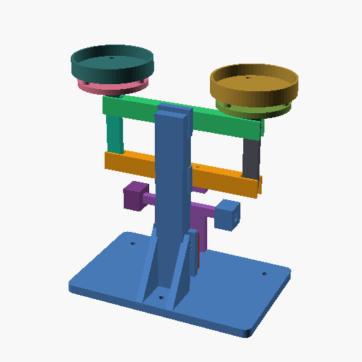

# 营造（Yingzao） · dsh-cad-harness

[](LICENSE)
[](docs/user/install.md)
[](docs/user/limits.md)
[](docs/user/preview.md)

[English](README.en.md) | 中文

> **营造（Yingzao）——用自然语言描述零件，得到经过验证、可直接打印的模型。**

本插件不是建模界面。几何生成已不是瓶颈，瓶颈在于**确认结果是否正确**：能生成但无法验证的系统只能产出“看起来对”的结果。本插件把「生成 → 验证 → 迭代 → 交付」做成闭环，需要判断的环节保留给人。

- 描述需求后，由 Agent 编写代码、编译、渲染，并**先自行判读图像**再提交结果
- 引擎提供**数值**：尺寸、体积、壁厚、间隙、干涉、运动行程、流体趋势
- 每一版均为**不可变版本**，可浏览、钉住、对比
- 第三方件（STL / STEP / 3MF / DXF）可进入同一套检查并参与装配
- 导出**单个版本**（STL/3MF/OBJ/OFF/WRL），或**整个项目**：ZIP 含每个零件的 STL + 装配清单 + 说明；也可按装配位姿合并成一个整机 STL

**文档分三类**：用户看 [docs/user/](docs/user/)，Agent 看 [docs/llm/](docs/llm/)，维护者看 [docs/dev/](docs/dev/)。

## 先看三个真实结果

下面三张图不是概念图，也不是图库素材：它们由示例项目**已登记的 STL 直接渲染**，
旁边的数字能在对应示例的 `run` / 报告 / `evidence/` 文件里找到。数字有正有负，负结果也保留。

### 1. 发条青蛙机芯：14/14 契约通过，但 7/11 件打印性不过



> 需求大意：巴掌大的发条青蛙机芯，外购发条，两级增速，凸轮—滑块输出行程 ≥ 4 mm，
> 整机 ≤ 60×36×26 mm，只画内部机械结构。

| 结果 | 实测 | 出处 |
|---|---|---|
| 外形 | 60×36×24.2 mm（含钥匙 26.0） | `evidence/envelope.json` |
| 两级增速 | 30/10 × 24/10 = **7.2:1** | `evidence/gear_mesh.json` |
| 凸轮—滑块行程 | **4.000 mm**（2 个周期、98 次位姿 0 干涉） | `evidence/cam_slider.json`、r066 |
| 12 件装配 | **0 干涉** | r069 |
| 装配契约 | **14/14 通过** | [assembly-check-report.json](examples/windup-frog/assembly/assembly-check-report.json)、r068 |
| 逐件 FDM 打印性 | **7/11 `excluded`，1 件 `difficult`，3 件 `not-excluded`** | `fdm-pla-0.4` r052–r059 |

**这张图证明什么**：齿轮/凸轮/滑块/机架的几何关系、行程和装配干涉确实被算过，不是“看起来像”。
**这张图不证明什么**：它不证明这台青蛙能直接打印、能装上发条、能跳。7 件被打印性判为
`excluded`，发条扭矩、跳高、跳频、运行时间都**未测**。示例自己把这些写在
[README](examples/windup-frog/README.md) 的“但这不是能直接装进壳里的结论”里。

### 2. 罗伯威尔天平：0.000° 的位置无关，但动态引擎曾经闭合不了



> 需求大意：六铰点平行四边形框架；两个盘面在 ±8° 内保持水平；同质量放在盘面
> x = −30 / 0 / +30 mm 三个位置，竖向位移必须相同；外购件只用常见 M3。

| 结果 | 实测 | 出处 |
|---|---|---|
| 外形 | 247×140×269 mm（不含砝码） | 示例 README §1 |
| 静态装配契约 | **20/20 通过** | r022 |
| 13 件 / 78 对装配 | **0 干涉 0 过紧** | r037 |
| 盘面法向偏差（−8°…+8°） | **0.000°**（从交付 STL 每 1° 重算） | [evidence/kinematics.json](examples/roberval-balance/evidence/kinematics.json) |
| 三个位置的竖向位移差 | **0.000 mm** | 同上 |
| 首轮 `simulate_motion` | 关节漂移 **105.566 mm**（负结果） | r001 |
| 首轮 `simulate_physics` | 5 个约束异常、稳态穿透 25.18 mm（负结果） | r002 |

**这张图证明什么**：位置无关不是“目测水平”，而是每个角度从 STL 重算出来的 0.000° / 0.000 mm。
**这张图不证明什么**：它不证明动态求解器一开始就可靠。首轮 motion / physics 都给出了负结果，
后来 r038 / r042 才把同一批 STL 跑稳；这段历史保留在示例里，没有删掉。
见 [罗伯威尔示例](examples/roberval-balance/README.md) §6。

### 3. 八仙桌：28 构件 / 378 对 0 干涉，但没有实物


> 需求大意：900×900×800 的八人方桌；全榫卯、木楔、竹销，不用一颗金属件；
> 单根毛料 ≤ 1000 mm；桌面必须拼板。

| 结果 | 实测 | 出处 |
|---|---|---|
| 外形 | 900×900×800 mm | [示例 README](examples/eight-immortals-table/README.md) |
| 构件 / 邻接对 | 28 件 / **378 对，0 干涉** | r003（本机 `cad-data/runs/r003/report.json`） |
| 装配契约（BOM） | 28 节点，**0 硬冲突**；47 对贴合面列为“未声明邻接” | r004 |
| 榫卯 | 16 处榫卯 + 4 个木楔 + 4 枚竹销，**0 金属件** | 示例 §4 / §8 |
| 净材积 / 成桌质量 | 42.2 L / **27.4 kg（按 0.65 g/cm³ 假设）** | 示例 §1 |
| 承载力 | **未做木结构仿真**，按传统经验取值 | 示例 §9 |

**这张图证明什么**：28 个构件的装配关系、榫肩贴合、378 对间隙是算过的；连“47 对未声明邻接”
也写进了报告，而不是只报 0 干涉。
**这张图不证明什么**：它没有经过真实木工开料、装配和承重测试；27.4 kg 是密度假设，不是称重。
这是一张“可施工的几何与 BOM”，不是“已经做出来并坐过 8 个人”的桌子。

三张图放在一起，想说明的不是“我们什么都能做”，而是：**结果带数字、数字带出处、负结果不隐藏。**
更多示例与各自边界见 [examples/README.md](examples/README.md)。

## 它不是原生 CAD，也不是开箱即用的桌面应用

这一条需要先说清楚，避免把“能对话出模型”误读成“替代 SolidWorks/Fusion”：

- **形态是 DSH 插件，不是原生应用。** 界面跑在 DSH 的 Web GUI 里，没有独立桌面窗口、
  原生文件管理器或离线安装器；关掉 DSH，就没有这个面板。
- **没有原生特征树 / 草图 / 约束求解。** 几何的源头是代码（OpenSCAD），版本是不可变快照；
  你不能在视口里拖一个面、改一个圆角再让特征树重算。要改，就改代码、出新版本。
- **不是 B-rep 精确 CAD。** 内核是 OpenSCAD + Manifold 的网格/CSG 路线；STEP 能进，
  **STEP 导出仍不在范围内**（在 `docs/dev/TODO.md` 里是 planned）。需要精确 B-rep datum
  或 STEP 交付的场合，它现在不合适。
- **不是自主建模。** 需求理解、结构方案、代码、检查编排仍由 Agent 完成，人要在关键节点
  判断“这是不是我要的”；它不会替你做产品决策。
- **不是验证证书。** 五层检查回答的是“几何上有没有反例”，不是“这个设计能过认证”。
  材料、疲劳、注塑工艺、木结构承载力这些，仍要 CAE、供应商或实物试验。

## 我们现在做得不够好的地方

这一节是主动写的，不是“known issues”模板。下面每一条都能在仓库里找到证据。

### 1. 起点是个人自用，后来才补产品化；早期提交很乱

这个插件最初是作者自己用的：想少画一点、少错一点。效果比预期好之后，才逐步补文档、
验收、发布流程。结果是仓库前半段像实验室，不像产品：

- 早期有重复提交：`fdd3765` 与 `8f6110e` 是同一句提交信息、同一批改动；
- 设计文档曾把 `DESIGN.md` 拼成 `DESGIGN.md`，后来才改；
- 目录/项目作用域改过多次（根目录 → `cad-data/` → 显式选择项目），迁移痕迹留在历史里；
- README、验收脚本、英文文档都是后补的，不是从第一天就按产品做的。

这不是“黑历史美学”，而是事实：**如果你看到某些接口/文档风格不统一，很可能就是不同阶段留下的。**
现在的规则（提交信息 `Why/Verified/Risk`、DCO、决策记录）是后来才立的。

### 2. `examples/bench` 题库在，但正式基线没有跑过

仓库里有题库、评分手册、题面和评分材料，但**按 `examples/bench/README.md` §5 的 N≥3 正式基线，
从来没有跑过**。目前只有一轮 `N=1` 的探索性运行
（[`RESULTS-20261018-glm53-high`](examples/bench/graders/RESULTS-20261018-glm53-high/RESULTS.md)）：

- 81.41M tokens / 564 次工具调用；
- 已跑的 6 道题可机检 P 列全是 **0**；
- `03-microscope` 在 A 段 203 次调用后撞 429，B 段未跑，**不计分**；
- 它是 headless、单模型、单轮，**不是**可比较的基线，也不能拿来宣称“我们比谁强”。

所以现在的“效果不错”主要是作者自己的使用体验和示例结果，不是统计意义上的 benchmark。
要谈模型间对比，至少要先补跑 03、按 N≥3 重复、把 E/H/R/C 四列人工分补齐。

### 3. 工具质量没有对齐，有的已经是准生产，有的还是 partial

不是所有 `check_*` 都同一成熟度。`docs/llm/processes.md` 用 `supported / partial / planned`
明确标注，但用户很容易把“有报告”误读成“都可靠”：

- 相对成熟：`check_printability`（壁厚/特征/间隙/悬垂）、`check_assembly`、`measure_*`、
  版本/证据链；
- 仍是 `partial`：CNC 六向可达性（体素近似）、EDM、钣金/激光/水刀 2D 截面、
  车削、压铸/注塑/砂型等，只覆盖主要几何失效模式，其余在 `handoff` 里；
- 动态仿真受求解器限制：罗伯威尔的 r001/r002 就是负结果；`simulate_physics` 的穿透数字
  可能是求解器伪影；流体/运动不能当“物理正确”的证书。

这些不是“以后再说”的 TODO，而是当前产品边界：**报告里的 `partial` 必须按 partial 读，不能按 pass 读。**

### 4. 示例复跑并不轻松，截图也不是实时 UI

- `examples/*/cad-data/` 被 `.gitignore` 排除；克隆仓库只得到文档、SCAD/STL、装配契约和渲染，
  要复跑得自己 `init_project` 并重新生成语料；
- “当前示例”只有少数几个，`microscope2/3/4`、`toy-balance` 等是历史/归档，不能当当前能力；
- README 里的三张图是**交付 STL 的离线渲染**，不是实时 UI 截图；UI 截图会随版本变化，
  这里刻意不用旧截图冒充当前界面。

### 5. 英文是机器翻译，UI 英文也只覆盖客户端

- 英文用户文档、`docs/en/llm`、`HARNESS.en.md` 是 MT-first，**没有经过人工润色**；
  这是明确的取舍：先让英文用户能读，再逐步修。
- 客户端 UI 文案已全量英文化，并有 `accept:ui-i18n` 扫描字面量；但 **host 的模型侧工具输出/
  诊断仍可能是中文**，`docs/dev` 也仍是中文。它们是给 Agent/维护者看的，不是 UI，但英文用户
  在工具返回里仍会看到中文。
- 英文文档里的代码、命令、路径保持原文；如果翻译和代码冲突，以代码/中文原文为准。

### 6. 只在 Linux 上做了完整收口，macOS / Windows 没有同等验收

README 的 badge 写 Linux/macOS/Windows，但当前 `accept:preview` / `rehearse:preview`
是在 Linux 上跑完的；没有在干净的 macOS / Windows 机器上跑同一套验收，也没有 CI 矩阵
（仓库远端是 GitCode，GitHub Actions 不能直接跑）。macOS/Windows 目前是“按文档应该能跑”，
不是“已经同等验证”。

### 7. 它不便宜，也不快

一轮 N=1 的题库探索就烧了 81.41M tokens；长任务（显微镜 A 段）能到 43M tokens。
对话式建模的代价是上下文反复重读，不是“零成本”。如果你只是画一个简单零件，
传统 CAD 可能更快；这个工具的价值在“可追溯的验证 + 迭代”，不在“省每一次点击”。

## 适合谁，不适合谁

| 适合 | 不适合 |
|---|---|
| 愿意用对话 + 代码建模，接受“改代码出新版本” | 要原生特征树、草图约束、拖拽编辑 |
| 需要版本不可变、证据可追溯、装配/打印性检查 | 要开箱即用、零配置、纯 GUI |
| 3D 打印 / 激光切割 / 钣金 / 装配类零件 | 要 STEP/B-rep 精确交付、认证级仿真 |
| 接受 `partial` 边界，愿意看 `handoff` | 把“有报告”当成“已认证” |
| Linux 为主，能自己装 OpenSCAD/Python | 需要成熟 Windows/macOS 安装器与多人协作 |

## 快速开始

先装 OpenSCAD（2021.01 可跑但 `doctor` 报 degraded；推荐 2025.06+，Manifold 后端）。

**方式 A：tarball（预览版首发，不需要 build）**

```bash
tar -xzf dsh-cad-harness-0.1.0.tgz
dsh plugin --profile <你的 profile> add -w "$PWD/package"
cd package
node scripts/setup.mjs     # 写入“营造模式”预设在本机的 skill 路径
node scripts/doctor.mjs    # kind=ok，或有解释的 degraded
```

**方式 B：源码 checkout（开发）**

```bash
dsh plugin --profile <你的 profile> add -w /path/to/dsh-cad-harness
cd /path/to/dsh-cad-harness && pnpm install && pnpm run build
npm run setup
node scripts/doctor.mjs
```

2. 预览版说明与已知边界 → [0.1.0 预览版说明](docs/user/preview.md)。
3. 新建会话时选预设 **「营造模式」**（普通会话看不到 CAD 工具，这是有意的）。
4. 直接描述需求：

> 做一个 60×40×8 的安装板，四角 M3 沉头孔，中心一个 20mm 通孔。

接下来：

- 完整流程与你要做的判断 → [从描述到交付](docs/user/workflow.md)
- 五层检查各回答什么、报告怎么读 → [验证能力](docs/user/verification.md)
- 它现在做不到什么 → [边界](docs/user/limits.md)
- 安装细节、首次准备、排错 → [安装](docs/user/install.md) / [故障排查](docs/user/troubleshooting.md)

## 证据验证（V1）

```bash
cd dsh-cad-harness
node scripts/verify.mjs /path/to/project --advisory
node scripts/verify.mjs /path/to/project --block --strict
```

`verify` 只读：检查 `requirements / model / fit / make / review / delivery` 六行，报告
缺失/过期的证据和 claim witness；不跑 CAD、不写 run、不判设计。

- 默认 advisory（exit 0）；`--block` 时 pass 0 / warn 1 / blocked|fail 2 / 用法错误 3；
  `--strict` 让 warn 也返回 2。
- claims：`<project>/claims.json` 或 `--claims <file>`；policy：
  `<project>/evidence-policy.json` 或 `--policy <file>`；没有 policy 就是 advisory。
- 项目特定判据可写成 `<project>/checks/<id>/`，先 `check-register` 注册，再用 `--checks`
  启用；负样本先过门，逐判据对账，写项目即作废；默认 `warn`，`--mount-checks` 可在画图前
  只验证检查本身。晚注册的检查只作旁证，不能当 claim witness。
- 详见 [docs/llm/verify.md](docs/llm/verify.md)。

## 文档

| 文档 | 讲什么 |
|---|---|
| [docs/README.md](docs/README.md) | 文档地图与“同一事实一个权威”的规则 |
| [docs/user/](docs/user/) | 用户指南：安装、流程、验证、边界、排错 |
| [docs/llm/](docs/llm/) | Agent 参考：引擎边界、陷阱、交付纪律 |
| [docs/dev/](docs/dev/) | 维护者入口：架构、设计、决策、计划、审计 |
| [examples/README.md](examples/README.md) | 样例索引：当前 / 历史 / 夹具 / 题库 / 沙箱 |
| [HARNESS.md](HARNESS.md) | 它是什么、不是什么、边界与取舍原则 |
| [DESIGN.md](DESIGN.md) | 当前设计：架构、模块、接口、环境变量全集 |

## 参与贡献

- 完整规则见 [CONTRIBUTING.md](CONTRIBUTING.md)：每次提交都要 `git commit -s` 签名（DCO 1.1）；DCO 不是 CLA。
- 提交信息按 [AGENTS.md](AGENTS.md) 写 `Why` / `Verified` / `Risk`（有方向取舍时加 `Decision`）。`Verified` 必须能指名一个可证伪的观察。
- 方向性决策写进 [docs/DECISION-LOG.md](docs/DECISION-LOG.md)（append-only）。
- 题库里的第三方素材一律物化使用、不入库（见 [examples/bench/ATTRIBUTION.md](examples/bench/ATTRIBUTION.md)）。

## 许可证

Apache License 2.0 —— 全文见 [LICENSE](LICENSE)，第三方声明见 [NOTICE](NOTICE)，审计明细见 [docs/THIRD-PARTY-AUDIT.md](docs/THIRD-PARTY-AUDIT.md)。

允许商业使用、修改、闭源再分发与售卖，只需保留版权与许可声明；另含显式专利授权与专利报复条款。

BOSL2（BSD-2-Clause）**不随仓库分发**：自行下载放到 `lib/BOSL2/`（已 gitignore）。
