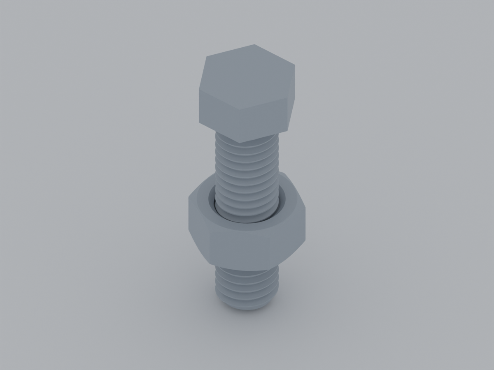
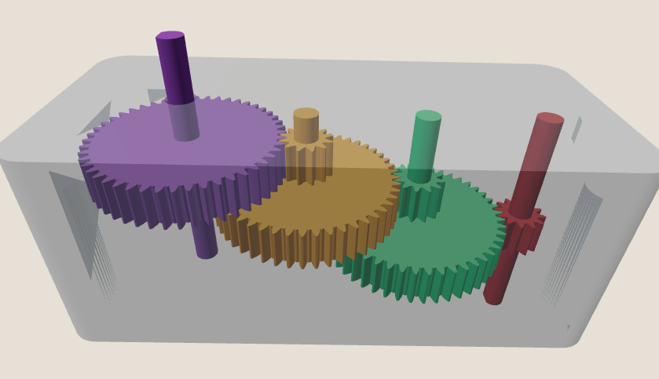
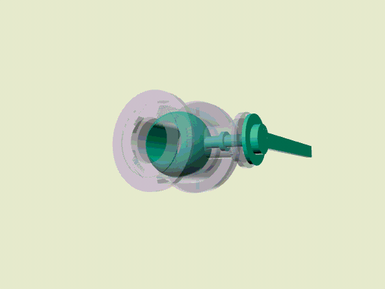
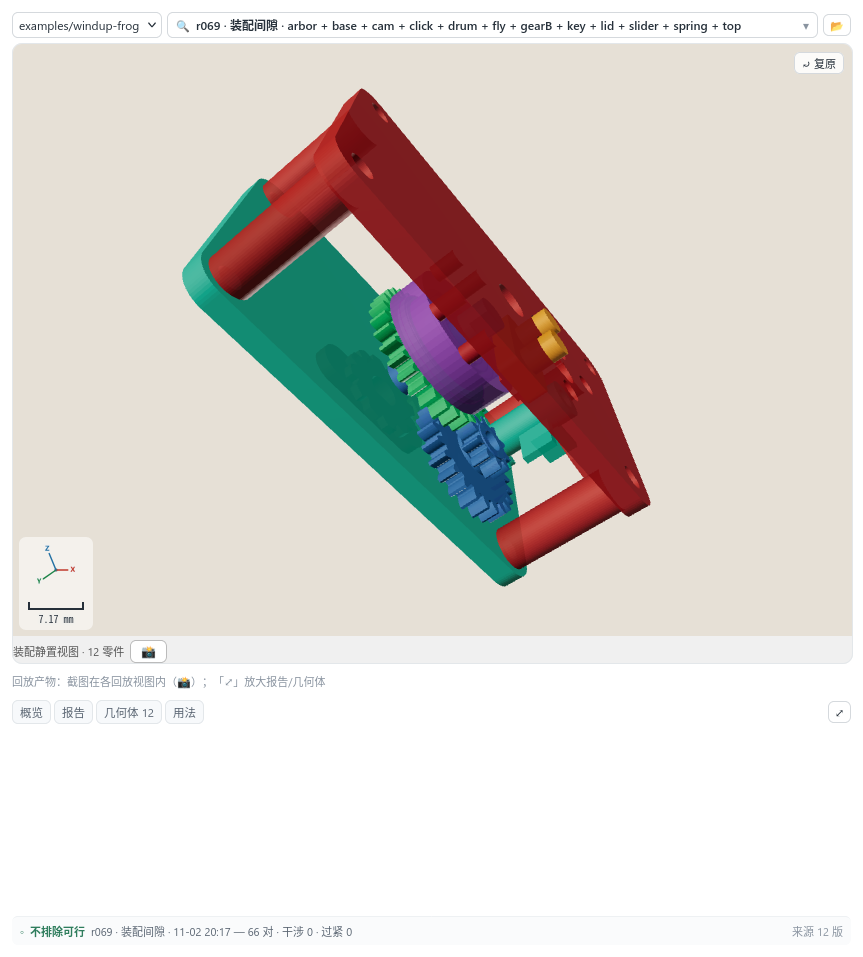

<div align="center">

# 营造 · Yingzao

**Agent 负责生成，插件负责闭环。**

dsh 的机械 CAD 插件：Agent 写参数化代码做设计，插件用一组 CAD 工具查配合、运动与可制造性，报告和版本历史在 DSH Web 侧边栏的「CAD 预览」里给你看——最终判断留给你。

[](LICENSE)
[](docs/user/install.md)
[](docs/user/limits.md)
[](https://www.npmjs.com/package/dsh-cad-harness)
[](docs/user/preview.md)

[English](README.en.md) · [快速开始](#快速开始) · [验证](#验证) · [文档](#文档)

</div>

| 零件 | 装配 | 运动 |
|---|---|---|
|  |  |  |
| 真实 **M8×1.25** 螺纹，约 **5.2 圈**啮合 | 24 实例 / 276 对，**0 干涉**，传动比 **64.000** | **0→90°** 行程，24/24 位姿，**0 干涉** |

```bash
dsh plugin --profile <你的 profile> add dsh-cad-harness
```

## 目录

- [适合谁用，不适合谁用](#适合谁用不适合谁用)
- [关于本项目](#关于本项目)
- [示例](#示例)
- [技术栈](#技术栈)
- [快速开始](#快速开始)
- [用法](#用法)
- [验证](#验证)
- [本版变化](#本版变化020-preview1)
- [已知边界](#已知边界)
- [文档](#文档)
- [参与贡献](#参与贡献)
- [许可证](#许可证)

## 适合谁用，不适合谁用

营造的定位是为 Agent 提供场地：以规范、稳定的方式产出机械构件，并保留回看、复算与交付的通道。它不承担提升 Agent 3D 能力的职责。几何能力取决于模型本身，这不是单个插件能够承担的工作。

### 适合

- 你已有明确的设计意图和验收标准，愿意用文字描述需求，并接受 Agent 以参数化代码建模，而非拖拽特征。
- 你需要的是可制造、可装配、功能可实现的零件或装配体，而不只是视觉上成立的渲染图。
- 你主要做装配体，且复杂度处于 Agent 能力范围之内。复杂度越高，收益通常越明显：收益不在于让原本无法设计的对象变得可设计，而在于对“能够设计、却无法制造、无法装配或功能无法实现”的部分进行纠偏，并尽量在交付前发现。
- 你愿意依据证据判断：版本、数值报告、干涉与行程检查；同时接受最终判断仍由人作出。
- 你看重下限：减少 Agent 表现最差的情况，而不是依赖偶发的高水平输出。

### 不适合

- 希望获得“一句话出图”的演示效果，或将 3D 生成能力本身作为卖点。
- 需要原生 CAD 的交互方式：草图约束、特征树、拖拽编辑。
- 需要认证级精度：工业公差、工程图、精确 FEA/CFD、量产 BOM。这里提供趋势判断和边界内的数值，不提供认证。
- 期待插件降低 token 消耗，见下一节。

以上是使用预期，不是准入条件。需求若属于后者，专业工具通常更合适。

### 关于 token：不期待更省，而期待更可预期

（内部实测，样本有限。）同一任务中，使用插件的平均 token 消耗不低于不使用插件，反而略高；但消耗的方差显著更小，单轮成本可以提前估算，不易出现大幅波动。

降低 token 消耗在计划之内，但优先级低于能力建设：不会为了节省 token 而削减验证或必要的检查。合理的预期是成本可预期、投入有效，而不是成本更低。

## 关于本项目

几何生成已经不是瓶颈，**确认结果是否正确**才是。能生成但无法验证的系统，只能产出“看起来对”的结果。

营造把「生成 → 验证 → 迭代 → 交付」做成闭环：

- **生成**：Agent 编写参数化代码（OpenSCAD 或 CadQuery），编译成不可变版本；
- **验证**：尺寸、体积、壁厚、间隙、干涉、运动行程、流体趋势由引擎给出数值，而不是由语言模型“目测”；
- **迭代**：每一版都能浏览、钉住、对比；旧版本和旧运行不会被覆盖；
- **交付**：导出单个版本，或整个项目（每个零件的 STL + 装配清单 + 说明）；也可按装配位姿合并成整机。

它面向的不是聊天框里“画一个零件”的演示。**多模态大模型**负责读写 SCAD/Python、查看渲染图并决定下一步；**DSH 插件**提供 CAD 工具、不可变版本、数值验证和交付门。它不追求全自动建模：重复的生成和检查交给 Agent，设计判断留给你。

## 示例

三个例子分别覆盖基础零件、装配体和运动仿真。

### 基础零件：M8 螺栓与螺母


> 做一个 M8×30 六角螺栓和 M8 六角螺母；螺纹 M8×1.25，螺母对边 13、厚 6.5；要真实螺纹，不要光孔。

| 检查项 | 结果 |
|---|---|
| 螺纹 | **M8×1.25**，螺母 6.5 mm 高，约 **5.2 圈**啮合 |
| 螺母对边 / 高度 | **13.00 / 6.50 mm** |
| 螺栓 | M8×30，六角头对边 13 |
| 外形包围盒 | 13.00 × 14.88 × 35.50 mm |
| 体积 | **2.44 cm³**（STL 实测） |
| 螺纹几何 | BOSL2 `threaded_rod` / `threaded_nut` 生成的真实螺纹，不是光孔 |

源码：[docs/readme-models/m8-bolt-nut.scad](docs/readme-models/m8-bolt-nut.scad)。渲染脚本：[docs/readme-models/render.py](docs/readme-models/render.py)。

### 装配体：三级直齿 64:1 减速器


三级直齿串联，齿数比 48:12，总传动比 64.000；6 个齿轮、4 根 Ø5 轴、8 个 685ZZ 轴承，箱体 106×48×42 mm，壳体为 FDM 尼龙，输入与输出位于对侧。

| 检查项 | 结果 |
|---|---|
| 总传动比 | **64.000**（三级，精确） |
| 中心距 | 24.0 mm（三级相同） |
| 齿轮 | 3 × z12 / 3 × z48，m0.8，齿宽 8 |
| 装配规模 | 24 个实例，**276 对** |
| 静态干涉 | **0 干涉、0 过紧** |
| 装配契约 | 23 条接口全部通过，0 硬冲突 |

装配检查只回答静态干涉与接口配合，不回答齿面受力、效率、噪声。

### 运动仿真：DN100 球阀


球阀从全开到全关，90° 行程，24 个位姿。

| 检查项 | 结果 |
|---|---|
| 行程 | **0→90°** |
| 采样 | **24/24** |
| 干涉 | **0** |
| 关节漂移 | 0 |

运动检查只回答“转得动、不撞、行程够”，不回答密封、扭矩和压降。

> 示例用于展示能力；材料强度、磨损、噪声、打印方向仍需单独验证。

## 技术栈

| 层 | 使用 |
|---|---|
| 几何内核 | **OpenSCAD** + **Manifold** 后端；可选 **CadQuery**（B-rep，单独 pack）；BOSL2 是可选 **OpenSCAD 建模库**（螺纹/齿轮/螺丝），不是标准件目录 |
| 标准件目录 | **99 specs / 14 families** 随包分发，预生成 STEP/STL（fit/visual）；当前预览版 **尚无工具入口**，见 [library/README](dsh-cad-harness/library/README.md) |
| 数值检查 | Python、trimesh、manifold3d、numpy、shapely |
| 宿主 | **DeepSeek Harness** 插件；Node.js ≥ 20、TypeScript |
| 面板 | React + WebGL 视口，随 DSH Web GUI 运行 |
| 证据 | 不可变版本、JSON 报告、六类证据、claims / policy / delivery audit |

## 快速开始

`setup --openscad=auto` 会准备 OpenSCAD（2021.01 可运行但 `doctor` 报 degraded；推荐 2025.06+ / Manifold）。已有 2025.06+ 系统版本则直接使用；否则优先下载官方快照，官方源不可达或持续低于 256 KB/s 时才切换到 OSS 镜像。

**版本不是偏好，是能力**：同一个 `plate.scad`，2021.01（CGAL）实测 **2467 ms**，带 Manifold 的构建 **69 ms**——差 36 倍，模型越复杂差距越大。低于 2025.06 时 `doctor` 会给出这条实测数据，`compile.ts` 也会在首次解析到旧版时提示一次。

网络与离线（三个开关，都不改分发形态）：

| 环境变量 | 作用 |
|---|---|
| `CAD_OPENSCAD_BIN` | 已有二进制，跳过下载 |
| `CAD_OPENSCAD_MIRROR` | 覆盖镜像地址（内网/区域镜像），仍按固定 sha256 校验 |
| `CAD_OPENSCAD_ARCHIVE` | 本地离线归档，等同 `--from`，完全不走网络 |

`LICENSE.GPL-2.0`、`SOURCE-OFFER.md`（GPL-2.0 §3(b) 源码书面要约）和 `manifest.json`（逐文件 sha256）随二进制发布在同一镜像前缀下；仓库里只保留后两者，避免第二个许可证文件干扰 SPDX 识别，见 [dsh-cad-harness/mirror/](dsh-cad-harness/mirror/)。

> OpenSCAD 在 `setup` 时准备；Python 运行时约 400MB，在首次计算（含 datum 解析）时安装；CadQuery pack 约 1.6 GiB，需显式安装。三者都不随 tarball 分发。

### 安装（推荐：npm）

```bash
dsh plugin --profile <你的 profile> add dsh-cad-harness
```

> 离线 / 内网安装用 GitHub Release tarball（`dsh plugin add -w`），步骤见 [安装与首次准备](docs/user/install.md)。

装完后跑一次准备，把预设和 OpenSCAD 就位：

```bash
npx dsh-cad-setup --openscad=auto   # 交互式会询问内核；非交互默认 openscad
## 或显式选择：npx dsh-cad-setup --openscad=auto --kernel cadquery
npx dsh-cad-doctor                  # kind=ok，或有解释的 degraded
```

内核选择写入 `$DSH_HOME/cad/backend.json`。 `setup`/`dsh-cad-provision` 和编译时的 OpenSCAD 选择都按**版本号最高者**：系统旧版本不会覆盖插件内的高版本快照。**CadQuery 需要单独安装约 1.6 GiB 的 pack，setup 不会自动下载**；OpenSCAD 仍是四视图渲染/网格导出的常驻依赖。

CadQuery 作者契约、`result`/`show_object`、datum 顺序与错误码见 [CadQuery 指南](docs/llm/cadquery.md)；端到端示例在 [bracket.py](dsh-cad-harness/examples/cadquery/bracket.py)。

**升级 dsh 之后要重跑一次 `npx dsh-cad-setup` 再重启。** 预设是从你装的 dsh 的
`standard.patch.yml` 逐字复制生成的，dsh 在新版本里会删改内部行；预设是整块挂载的，
一行对不上，整个「营造模式」就不出现（不会报错，只是没有这个模式）。`npx dsh-cad-doctor`
会报 `preset-standard-drift` 并给出这行修复命令。

> pnpm 12 首次安装会提示 `Agent skills awaiting approval: dsh-cad-harness`——这是它对包内 skills 的审批提示，不是安装失败；`pnpm approve` 可以查看。

国内网络建议把 npm 源设为 npmmirror，安装会走镜像缓存；OpenSCAD 本身仍从官方快照或本项目镜像下载（见上文三个开关）。

### 备选：源码 checkout（贡献者）

```bash
git clone https://github.com/songsenand/yingzao.git
cd yingzao/dsh-cad-harness && pnpm install && npm run build
dsh plugin --profile <你的 profile> add -w "$PWD"
node scripts/setup.mjs --openscad=auto
npx dsh-cad-doctor
```

### 开启营造模式

1. 新建会话时选择预设 **「营造模式」**；普通会话看不到 CAD 工具，这是有意为之。
   - **大部分时间都用它的话，可以设为默认**：设置 → **Agent 预设** → 点「营造模式」卡片上的 **「设为新任务默认」**。之后新建的会话出生就是营造模式，不用每次选，也不会因为「预设只作用于当前空白会话」而白选一次。
   - 代价是每个新会话都带上 CAD 工具表；偶尔用一次的话，保持默认的「标准模式」、按需切换更划算。改回来：同一处把「标准模式」设为新任务默认。
2. 在右侧打开 **CAD 预览** 标签页。如果标签页不存在，先重启 dsh，再新建一个营造模式会话。
3. 直接描述需求：

> 做一个 60×40×8 的安装板，四角 M3 沉头孔，中心一个 20 mm 通孔。

打开后界面如下（示例为发条青蛙装配，12 个零件 / 12 个版本）：



面板里能看到：

- **版本历史**：`v001`、`v002`……每次生成/修改都是不可变版本，可以点开对比、钉住、回看；
- **三维视口**：旋转、缩放、平移，旁边给包围盒数字；
- **整机预览**：装配清单里的 part@version 直接拼成整机（不依赖某次运行），就在**当前视口里**显示，不弹窗；可开**爆炸视图**、拖滑块把零件沿装配中心拉开；视口右上角的「整机爆炸」一步直达，打开就是拉开的状态，「← 零件」回来；
- **测量与标注**：距离、三点角度、剖面面积、孔径，壁厚与剖切，红框标注问题；量过的条目可改名、可删除，并随截图说明带走；
- **流体进度与取消**：长跑（实测 161s）会显示「已跑步数/总步数」百分比，随时可取消——取消会终止求解进程，而不是假装停下；
- **运行回放**：机构运动、刚体物理、流体趋势的时间线，可以停在某一帧；
- **验证状态**：装配检查、打印性、交付审计的结果和“待复核”提示；
- **导出入口**：单版本 STL/3MF/OBJ/OFF/WRL，或整个项目 ZIP；被交付审计拦住时会弹窗要求确认；
- **跟随主题**：面板的底色、文字和按钮随 DSH Web GUI 的亮/暗色设置切换（含视口上的工具条与回放控制）。三维视口本身的底色仍是「背景」里的场地预设，深色模式想要深底色可在那里改选。

> 面板是**只读视口 + 人的指认通道**：它不替代 Agent 写代码，也不替代引擎给真值；它让人能看见、能量、能指出问题。

下一步：阅读 [从描述到交付](docs/user/workflow.md)，或 [验证能力](docs/user/verification.md)。

## 用法

一次典型的对话分五步：

1. 你描述需求、约束和验收标准；
2. Agent 生成参数化 SCAD，登记为 `v001`；
3. 引擎运行尺寸、壁厚、间隙、打印性、装配等检查，并把结果写成报告；
4. Agent 读渲染图和报告，发现问题后生成 `v002`；
5. 你确认后导出单版本（STL / 3MF 等）或整机装配，也可以交给下游。

版本不可变：`v002` 不会改写 `v001`；检查报告绑定到它实际检查的版本，旧版本的报告不会自动成为当前版本的证据。

## 验证

```bash
# tarball 安装后
npx dsh-cad-verify /path/to/project --advisory
npx dsh-cad-verify /path/to/project --block --strict

# 源码 checkout
cd dsh-cad-harness
node scripts/verify.mjs /path/to/project --advisory
```

`verify` 只读：检查 `requirements / model / fit / make / review / delivery`
六行，报告缺失/过期的证据和 claim witness；不跑 CAD、不写 run、不判设计。

- 默认 advisory（exit 0）；`--block` 时 pass 0 / warn 1 / blocked|fail 2 / 用法错误 3；`--strict` 让 warn 也返回 2。
- claims：`<project>/claims.json` 或 `--claims <file>`；policy：`<project>/evidence-policy.json` 或 `--policy <file>`；没有 policy 就是 advisory。
- 项目特定判据放在 `<project>/checks/<id>/`：先 `npx dsh-cad-check-register` 注册，再用 `--checks` 启用。注册时会跑负样本，负样本通过则拒收；每条判据都要有 finding 或 skipped；检查不得写项目。
- 详见 [docs/llm/verify.md](docs/llm/verify.md)。

### DSH 版本兼容（本地容器矩阵）

支持的 DSH 范围写在 `dsh-cad-harness/package.json` 的 `engines.dsh`：
`>=0.2.1-rc.2 <0.3.0`。范围内 13 个版本已用 **0.2.0-preview.1** 在 kern 容器里逐个实测（2026-11-28，12 PASS + 1 上游阻塞，见 [DSH-MATRIX.md](docs/dev/DSH-MATRIX.md)），可以直接照下表挑版本：

| 状态 | DSH 版本 |
|---|---|
| ✅ 可用（9 个 rc，支持承诺覆盖） | `0.2.1-rc.2` `0.2.1-rc.3` `0.2.1-rc.4` `0.2.1-rc.5` `0.2.2-rc.1` `0.2.2-rc.2` `0.2.2-rc.3` `0.2.2-rc.4` `0.2.2-rc.5` |
| ✅ 验证通过（3 个 alpha；预发布，不承诺） | `0.2.2-alpha.2` `0.2.2-alpha.3` `0.2.3-alpha.2` |
| ❌ 不可用（上游问题，与插件无关） | `0.2.3-alpha.1` |

`0.2.2-rc.1` 是当前 CI 与 checked-in preset 的基准版本。低于下界的 8 个版本
（`0.2.0-rc.1/2`、`0.2.1-alpha.1–5`、`0.2.1-rc.1`）和 `0.3.0+` 不在测试范围，既不承诺
也不排斥。上表每一行都跑同一套 T0–T2 断言（安装 → 用该版本自带的 `standard.patch.yml`
重生成 preset → 组合 → 激活 → 9 个 CAD 工具面 → 一次真实 `cad_session` 调用），完整表
与失败原因见 [docs/dev/DSH-MATRIX.md](docs/dev/DSH-MATRIX.md)。

仓库带一个本地可跑的兼容矩阵：用
[kern](https://github.com/getkern/kern)（rootless、无 daemon）在一次性容器里对每个版本跑
**按该版本重生成 preset → 组合 → 激活 → 9 个 CAD 工具面 → 一次真实 `cad_session` 调用**。
它不会全局安装 dsh，也不会写 `~/.dsh`。

```bash
cd dsh-cad-harness
node scripts/accept-dsh-matrix.mjs          # 默认 0.2.1-rc.2 + 0.2.2-rc.5
node scripts/accept-dsh-matrix.mjs --json
node scripts/accept-dsh-matrix.mjs --engine local   # 调试：在本机跑同一套断言
```

需要先装 [kern](https://github.com/getkern/kern)（rootless 单二进制，无 daemon）：

```bash
curl -fsSL https://raw.githubusercontent.com/getkern/kern/main/install.sh | sh
```

不想装到 `~/.local/bin` 时，把二进制放到 `<--state>/bin/kern` 即可（脚本先找 `PATH`，再找这里；也可用 `KERN_BIN` 指定）。

没有容器运行时可用 `--engine local` 调试，但它用的是宿主机的 Node，不作为版本兼容的证据。

测试 box 会加 `--privileged`（让 DSH 的嵌套 bwrap 能起来）和 `--memory 4g`；仍是 rootless、无 daemon，只挂载仓库与版本卷。安装阶段用 `--net host` 拉包，测试阶段用 `--net none`，模型请求只走 loopback。

首次运行把 DSH 装进一个命名卷（每版约 1.2 GB），之后复用；结果写到
`dsh-cad-harness/verification/dsh-matrix/`。缓存默认在 `~/.cache/yingzao-dsh-matrix`，可用
`--state` 指到仓库内的临时目录，整个目录可直接删除。容器只覆盖 Linux x64，Windows/macOS 的
原生路径仍由 CI 覆盖。

> 必须在普通终端里跑：kern 需要 systemd 用户总线，不能嵌套在 DSH 自己的 bwrap 沙箱里。

## 本版变化（0.2.0-preview.1）

> 仓库当前版本是 0.2.0-preview.1（未发布）；npm 最新已发布版本是 0.1.2-preview.1。装已发布版时按 `dsh plugin add dsh-cad-harness` 即可，tarball 文件名以发布页为准。

- **测量四族 + 测量历史**：距离、三点角度（量中间点）、剖面面积、孔径；量过的条目可改名、可删除，随截图说明带走。
- **视口导航**：「视图」菜单给前/后/左/右/顶/底 + 等轴，透视↔正交，复原/Home；**装配逐件显隐 / 隔离 / 高亮**。
- **审计视图**：机器页直接回答"哪一步还没跑"，按判定分序列出，点一行跳回对应的运行或版本。
- **流体**：流轴由内腔决定（短粗件不再被驱动着横穿管壁）；长跑显示「已跑步数/总步数」并可取消
  （取消会终止求解进程）；薄壁 <2 格自动细化或拒绝；穿壁/出域粒子被挡回墙内（穿透 7,098→0）。
- **检查可重跑**：`run.json` 记请求，制造/装配一键重跑、应力可重放（版本重新钉住），
  缺参数的旧运行会**如实拒绝并列出缺什么**。
- **BOM CSV 导出**：七列（零件名/版本/数量/材料/工艺/来源/库存编号），未确认的工艺会标出来。
- 完整说明、证据与已知问题见 [0.2.0-preview.1 发布说明](docs/dev/RELEASE-NOTES-0.2.0-preview.1.md)。

> 本版是 **preview**：13 项门禁中 **11 项收口**，2 项（Q1 token A/B、U21 真机切标签页）标记为
> **「已实现 · 未签收」**——机器侧证据齐全且可复跑，但缺一次只有人能做的观察；本版按 **11/13**
> 发布，不把它们写成"已完成"。补做步骤见发布说明 §1/§4 与签收清单。

## 已知边界

- **不是原生 CAD**：没有特征树、草图约束和拖拽编辑，几何源头是代码；STEP 能进，也能按件导出（往返与完整审计仍待补）。
- **起点是个人自用**：效果超出预期后才补文档和验收，早期提交历史比较乱。
- **题库没有正式基线**：`examples/bench` 只有一轮 N=1 探索运行，6 题机检通过数均为 0，03 因服务端配额上限（429）未完成，不是可比较的 benchmark。
- **工具成熟度不齐**：打印性检查 / 装配检查相对成熟，CNC、EDM、钣金、车削、压铸等仍是 `partial`，动态仿真受求解器限制。
- **示例不能全部一键复跑**：`examples/*/cad-data/` 被 gitignore，历史示例只保留文档、源码和渲染。
- **当前示例按“进新退旧”维护**：新示例进入当前表时，等量或更老的示例移到历史表；目录、语料与证据不删除，只是不再作为当前示例展示。
- **长任务**：后台 job 仍只覆盖 OpenSCAD 编译；渲染、仿真仍同步（0.1.2 未变）。
- **英文是机器翻译**：英文用户文档、`docs/en/llm`、`HARNESS.en.md` 未经人工润色；客户端 UI 已英文化，模型侧输出仍可能为中文。
- **成本不低**：那一轮探索消耗 81.41M tokens；长任务的上下文成本是真实成本。

## 文档

| 文档 | 讲什么 |
|---|---|
| [docs/user/](docs/user/) | 用户指南：安装、流程、验证、边界、排错 |
| [docs/llm/](docs/llm/) | Agent 参考：引擎边界、陷阱、交付纪律 |
| [docs/dev/](docs/dev/) | 维护者入口：架构、设计、决策、计划、审计 |
| [examples/README.md](examples/README.md) | 样例索引：当前 / 历史 / 夹具 / 题库 / 沙箱 |
| [HARNESS.md](HARNESS.md) | 它是什么、不是什么、边界与取舍原则 |
| [DESIGN.md](DESIGN.md) | 当前设计：架构、模块、接口、环境变量全集 |
| [docs/README.md](docs/README.md) | 文档地图与“同一事实一个权威”的规则 |

## 参与贡献

- 完整规则见 [CONTRIBUTING.md](CONTRIBUTING.md)：每次提交都要 `git commit -s` 签名（DCO 1.1）；DCO 不是 CLA。
- 提交信息按 [AGENTS.md](AGENTS.md) 写 `Why` / `Verified` / `Risk`（有方向取舍时加 `Decision`）；`Verified` 必须能指名一个可证伪的观察。
- 方向性决策写进 [docs/DECISION-LOG.md](docs/DECISION-LOG.md)（append-only）。
- 题库里的第三方素材一律物化使用、不入库（见 [examples/bench/ATTRIBUTION.md](examples/bench/ATTRIBUTION.md)）。

## 许可证

Apache License 2.0。全文见 [LICENSE](LICENSE)，第三方声明见 [NOTICE](NOTICE)，审计明细见 [docs/THIRD-PARTY-AUDIT.md](docs/THIRD-PARTY-AUDIT.md)。

允许商业使用、修改、闭源再分发与售卖；条件是随分发附上许可证副本、保留版权与 NOTICE 声明，并在修改过的文件中标注改动。另含显式专利授权与专利报复条款。

BOSL2（BSD-2-Clause）**不随仓库分发**：自行下载放到 `lib/BOSL2/`（已 gitignore）。
