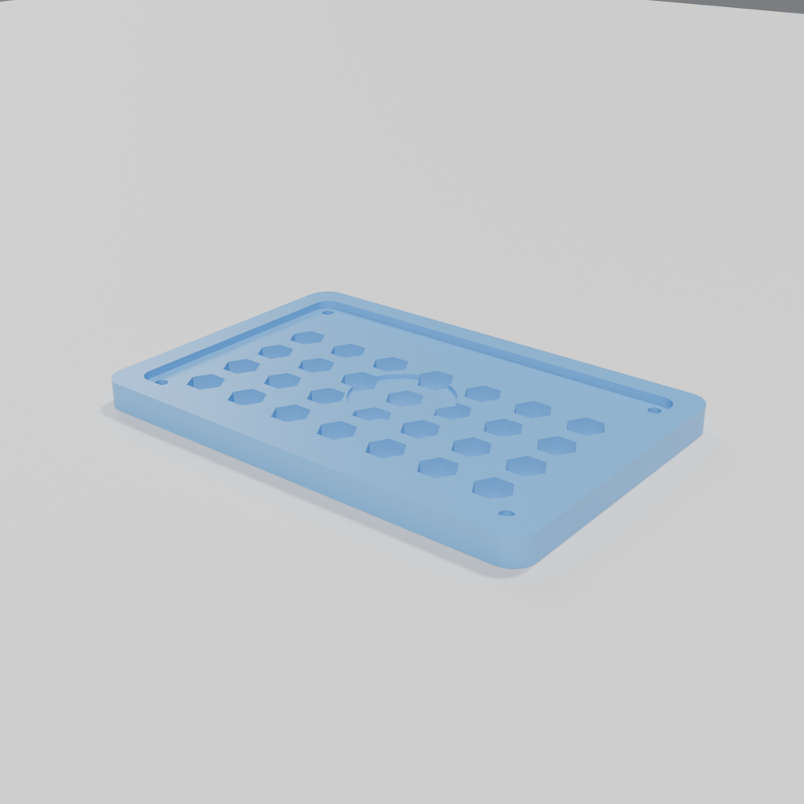

# Decorative panel — the art lane's render target

A 240 × 160 × 14 mm hexagonal-lattice wall panel. It exists to show the **split**
of the optional Blender/bpy lane:

- the geometry stays in its authoritative, parametric source — [`panel.scad`](panel.scad);
- Blender supplies the camera, material and light — [`skills/cad-art/render_studio.py`](../../dsh-cad-harness/skills/cad-art/render_studio.py);
- the render is **not** a printability certificate. For print, import the STL as a
  version and run `check_printability` / `measure_part`.



## Build the mesh

```bash
openscad -o panel.stl panel.scad
```

Sanity check from this repository (Manifold, 2026-10-25): one body, watertight,
genus 32 (the hexagonal openings + mounting holes), volume **348,736.9 mm³**,
bounding box 240 × 160 × 14 mm. That is a geometry check, not a print approval.

## Render it

### If the user has installed bpy (the L1 path)

```text
run_python({
  script: "<plugin>/skills/cad-art/render_studio.py",
  args: ["panel.stl", "--out", "renders", "--mode", "hero",
         "--engine", "cycles", "--size", 1024, "--samples", 64],
  cwd: "<this example>"
})
```

### If the user has a Blender CLI but not bpy (e.g. macOS Intel + 4.5 LTS)

The same script is dual-entry:

```bash
blender -b --factory-startup -noaudio -P ../../dsh-cad-harness/skills/cad-art/render_studio.py -- \
  panel.stl --out renders --mode hero --engine cycles --size 1024 --samples 64
```

`--mode views` (Workbench, four views, ~1.3 s at 1024) is the iteration image;
`--mode hero` (Cycles, ~13 s at 1024/64 on a 16-core CPU) is the presentation
image. Read `renders/metadata.json` for engine, unit, bbox and output paths.

## Read the skill before using this

[`skills/cad-art/SKILL.md`](../../dsh-cad-harness/skills/cad-art/SKILL.md) is the map:
preflight, install, QC boundary, platform limits and the "render ≠ printable" rule.
This example is deliberately a **render target**, not a bpy modeling tutorial;
bpy-generated geometry is L3 and is not part of the L1 promise.
