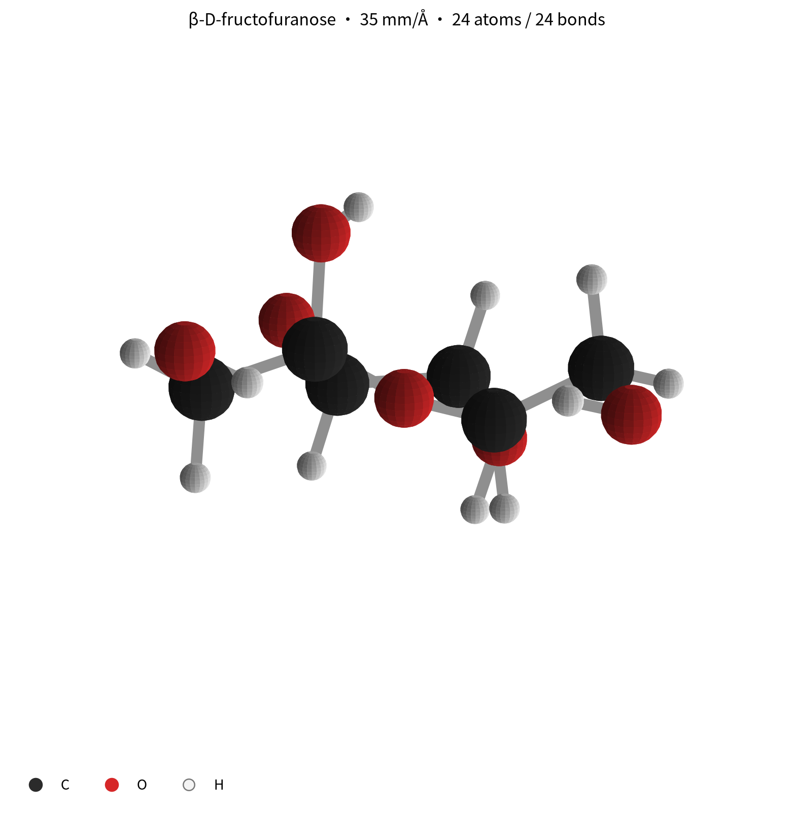
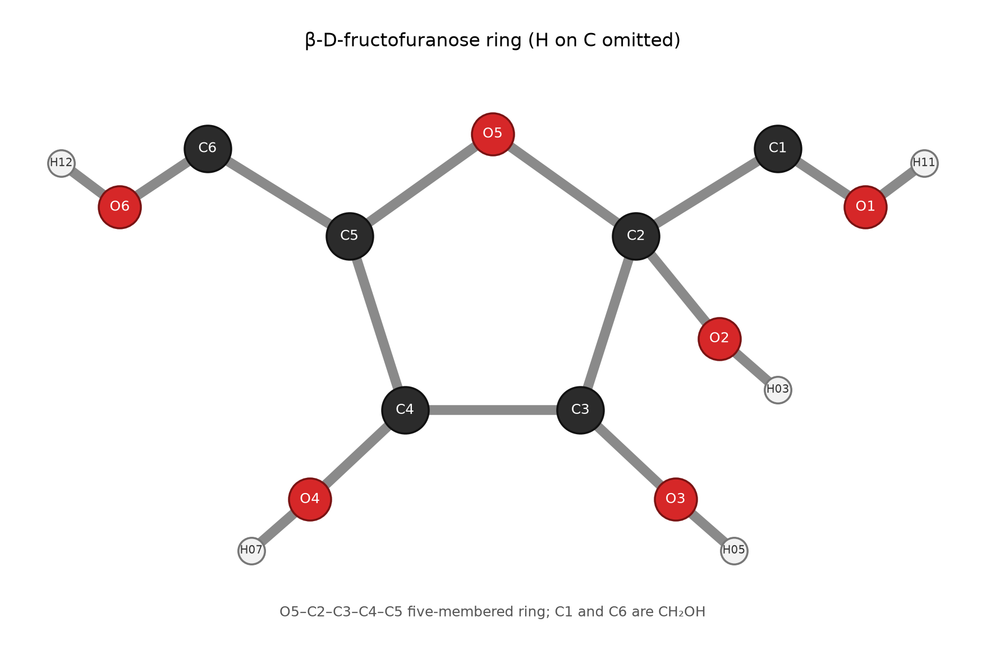
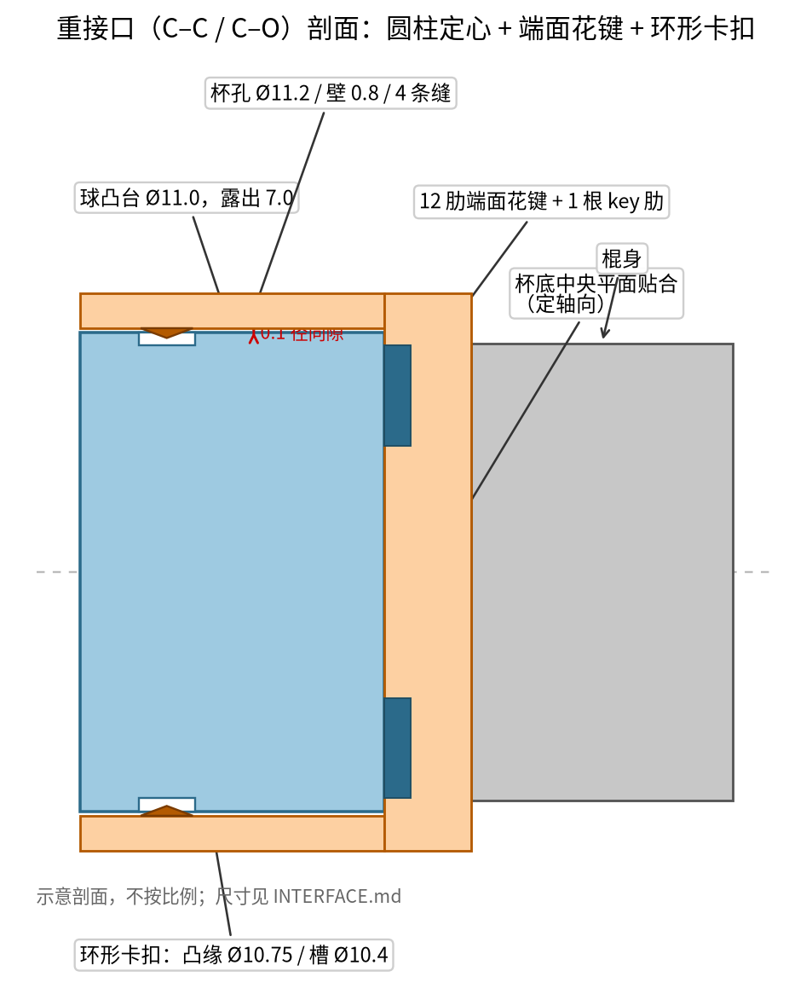

# 果糖球棍模型（β-D-呋喃果糖）

一个可以**拆成 24 个球 + 24 根棍**、徒手反复装拆的 FDM 分子模型。每个重键接口用
**12 肋端面花键 + 唯一 key 肋 + 环形卡扣**：推入即卡、转到唯一角向才落座、不自由转、
不自己掉。轻接口（C–H/O–H）只保留圆柱 + 卡扣，因为端基 H 绕键轴转不影响任何原子位置。

| 项 | 值 |
|---|---|
| 分子 | β-D-呋喃果糖，C6H12O6，PubChem CID 439709 |
| 规模 | 35 mm/Å；整体 224 × 201 × 129 mm |
| 零件 | 37 个唯一版本 / 48 个实例（24 球 + 24 棍） |
| 接口 | 重：Ø11 花键+卡扣；轻：Ø6.5 圆柱+卡扣 |
| 材料 | PLA+（卡扣更耐用可换 PETG 棍） |
| 打印 | 0.4 mm 喷嘴，0.2 mm 层高，3 壁，15% 填充 |
| 拆装 | 无工具，直推/直拉；重键只有唯一角向 |

## 预览

## 文件

| 路径 | 内容 |
|---|---|
| [`SPEC.md`](SPEC.md) | 分子身份、原子映射、键表、尺度、坐标约定 |
| [`INTERFACE.md`](INTERFACE.md) | 接口方案对比、尺寸、公差、卡扣力估算、防错 |
| [`PRINT.md`](PRINT.md) | 打印姿态、支撑、装配顺序、携带、拉脱试验 |
| [`BUILD.md`](BUILD.md) | 逐次构建/检查记录（版本、run、数字） |
| [`VERIFICATION.md`](VERIFICATION.md) | 实测、仿真、审计与边界 |
| [`spec/molecule.json`](spec/molecule.json) | 机器可读几何/接口/装配变换（权威） |
| [`spec/scad/`](spec/scad) | 每个唯一件的 OpenSCAD 源 |
| [`spec/import_manifest.json`](spec/import_manifest.json) | 注册用 STL + datum 清单 |
| [`assembly/assembly.json`](assembly/assembly.json) | 装配契约（BOM + 接口检查） |
| `cad-data/` | 版本库与运行记录（生成物，面板读取） |

## 快速开始

1. 按 [`PRINT.md`](PRINT.md) 先打 **Fru-C3 + Fru-B03** 试配。
2. 通过后批量打印；按颜色分球（黑 C / 红 O / 白 H）。
3. 按 [`PRINT.md`](PRINT.md) §4 从 C2 开始装五元环，最后装 H。
4. 携带时拆成球/棍两袋；不要长期放高温车内。

> 面板查看：本项目的语料在 `examples/ball-and-stick/fructose-molecule/cad-data/`。仓库根的
> `cad-data` / `assembly` 符号链接在构建后已恢复指向 glucose；请新建一个 cwd 指向本目录的
> 会话，或在面板工作目录下拉里选择本目录，才能看到这批版本。
> 本机仓库根还有一个 **`fructose-molecule` 视图别名**（指向本目录的 symlink），它只是让面板
> 的 depth≤2 发现逻辑能在根会话里列出本项目；真正的语料仍在
> `examples/ball-and-stick/fructose-molecule/cad-data/`，删除别名不影响项目。

## 当前状态

- 37 个交付件 + 2 个仿真导向件已注册（v001–v041；48 个交付实例）。
- 装配契约 **122/122 pass**（120 静态 + 2 motion，`not-excluded`，0 hard / 0 skipped / 0 undeclared）：run r007。
- 插入仿真：B03 0 干涉（r004/r013）、B15 0 干涉（r005）；B03 错相 15° 在最终位姿 **10.06 mm³** 干涉（r006，预期负样本）。仿真只覆盖导向/落座，**不覆盖卡扣弹性**。
- 打印筛查：5 个代表件（r008–r012）全部为 `difficult`；4 件 `excluded` 的薄点已复测为 0.65 花键肋宽 / 0.488–0.695 杯口尖唇，**无槽角杯壁 0.799 mm**。这不是全件可打印证明，也不声明全件可制造。
- `delivery_audit`：**difficult，0 blocked**（2 warn / 2 info）；装配/运动有证据，制造性只做代表件抽查。
- 这不是“已经实物打印验证”的声明；卡扣力是估算，必须按 [`PRINT.md`](PRINT.md) §6 做拉脱试验。

## 设计边界

- 只验证了**刚性导向/落座路径**；卡扣的弹性张开不在刚体仿真能力内。
- 花键抗扭、卡扣保持力是梁模型/量级估算，不是扭矩/疲劳试验。
- 模型是展示/教学件，不用于承力；小件不适合 3 岁以下。
