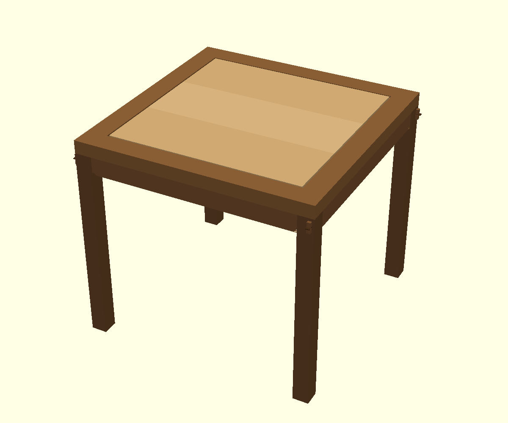
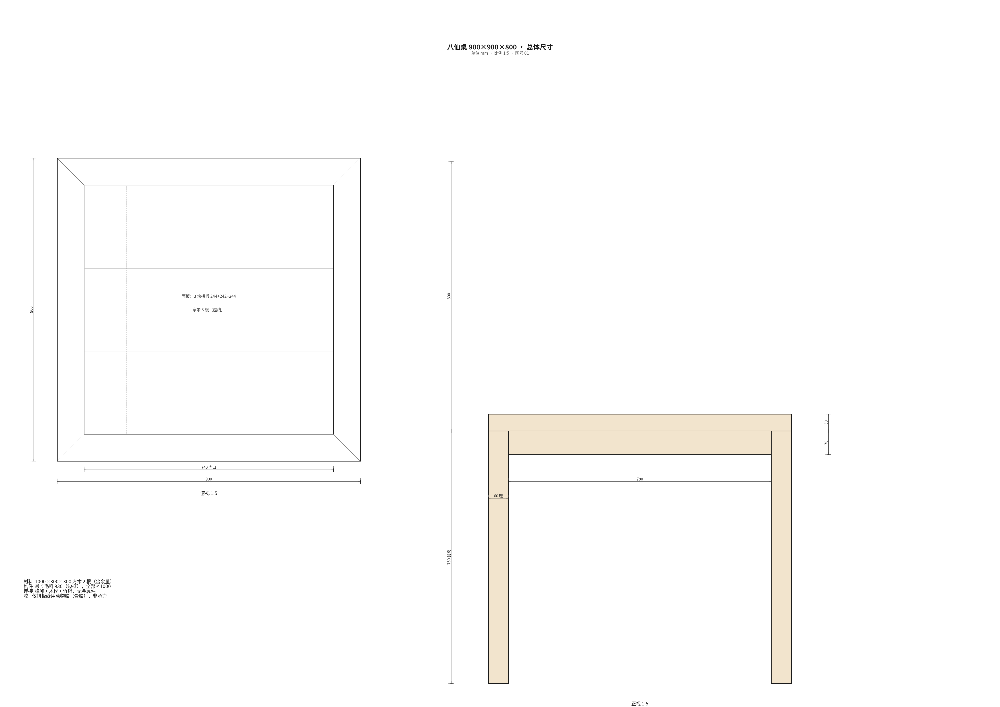
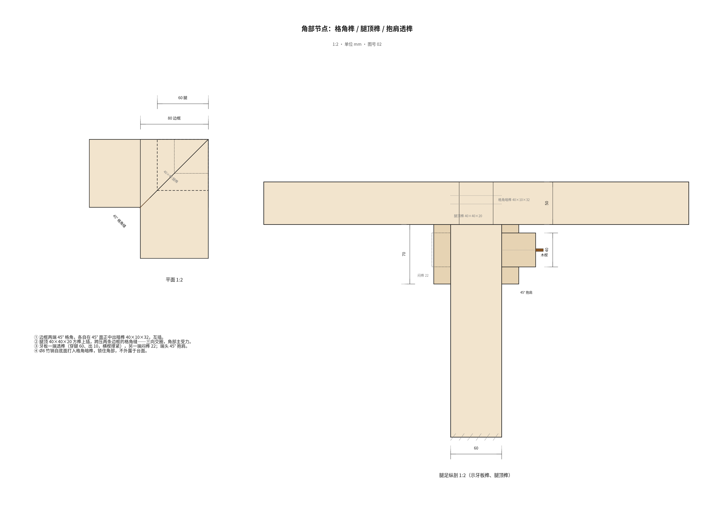
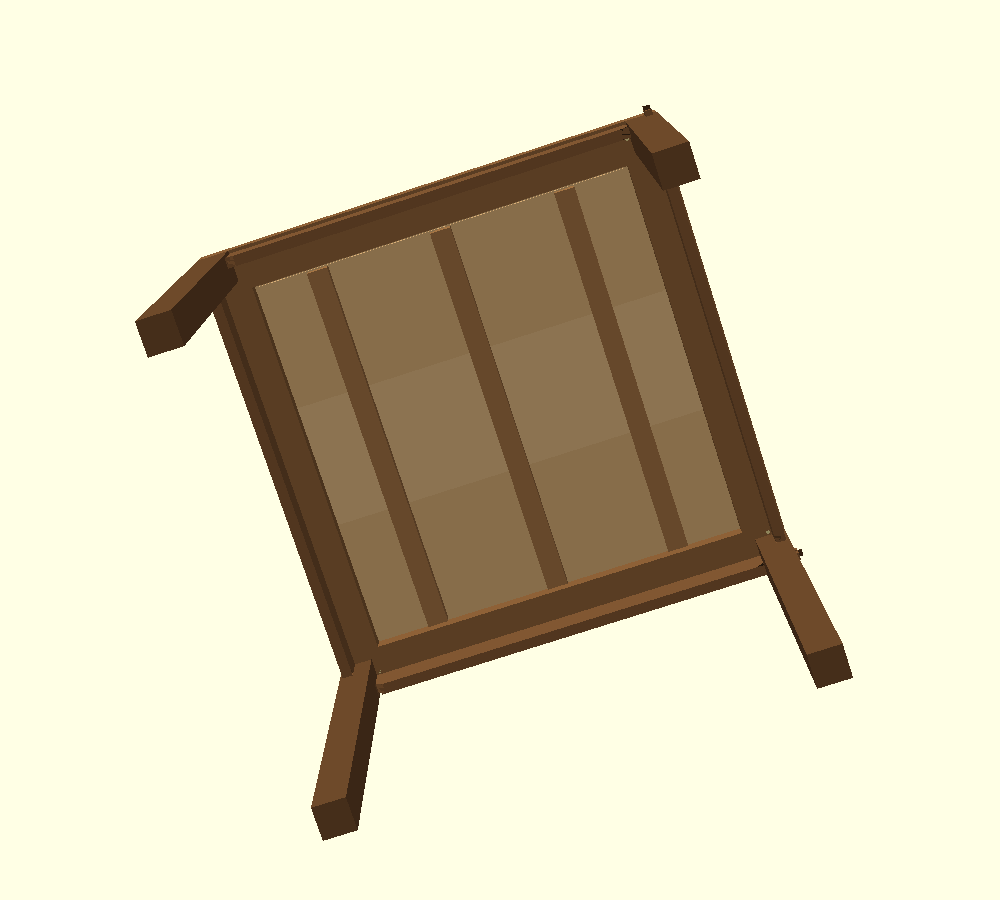

# 八仙桌 · 900×900×800 · 全榫卯方桌

> 需求输入：[PROMPT.md](PROMPT.md)
> 施工图：[01 总体](drawings/01-views.svg) · [02 角部](drawings/02-corner.svg) · [03 穿带](drawings/03-cleat.svg)
> 装配间隙：`runs/r003`（28 构件、378 对、0 干涉）· 装配契约：`runs/r004`（BOM，0 硬冲突）
> 参数化模型：[tools/gen.py](tools/gen.py) → `cad/*.scad` → `cad/stl/*.stl` → 版本 v001–v014



---

## 0. 一句话结论

一张 **900 × 900 × 高 800 mm** 的方桌，每边 2 人、共 8 人（每人 450 mm 沿边），
边框 50 厚、宽 80，腿 60 见方，牙板 70 高，面板 22 平镶。
**16 处榫卯 + 4 个木楔 + 4 枚竹销，无一颗金属件**：桌面四角格角榫（暗榫 + 竹销），
腿顶 40×40 方榫上插、跨压两条边框的格角缝（三向交圈的粽角做法），
牙板一端透榫穿腿加横楔、一端闷榫（抱肩榫），桌面攒边打槽、三块拼板、三根燕尾穿带。
全部构件毛料长度 ≤ **930 mm**（< 1000），用 **2 根 1000×300×300 方木**，净材 42.2 L、成桌约 **27.4 kg**。
28 个构件按图装配：**0 干涉**；榫肩与贴合面为 0.000 mm（设计如此）。

| 项目 | 数值 | 备注 |
|---|---|---|
| 外形 | 900 × 900 × 800 | 台面顶 z=800 |
| 座次 | 8 人 / 每边 2 人 | 沿边 450 mm/人 |
| 腿部净空 | 680 mm | 牙板下沿 |
| 净材积 | 42.2 L | 由 STL 实测求和 |
| 成桌质量 | 27.4 kg | 按硬木 0.65 g/cm³【假设】 |
| 毛料 | 2 根 1000×300×300 | 下料最长 930 |
| 金属件 | 0 | 榫、楔、销全部木质/竹质 |
| 胶 | 仅动物胶（骨胶），非承力 | 见 §8 |

---

## 1. 需求 → 设计对照

| 需求（PROMPT.md） | 本桌回答 | 证据 |
|---|---|---|
| 方桌、8 人、朴素结实 | 900×900×800，直牙板方腿，无雕饰；榫卯外露的透榫与楔 | 图 01，`renders/iso.png` |
| 全部非金属 | 0 金属件；4 竹销 + 4 木楔 + 16 榫卯 | §4、§8 |
| 榫卯/木楔承力，胶不承力 | 结构锁紧全部由榫、楔、销完成；胶只用于拼板缝与格角缝封闭 | §8 |
| 单根料 ≤ 1000，计余量 | 最长毛料 930（边框）；牙板 900、腿 780、面板 752 | §3 |
| 桌面必须拼板 | 3 块拼板：244 + 242 + 244 = 730，龙凤榫 + 穿簧 | §4.4，图 03 |
| 边框四角格角榫 | 45° 格角 + 40×10×32 暗榫，Ø8 竹销锁 | §4.1，图 02 |
| 攒边打槽装面板 | 边框内口开 6.4×14 槽，面板出 6×14 舌榫，肩部留 5 mm | §4.4 |
| 穿带防翘 + 与边框关系 | 3 根燕尾穿带挂住面板，两端距边框 7 mm，不顶死 | §4.5 |
| 腿与边框粽角榫、三面交圈 | 腿顶 40×40×20 方榫跨压格角缝，与两框外皮取平 | §4.2 |
| 牙板抱肩榫 | 端头 45° 抱肩，一端透榫（出 10）+ 横楔，一端闷榫 22 | §4.3 |
| 透榫锁紧用木楔 | 4 处透榫全部加横楔，楔头外露 4 mm | §4.3 |

---

## 2. 总体与比例



尺寸链（mm）：

```
总高 800 = 腿 750 + 边框 50
台面 900 × 900；边框宽 80，内口 740
腿 60 × 60，位于四角：x,y ∈ [390, 450]，外皮与边框外皮平
牙板 70 高（680..750）、20 厚，外皮比腿缩进 6 —— 形成一道阴影线
面板 22 厚，平镶，台面与边框上表面齐平
```

**为什么是 900 而不是 1000**：单根料长 1000。台面若做 1000，边框下料就得 1000+，
锯缝、端头修整、刨削都没有余量，违反硬性要求 2。900 是"1000 料 + 20~30 余量"能做出的
最大常规八仙桌尺寸；840/860 也常见，900 兼顾 8 人与用料。

**8 人怎么坐**：每边 450 mm 坐 2 人（每人 450 净宽），四条腿各占一角，腿部净空 680 mm，
膝盖不碰牙板。这是八仙桌的传统坐法；若 8 位成人要更宽松，只能加大台面，而 1000 料不允许。

---

## 3. 零件与下料

### 3.1 零件表

| 零件 | 版本 | 数量 | 成品尺寸 (mm) | 说明 |
|---|---|---:|---|---|
| 桌腿 | v001 | 4 | 60×60×750（含顶榫 40×40×20） | 一透榫槽、一闷榫槽 |
| 边框 | v010 | 4 | 900×80×50 | 两端 45° 格角，一榫一卯；全长面板槽；腿榫卯 |
| 牙板 | v003 | 4 | 872×70×20（含榫） | 一端透榫、一端闷榫；端头 45° 抱肩；楔槽 |
| 面板-边板 | v011 | 2 | 730×244×22 | 外长边 + 两短边出舌；内侧龙凤榫槽 |
| 面板-中板 | v012 | 1 | 730×242×22 | 两长边龙凤榫槽；两短边出舌 |
| 穿带 | v013 | 3 | 726×40×32（含燕尾 30→44×6） | 燕尾挂面板，两端距边框 7 mm |
| 穿簧 | v014 | 2 | 720×15.6×5.8 | 龙凤榫内穿簧，隐蔽件 |
| 木楔 | v008 | 4 | 33×13.2×3 | 硬木劈料，透榫加楔 |
| 竹销 | v009 | 4 | Ø8×34 | 竹质，自底面锁格角暗榫 |

### 3.2 配料（2 根 1000×300×300 方木）

每根先截一段 **930** 长（余 70 作锯缝、端头、试件），再按厚度剖分：

| 料 | 剖分（厚度方向） | 出件 |
|---|---|---|
| **1#** | 70 板 1 块 → 4 根 70×70×930，取 4 条腿（780/根） | 腿 ×4 |
|  | 56 板 2 块 → 每块纵剖 3 条 86 宽，共 6 根 86×56×930 | 边框 ×4（余 2） |
|  | 32 板 3 块 → 每块剖 6 条 40 宽，取 3 根 726 | 穿带 ×3 |
|  | 余 22 厚 → 楔料、试件 | 木楔 |
| **2#** | 26 板 2 块 → 每块剖 3 条 76 高，共 6 条 26×76×930（牙板切 900） | 牙板 ×4（余 2） |
|  | 26 板 3 块 → 每块剖 1 条 256 宽，切 752 长 | 面板 ×3 |
|  | 余 10 厚 → 剖 20 宽，切 730 长 | 穿簧 ×2 |
|  | 余 160 厚 → 净板备料（可做凳面/几面） | — |

- 长度余量：锯缝 3 + 端头修整 5 + 刨削/时效 12~20；表中"毛料"均已计入。
- 宽度/厚度余量：每面 3，剖开后刨净。
- **净材积 42.2 L，毛料 180 L，出材率 23%**。受"单根 1000"限制，每根料只能截一段长件，
  余下的是 60 短头与大块边板——不是废料，是可继续做凳、几的净板。
- 竹销用一段干竹（或竹筷），不占方木。

---

## 4. 榫卯



### 4.1 桌面边框四角：格角榫（45° 格角 + 暗榫 + 竹销）

- 两条边框端头各做 45° 斜切，拼成 90° 格角，外皮三面交圈；
- 每条边框在 45° 斜面正中出 **40×10×32** 暗榫，插入对方 45° 面上的卯；
- 角部下方钻 **Ø8** 孔，自底面打入竹销，销住暗榫；销顶止于 784，**台面下 16 mm，不见孔**；
- 严丝合缝后，格角缝可薄涂动物胶作封闭，**承力不靠胶**。

### 4.2 腿与边框：粽角榫（三向交圈）

- 腿顶出 **40×40×20** 方榫，正对边框角块（80×80）中心，**横跨两条边框的 45° 格角缝**；
- 角块上的卯两半分别开在两条边框上，装配后合成一个 40.4×40.4 的方卯；
- 腿的两外皮与边框外皮取平，格角线从台面一直交到腿顶——这是"三面交圈"的外观；
- 受力：台面荷载经边框角 → 腿顶榫 → 腿；腿顶榫同时把两条边框锁成一体，
  弥补纯 45° 格角在受扭时容易开缝的弱点。

> 说明：本榫按"格角 + 腿顶方榫跨缝"的做法建造并建模；它承担粽角榫的三向锁合作用，
> 但外角不像"腿顶到台面"的粽角那样露腿断面——台面保持整圈边框，更适合日常使用。

### 4.3 牙板与腿：抱肩榫（一透一闷，透榫加木楔）

- 牙板端头做 **45° 抱肩**（端部底面斜切 15×15），肩面贴腿；
- **A 端**：透榫 **14×40**，穿腿 60、出腿 10；榫端开 3.2 横槽，打入 33×13.2×3 硬木楔，
  撑开榫头上下两片、锁死在腿内；楔头外露 4 mm（可齐平刨去，也可留着作装饰）；
- **B 端**：闷榫 **14×40×22**，不穿透腿，外观干净；
- 四根牙板各一透一闷，绕桌一周交替——每条腿只露一个榫头，节奏统一；
- 两条相邻牙板的榫在腿内**不相交**：透榫在中部（y 427~441），闷榫只到 22 深，
  与透榫槽留 14 mm 实木，避免三向交叉掏空腿。

### 4.4 攒边打槽装面板（拼板）

- 边框内口全长开槽：**6.4 高 × 14 深**，槽口在 370，槽底 384；槽开到 45° 端面，
  四角两框的槽合成 L 形，面板四角 45° 割角后正好落入；
- 面板出舌：**6 厚 × 14 长**（365 → 379），四周一圈；
- **肩部留 5 mm、槽底留 5 mm**：面板可随湿度胀 5 mm 而不顶死边框（按平衡含水率下料；
  干燥地区建议留 8 mm）；
- 面板 = 3 块拼板 **244 + 242 + 244 = 730**：两长边开龙凤榫槽（8 深 × 6.2 高），
  中间卧 **720×15.6×5.8 穿簧**；拼缝薄涂动物胶，只起密闭与找平作用，**不承担结构拉力**；
- 面板平镶，与边框上表面齐平（"平做"），不做起线、不做束腰——朴素。

### 4.5 穿带防翘



- 3 根 **726×40×32** 穿带，横跨面板木纹（x = −244 / 0 / +244）；
- 穿带顶面做**燕尾**（下宽 30、上宽 44、高 6），滑入面板底面开出的燕尾槽——
  燕尾挂住面板，穿带自身的刚度把面板校平，防止起翘；
- **与边框的连接**：穿带两端**不顶边框**，各留 **7 mm**（面板可胀 5 mm，穿带随面板移动）；
  不钉、不胶、不榫入边框。穿带靠燕尾挂在面板上，四周被边框挡住，不会滑出；
- 这是有意的"浮动"：面板要胀缩，穿带若两端顶死，潮季就会把边框撑开或把面板顶弯。

### 4.6 竹销

- 4 枚 **Ø8×34** 竹销，位置在四角格角暗榫正下方：(418,384)、(−384,418)、(−418,−384)、(384,−418)，
  自边框底面钻入，穿过暗榫；销顶止于 784，台面下 16 mm；
- 作用：锁住格角暗榫，防止长期使用中暗榫因干缩而退出；台面看不到销孔。

### 4.7 榫卯清单

| 部位 | 做法 | 关键尺寸 | 数量 |
|---|---|---|---:|
| 边框四角 | 格角榫（45° + 暗榫） | 暗榫 40×10×32 | 4 |
| 腿 ↔ 边框 | 粽角榫（腿顶方榫跨格角缝） | 40×40×20 | 4 |
| 牙板 ↔ 腿 | 抱肩榫：透榫 + 横楔 / 闷榫 | 14×40×(70/22) | 8 |
| 面板 ↔ 边框 | 攒边打槽（舌榫入槽） | 舌 6×14，槽 6.4×14 | 4 边 |
| 拼板 | 龙凤榫 + 穿簧 | 槽 8×6.2，簧 15.6×5.8 | 2 |
| 穿带 ↔ 面板 | 燕尾挂接 | 30→44×6 | 3 |
| 透榫锁紧 | 木楔 | 33×13.2×3 | 4 |
| 格角锁紧 | 竹销 | Ø8×34 | 4 |

---

## 5. 为什么没有管脚枨（脚踏）

八仙桌传统上多不设管脚枨：8 人围坐，脚下要留空。本桌的刚度来自两个闭合的"环"：

1. **上环**：四条边框 45° 格角 + 四角腿顶方榫跨缝 + 面板（舌榫入槽）——一个刚性方框；
2. **下环**：四条牙板，每条一端透榫加楔、一端闷榫，把四条腿在中部锁成另一个方框。

两个环 + 四条腿构成一个箱形结构，抗侧向摇晃靠的是牙板透榫与楔，而不是枨。
若用于频繁搬动或地面不平的场合，可在腿间 150 mm 高处加管脚枨（本设计不设，留接口）。

---

## 6. 装配顺序

1. **拼板**：三块板刨平、开龙凤榫槽，穿簧卧入，动物胶拼缝，加压养护；刨到 22 厚、
   730×730，四边出 6×14 舌榫，四角 45° 割角，底面开 3 道燕尾槽。
2. **穿带**：3 根穿带自面板一端滑入燕尾槽，两端各留 7 mm；至此"面板组件"完成。
3. **边框**：刨净、截长 900，两端 45°，开暗榫/卯、全长面板槽、四角腿榫卯、竹销孔。
4. **合边框**：把面板组件放入，四条边框同时合拢（45° 格角、暗榫对卯），
   夹具校方；格角缝薄涂动物胶封闭，静置。
5. **腿 + 牙板**：四条腿与四条牙板先组成"腿圈"（透榫穿出、闷榫入位），
   透榫暂不打楔。
6. **合腿**：把边框组件整体抬起，四条腿顶 40×40 方榫对准角块方卯，落下、敲实。
7. **打楔**：4 处透榫各打入一枚木楔，楔头留 4 mm 或齐平刨去。
8. **打销**：自底面四角钻 Ø8×34，打入竹销，锯平、刨光。
9. **净面**：刨光、刮净，棱角倒 1 mm；桐油或蜂蜡饰面，不用化学漆。

> 试装（第 4、6 步之前）必须做：榫卯按 0.2 mm 配合留量，手工刨/凿修配，以能轻敲入、
> 不晃为度。模型里的 0.2 mm 是名义值，实做以试装为准。

---

## 7. 材料与加工要点

- **材种**：榆木、柞木、榉木、水曲柳等硬木均可；传统北方八仙桌多用榆木。
  腿、边框选直纹、无节的料；面板选纹理相近的三块，拼缝两侧纹理方向一致。
- **含水率**：下料前干燥到当地平衡含水率（北方 8~10%，南方 12~14%）；拼板后养生 1~2 周再净刨。
- **纹理**：腿、牙板、边框顺纹；穿带顺纹；面板三块同向（本设计木纹沿 x）。
- **加工**：榫头比卯眼小 0.2（宽厚各留），榫肩要严；透榫的楔槽用细锯开，楔用硬木劈料，
  打入时听声、看缝，一次到位。
- **饰面**：刨光后 240# 打磨，桐油两遍或蜂蜡烫蜡；不做厚漆，保留木纹。

---

## 8. 无金属 / 用胶声明

**金属件：0。** 全桌没有钉子、螺丝、螺栓、合页、金属箍、金属连接件。
紧固全部为：木榫（16 处）、木楔（4）、竹销（4）、燕尾（3）、舌榫（4 边）。

**胶：只用动物胶（骨胶/皮胶），且不作主要连接强度。**

| 用胶处 | 用量 | 作用 | 是否承力 |
|---|---|---|---|
| 面板三条拼缝 | 薄涂 | 密闭、找平，配合龙凤榫 + 穿簧 | 否（穿簧与舌榫定位，槽承担） |
| 边框格角缝 | 薄涂 | 封闭缝隙、防潮 | 否（暗榫 + 腿榫 + 竹销锁紧） |
| 其他榫卯 | 不用胶 | — | 榫、楔、销承力 |

拆解性：竹销可钻出、木楔可退出、榫卯可拆——这是"可修"的传统做法，也是不用胶的理由。

---

## 9. 验证与证据

| 内容 | 结果 | 来源 |
|---|---|---|
| 装配干涉 | 28 构件、378 对：**0 干涉**；榫肩/贴合面为 0.000 mm 接触（设计如此） | `runs/r003/report.json`（`validate_assembly`） |
| 装配契约（BOM） | 28 节点、0 硬冲突；47 对贴合面列为"未声明邻接"（见下） | `runs/r004`（`check_assembly`） |
| 零件实体 | 9 个零件全部 watertight、单实体 | 导入记录（v001–v014） |
| 视觉复查 | 9 个零件 top+iso 已记录 | `review_visual` 记录 |
| 构件长度 | 最长毛料 930 < 1000 | §3.2 |
| 桌面拼板 | 3 块 244+242+244，非整板 | v011/v012，图 03 |
| 净材积/质量 | 42.2 L / 27.4 kg（0.65 g/cm³ 假设） | STL 体积求和 |
| 装配复跑 | `bash tools/build.sh`（重建 SCAD/STL），再在 CAD 运行环境跑 `tools/check_interference.py` | 脚本 |

**没有做的验证（如实说明）**：

- **没有做结构仿真**。木材是正交各向异性材料，榫卯的承载力取决于纹理、配合与含水率，
  线弹性各向同性有限元给出的"安全系数"会误导。本设计按传统节点尺寸（腿 60、牙板透榫 14×40、
  腿顶榫 40×40）取值，属于经验做法，不是计算结论。
- **0.2 mm 配合是名义值**，实做以试装为准。
- **装配契约未声明接口**：47 对"未声明邻接"全部是设计中的贴合面（腿顶榫肩、牙板肩、面板与穿带、
  竹销与边框）。要写成可判定接口，需要给每个版本加 datum，而那会改写版本号、让已有 run 全部失效；
  本次以 `validate_assembly` 的 378 对间隙结果为准，契约只作为 BOM 与邻接清单。
- **面板胀缩按 5 mm 预留**（约 2.3% 含水率变化）；若在集中供暖、极干燥环境使用，
  应按 8 mm 留（把面板宽度改到 724，舌榫加长到 17，槽深 20）。

---

## 10. 已知局限

1. 8 人 × 450 mm 是传统紧凑坐法；若要求每人 500 mm，900 台面不够，而 1000 料不允许更大的台面。
2. 27.4 kg 偏重（50 厚边框、60 腿），换来的是刚度与耐用；若要减重，可把边框减到 45、腿减到 55，
   但腿顶榫要相应减到 36×36，需重新校核。
3. 穿带与边框"不连接"是刻意的，但依赖边框挡住穿带端头；若拆下边框，穿带可滑出——
   这是可拆装结构的代价，装配时注意顺序。
4. 本模型不含倒角、饰面与木材缺陷；实做需按料选材、避节避裂。

---

## 11. 文件清单

```
PROMPT.md                需求原文
README.md                本文
drawings/01-views.*      总体平/立视图（1:5）
drawings/02-corner.*     角部节点（1:2）：格角榫 / 腿顶榫 / 抱肩透榫
drawings/03-cleat.*      攒边打槽 / 穿带（1:2）
renders/iso.png          整机
renders/bottom.png       底面：三根穿带
renders/corner_explode.png  角部爆炸
cad/parts.scad           全部零件模块（单一尺寸源生成）
cad/*.scad               单件 / 装配 / 爆炸 / 剖面
cad/stl/*.stl            导出实体（导入为版本 v001–v014）
tools/gen.py             参数化生成器（尺寸、装配、下料）
tools/views.py           出图视图
tools/drawings.py        施工图（SVG/PNG）
tools/build.sh           重建全部 SCAD/STL 并跑干涉自检
tools/check_interference.py  逐对干涉自检
assembly/instances.json  28 个装配实例（位置/旋转）
assembly/cutlist.json    下料表
assembly/assembly.json   28 节点 BOM（check_assembly 契约）
assembly/validate-input.json  validate_assembly 输入
```

---

*本设计为"可建造的传统做法 + 可验证的几何"：榫卯尺寸、配合与干涉都可在模型里复查；
承载力按传统经验取值，未做木结构仿真，这一点在 §9 已明确。*
