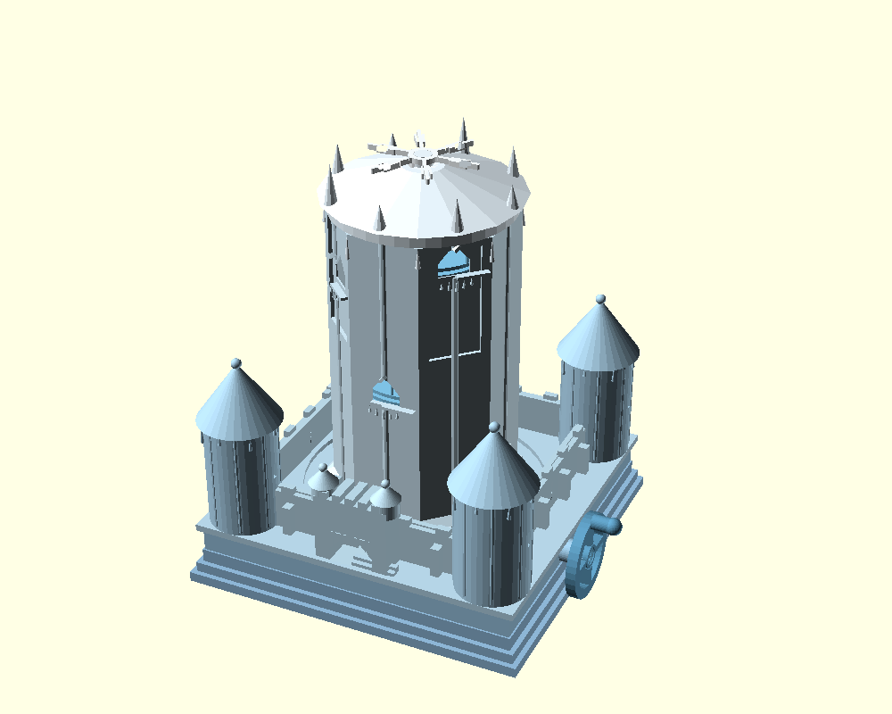

# 冰雪城堡八线手摇绕线器

一只外观像冰雪城堡的手摇绕线器：单摇柄、蜗杆 10:1 减速、一根主轴同时带 8 个线轮收线，
每个线轮各有一组碟簧压紧的摩擦离合，某条线拉紧时只有那个轮打滑。

- 整机包络：**231 × 204 × 248 mm**（X × Y × Z，含右侧手轮；用户要求 120–250 mm/轴）
- 全部 **FDM / PLA**，**无外购件**：蜗杆、蜗轮、碟簧、销、卡簧全部打印
- 8 个线轮（Ø84 × 18，节距 20），9 片摩擦压盘（Ø36 × 2），3 片碟簧叠成一组
- 最大单件 204 mm（底座下座），可上 220 × 220 × 250 打印床
- 视觉：方形冰台 + 四角塔 + 中央八角主塔 + 8 个尖拱线窗 + 冰冠 + 雪花顶饰 + 门楼



## 1. 机构

```
手轮 ──曲柄轴── 双头蜗杆(2 头) ══ 蜗轮(20 齿, 10:1) ── 主轴(D 形 Ø14)
                                                      ├─ 8 × 线轮 (D 孔, 1:1)
                                                      ├─ 9 × 摩擦压盘 (D 孔, 1:1)
                                                      └─ 雪花顶饰 (D 孔, 1:1, 随轴转)
```

- **收线**：摇柄转 10 圈 → 主轴转 1 圈 → 8 个线轮各转 1 圈。蜗杆双头自锁性弱，但 10:1
  减速让手摇力矩可控。
- **摩擦离合**：每两片压盘之间夹一个线轮；顶部用 3 片 Ø34/Ø14 碟簧 + Ø60 止推垫圈，
  由冰冠内侧的预紧凸台（223.68–224.4）压住。某条线被拉紧超过设定扭矩时，该线轮在
  两片压盘之间打滑，不拖累其它 7 条。
- **走线**：线轮外缘 Ø80，线从塔身对应高度的 18 × 18 尖拱窗（下 4 正方位、上 4 斜面）
  的窗台引出；8 条线从 8 个窗出去，互不交叉。
- **容量**（按 0.5–1 层排线估算）：Ø2 mm 线约 8–17 m/轮，Ø1 mm 线约 30–45 m/轮；
  8 轮合计 Ø2 约 64–136 m。实际取决于排线手法，未实测。

## 2. 零件清单（20 种，43 件）

| 零件 | 数量 | 尺寸 mm | 版本 | 说明 |
|---|---|---|---|---|
| 底座下座 | 1 | 204×204×20 | v010 | 三级方台 + 内腔 + 中心承压柱 |
| 底座中框 | 1 | 201×190×14 | v041 | 190 方环 + 曲柄轴承座（y=-17.3） |
| 底座顶板 | 1 | 196×196×20 | v033 | 托座 + 4 角塔插孔 + 护城河 |
| 主塔 | 1 | 112×112×186 | v046 | 八角塔身 + 8 线窗 + 塔颈 + 卡扣槽 |
| 冰冠 | 1 | 112×112×39.4 | v054 | 卡扣裙 + 锥顶 + 8 冠尖 + 预紧凸台（去 5 mm 薄檐）|
| 雪花顶饰 | 1 | 66×58×6 | v019 | 六臂冰晶，D 孔随轴转 |
| 城门楼 | 1 | 57×17×57.5 | v055 | 门洞 + 闸栏 + 2 小角楼（外移 0.5）|
| 主轴 | 1 | **Ø14×226** | v061 | Ø14 D 形轴 + 下轴肩；挠度 ~0.7 mm、最薄 1.938（过 1.2 判据）|
| 蜗轮 | 1 | Ø26.6×5.1 | v062 | 20 齿，模数 1.2，**双头齿槽相位 0°**，0.4 侧隙，齿顶修缘 r13.3，D 孔 14.4 |
| 曲柄轴 | 1 | Ø8×124.5 | v076 | 双头蜗杆 zrot(90)、0.4 侧隙、D 榫 Ø12；**蜗杆端 R0.5 + 榫台阶 R0.5 + D 面 0.5 倒角**，全链无细颈/无 90° 台阶 |
| 手轮 | 1 | Ø50×23 | v073 | 4 辐 + 握把 + **D 孔 12.4**（配 Ø12 曲柄榫）|
| 挡圈 | 1 | Ø20×2 | v057 | C 形卡环，内孔 9.5 压配 Ø10 |
| 碟簧组 | 1 | Ø34×5.68 | v037 | 3 片碟簧安装态 |
| 止推垫圈 | 1 | Ø60×2 | v026 | 压住碟簧组 |
| 定位销 | 4 | Ø4×8 | v001 | 主塔与顶板定位 |
| 线轮 | 8 | Ø84×18 | v014 | 实心桶 + 双法兰 + 12 冰棱 |
| 摩擦压盘 | 9 | Ø36×2 | v002 | 6 个减重孔，D 孔 |
| 角塔 | 4 | Ø52×107 | v053 | 塔身 + 锥顶 + 冰锥 + 2.2 平檐 + Ø30 插榫 |
| 城墙 | 3 | 111.6×28 | v038 | 城齿 + 扶壁 + 雪花浮雕 |
| 城门墙 | 1 | 111.6×28 | v039 | 22×18 门洞 + 闸栏 |

## 3. 装配

装配契约在 `assembly/assembly.json`（修订 4，43 个实例、69 个接口），源文件
`assembly/root.json`。

```bash
cad assembly check          # 69/69 接口通过，0 过盈；25 处“未声明邻接”均为 0–0.4 mm 间隙/接触
```

接口含：三级底座贴合、塔/冠/雪花同轴与贴合、主轴与 8 轮 9 盘的 D 副、蜗杆/蜗轮中心距
17.3、8 组“盘–轮–盘”贴合、4 角塔销孔、4 墙身底、门楼底、碟簧组与止推垫圈预紧等。

## 4. 生成与预览

```bash
export OPENSCADPATH=/home/songsenand/Project/ToyMarker/lib
openscad -o out.png --imgsize=1000,800 --autocenter --viewall \
  --camera=0,0,0,60,0,25,0 --projection=p \
  examples/ice-castle-winder/scad/icecastle.scad
```

- `scad/icecastle.scad` 是全参数主模型（`$fn=40`，BOSL2 齿轮/蜗杆）。
- `scad/*.scad` 是单件包装（`SHOW_ALL=false` + 主模型 + 调用的模块 + `datum` 行）。
- 所有零件由 CAD 面板生成并登记为版本；`cad inspect measure` 可复测单件。

## 5. 验证状态（2026-11-25）

| 项目 | 状态 | 证据 |
|---|---|---|
| 包络 120–250 | **通过** | 实测 231×204×248；最大单件 204 |
| 8 轮/单摇柄/离合器 | **结构完成** | 43 实例装配，69 接口机检 |
| 装配 | **not-excluded** | `cad_assembly check` 修订 17：70/70（含 motion-clearance），0 过盈 |
| 机构运动 | **通过** | 运动 r085：42 个交付版本实例（Ø14 主轴 + v076 曲柄）、0 干涉、22 个齿轮副 `agrees` |
| 可打印性 | **通过/已知** | 主轴 Ø14 后 **not-excluded**（1.938）；剩门楼 0.03、曲柄 0.083 两处已知锐边（见 §6）|
| 视觉审查 | **完成** | 21 个当前版本全部 top+iso review |

**运动排查结论**：之前 8–25 mm³ 不是齿廓精度，是**相位错半齿**——`gear_spin=9°`（180/teeth）是 BOSL2 单头蜗杆示例的相位，双头蜗杆正确齿槽相位是 0°。改成 0° 后 r033 起 pass，版本化后 r056/r065 pass。原来怀疑的“喉形/滚齿”不需要了。
1) 蜗轮改成喉形（throated）齿廓，或
2) 中心距再放 0.3–0.5 并重算齿厚（会削弱齿根），或
3) 把该齿轮副在装配契约里声明为 `intent`（有意啮合接触），并接受运动 run 的 fail 记录。

当前：运动门已过（r078），保留 r030/r074 的 fail 记录作为排查过程（r074 为 Ø14 但孔未改的中间态，已退役）。

**可打印性的边缘薄片**：主塔 0.082（顶层窗与角棱之间）、冰冠 0.299（盘缘）、门楼 0.03
（城齿/角楼棱）、主轴 0.068（挡圈槽与 D 面交棱）、蜗轮 0.025（齿顶）、曲柄 0.08（蜗杆与轴肩）。
这些是 0.03–0.3 mm 的锐边，实际打印会融合/圆角，不影响装配；但按 `fdm-pla-0.4` 的
`wallMinMm=1.2` 判 excluded，属“已声明的排除”，不是“可制造”的证明。

## 6. 已知问题 / 下一步

1. **蜗杆副**：已解决。相位 `gear_spin=0`（双头；9° 是单头示例值）+ 旋向 `zrot(90)` + 17.3 中心距 + 0.4 侧隙 + 齿顶修缘 r13.3，r056/r065 均 pass、0 干涉。0.8/0.9/1.0 侧隙会把蜗轮裂成 2 体，0.4 是 1 体的上限。
2. **离合预紧**：碟簧自由高 6.5、安装 5.68，名义预紧 16–25 N、离合扭矩 110–180 N·mm；
   没有扭矩实测。手感偏松/偏紧时，用冰冠卡扣的厚度或垫片调整。
3. **线容量**：Ø2/Ø1 的估算未实测；实际排线层数决定。
4. **打印**：大件（下座 204、顶板 196、主塔 186 高）需要 220×220 以上热床；线轮顶部
   法兰 22 mm 悬垂、冰冠底面、角塔檐口、门楼角楼需要支撑或分件。
5. **手轮力矩**：10:1 蜗杆的效率未算；8 轮同时收线的总阻力未测。
6. **2 处已知锐边（C 收口，用户确认）**：城门楼角楼锥缘 0.03、曲柄蜗杆端交棱 0.083。主轴已通过加粗到 Ø14 解决（1.938 mm，过 1.2 判据）。这两处加 0.5/1.2 倒角只会把一条锐棱换成两条新棱或裂体，几何上到不了 1.2 mm 判据；打印时自然融合/需轻打磨，不影响装配与运动。
6. **8 条线的出口**：窗台是走线导向，线从窗洞直接引出；没有压线轮/张力轮，回抽时靠
   摩擦离合保持张力。

## 7. 文件

```
examples/ice-castle-winder/
├─ README.md                 本文件
├─ PROMPT.md                 原始需求与已确认的取舍
├─ scad/icecastle.scad       参数化主模型
├─ scad/*.scad               20 个单件包装
├─ assembly/assembly.json    装配契约（修订 4）
├─ assembly/root.json        契约源
├─ renders/iso8.png          整机预览（README 用图，随仓库入库）
└─ cad-data/                 版本库、run 记录与其余渲染/检查图（生成物，不入库）
```

CAD 项目键：`ice-castle-winder-6ff888fc`；在面板「CAD」中可查看所有已登记版本与 run。
