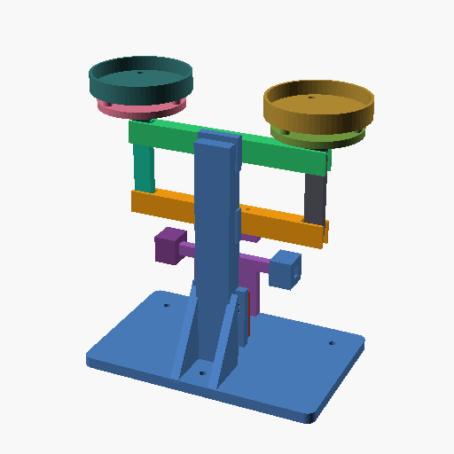

# 罗伯威尔天平（Roberval Balance）· 准生产示例

> 需求输入：[PROMPT.md](PROMPT.md)
> 装配契约：[assembly/assembly.json](assembly/assembly.json)
> 运动学/位置无关性证据：[evidence/kinematics.json](evidence/kinematics.json)（脚本 [tools/roberval_sweep.py](tools/roberval_sweep.py)）
> 本文所有数字都有 run 号、版本号或脚本输出可查；查不到的一律写"未测"。



---

## 1. 一句话结论

一台 **247 × 140 × 269 mm**（不含砝码；最大 160 g 砝码顶到 305.5 mm）的六铰点罗伯威尔天平：
上下横梁各绕中点转动，两根竖直边杆只平移不转动，因此**两个盘面在 ±8° 行程内始终保持水平（实测法向偏差 0.000°）**，
同一质量放在盘面 **x = −30 / 0 / +30 mm** 三个位置的竖向位移完全相同（实测差 0.000 mm），
这就是罗伯威尔"位置无关"的几何根源。
静态装配契约 **20/20 通过**、13 件整机 **0 干涉 0 过紧**、0 未声明邻接；每个打印件都跑过 `fdm-pla-0.4`。

**但有两条必须说清：**
1. r001/r002 是**旧版引擎**的负结果（关节漂移 105.6 mm / 39.2 mm，见 §6.3）。2026-11-02 修正后，同一批 STL 在 physics（穿透 0、约束异常 0）和 motion（漂移 0、24/24 采样）都已能稳定复跑；但那是**引擎级回归**，还没有生成新的 run id。运动证据暂仍由解析扫掠脚本给出，装配契约因此**没有 motion-clearance 接口**——`delivery_audit` 会报 `contract-without-motion`。
2. 框架叉口按严格 `fdm-pla-0.4` 判 **excluded**（890 / 1026 mm² 悬垂），需要局部支撑；托盘沉孔已从 0.86 mm 薄壁改成 1.75 mm 平底沉孔。这不是"能直接无支撑打印"的零件。

---

## 2. 需求 → 设计

| 需求（PROMPT.md） | 本机回答 | 证据 |
|---|---|---|
| 六铰点平行四边形框架 | 上/下横梁中点各一个转动副；两端叉口各一个；两根边杆连接上下 | I1–I6，r022；r037 |
| 边杆保持竖直、盘面水平 | 上下横梁同角转动，边杆只平移；盘面法向偏差 **0.000°**（−8°…+8°） | `evidence/kinematics.json` |
| 位置无关 | 盘是刚体平移，盘上任意点的竖向位移相同；**x = −30/0/+30 三点差 0.000 mm** | 同上 |
| 双盘、单盘 0–200 g | 盘内底 Ø82.265；按 200 g/盘设计；盘支架 3 点支承（2 螺钉 + 1 垫） | §5，r023 |
| 标尺分度 1 g | 指针尖半径 105 mm；下摆件一阶矩 3166.3 g·mm ⇒ **2.653 mm/g**；±5 g 刻线 ±13.27 mm（±7.25°） | r024 前测量 + 脚本 |
| 三脚调平 | 3 × M3×16 脚钉 + 底部六角螺母坑；外露量可调 | 装配 I?（脚钉在 BOM，未进契约） |
| 零点微调 | 指针滑轨上两只对称摩擦滑块（±45 mm），差动/同向移动配零 | I18/I19；r037 |
| 限位前不得干涉 | 机械极限为指针/刻度板接触 **11.75°**（尖行程 21.38 mm）；±8° 内最小非关节间隙 0.644 mm | 脚本 `hardStop` |
| 外购件只用常见 M3 | 21 螺钉 + 9 螺母 + 10 垫片，全部 M3 | §4 BOM |
| 5 个 1:2:4:8:16 砝码 | 10/20/40/80/160 g；实测体积比 **15.993 : 8.000 : 4.000 : 2.000 : 1.000** | v038…v034；r015–r017/r020/r021 |
| 最大砝码底面积 = 盘内底一半 | 2660.3 / 5308.6 = **0.5011**（+0.2%，在 ±2% 内） | `measure_section` v069；v034 |

---

## 3. 机构原理（为什么位置无关）

罗伯威尔框架的六个铰点是：**上下横梁的中点各 1 个 + 四个角各 1 个**。
上、下横梁各绕自己的中点转同样的角 θ；两根边杆的上、下铰点分别落在两根横梁的同一半径 R 的角点上，
因此边杆在任意 θ 下都**保持竖直、只做平移**；托盘固定在边杆上，所以盘面也**只平移、不转动**。

- 盘上任意一点（包括偏置的砝码）在 θ 下的竖向位移都是 `R·sinθ`，与 x 无关；
- 因此 1 g 载荷产生的力矩是 `m·g·R·cosθ`，**与载荷在盘上的位置无关**；
- 指针（含配重块和两只滑块）随下横梁转动，是回复元件；其质心在支点下方 `d`，
  静态灵敏度约为 `θ/m = R / (M_bottom·d)`；
- 实测下摆件 `M = 122.623 g`、`d = 25.821 mm`、一阶矩 **3166.3 g·mm**，
  指针尖 105 mm ⇒ **2.653 mm/g**（1° 约 0.377 g）。

这不是"近似水平"：脚本对 −8°…+8° 每 1° 从交付 STL 重建整机，盘面法向偏差始终为 **0.000°**。

---

## 4. 零件与 BOM

### 4.1 打印件（PLA，1.24 g/cm³【假设】）

| 零件 | 版本 | 数量 | 体积 mm³ | 质量 g | 说明 |
|---|---|---:|---:|---:|---|
| 底座+立柱（含刻度安装凸台、三脚孔、侧肋） | v066 | 1 | 472 166 | 585.5 | 竖直打印 |
| 上横梁 | v049 | 1 | 46 279 | 57.4 | 平放，等厚 15 |
| 下横梁 | v050 | 1 | 45 817 | 56.8 | 平放，等厚 15 |
| 指针（配重块+两条调零滑轨） | v063 | 1 | 33 465 | 41.5 | 平放，8 厚 |
| 边杆 | v051 | 2 | 17 510 | 21.7×2 | 竖立，顶部法兰/键 |
| 托盘支架 | v046 | 2 | 27 474 | 34.1×2 | 平放，中央键孔 |
| 托盘 | v069 | 2 | 31 748 | 39.4×2 | 平底/4 mm 底，Ø6.2 平底沉孔 |
| 刻度板 | v067 | 1 | 9 041 | 11.2 | 竖立，2.653 mm/g 刻线 |
| 调零滑块 | v028 | 2 | 9 816 | 12.2×2 | 摩擦鞍块 |
| 砝码 160/80/40/20/10 | v034…v038 | 各 1 | 128 729 / 64 367 / 32 184 / 16 091 / 8 049 | 159.62 / 79.81 / 39.91 / 19.95 / 9.98 | 严格相似圆柱 |
| **打印件合计** | | 18 件 | | **≈ 966 g + 砝码 309 g** | |

底座 585.5 g 偏重（220×140×10 的板 + 立柱 + 侧肋）；整机含砝码约 **1.33 kg**。
如果要做第二版，底座减重窗是首先该动的地方——本文不把它写成"已优化"。

### 4.2 外购件（只有 M3；模型是示意件）

| 规格 | 用途 | 数量 | 模型版本 |
|---|---|---:|---|
| M3×20 半牙 | 四个角铰（双剪：耳-垫-眼-垫-耳） | 4 | v039 |
| M3×30 半牙 | 两个中心铰（单剪，自攻入底座铰板） | 2 | 未建模（BOM） |
| M3×35 半牙 | 指针法兰两只（梁顶穿入、法兰下螺母） | 2 | v040 |
| M3×12 内六角 | 托盘支架→边杆法兰（自攻） | 4 | 未建模（BOM） |
| M3×12 盘头 | 托盘→支架凸台（自攻） | 4 | 未建模（BOM） |
| M3×16 | 三只调平脚（底部螺母坑） | 3 | v041 |
| M3×10 | 刻度板两只（自攻入底座凸台） | 2 | v042 |
| M3 六角螺母 | 角铰 4 + 指针 2 + 脚 3 | 9 | v043 |
| M3 平垫 0.5 | 角铰两侧（8）+ 中心铰 2 | 10 | v044 |

外购件**不进装配契约**（示意模型没有真实螺纹，自攻/螺母配合不是间隙配合）；
契约只覆盖 13 个打印件与它们的贴合/同轴/间隙。这是本示例的明确取舍。

---

## 5. 装配契约与静态检查

### 5.1 `check_assembly` → **r022，20/20 通过**

- 6 条 `转动副`，`coaxial`，容差 ±0.25 mm（轴偏移实测 0）；四个角铰的 0.5 mm 垫片间隙在契约外由 BOM 保证；
- 托盘/支架/边杆的贴合面 `distance 0`（±0.2）；
- 托盘两只螺钉 `coaxial`（±0.3）；指针与刻度面 `distance 2`（1.5–2.5）；
- 指针安装面 `distance 0`；调零滑块与导轨 `distance 0`；刻度板与底座 `distance 0`；
- **0 未声明邻接**（`adjacencyThresholdMm=0.6`）。装配渲染见 `renders/whole-iso.png` / `whole-front.png`。

### 5.2 `validate_assembly` → **r037，13 件 / 78 对，0 干涉 0 过紧**

阈值 `clearanceThreshold=0`、`interferenceEpsilonMm3=20`（后者用于吸收调零滑块 0.1 mm 摩擦筋的名义过盈，14.4 mm³）。
关键间隙：边杆眼-横梁叉口 **0.5 mm**（每侧）、指针-刻度 **1.4 mm**（刻线凸起处）、底座-指针 6.0 mm、底座-横梁 5.59 mm。

> 装配的 13 件是打印件；BOM 里的 M3 未建模，因此"螺钉能不能穿过孔"是纸面 BOM 约束，不是 `validate_assembly` 的数字。

---

## 6. 运动、位置无关性与限位

### 6.1 解析扫掠（本示例的运动证据）

脚本从交付 STL 重建整机，对 θ = −8°…+8° 每 1°：

- 上/下横梁绕各自中点转 θ；
- 两根边杆**只平移**：`(±R(cosθ−1), 0, ∓R sinθ)`；
- 托盘/支架/边杆随边杆平移；
- 指针、配重、滑块随下横梁绕下中点转 θ；
- 托盘顶面法向、盘上三点（x=−30/0/+30）的竖向位移、指针-刻度/限位柱/底座/横梁的最小距离。

结果（`evidence/kinematics.json`）：

| 检查 | 结果 |
|---|---|
| 盘面法向偏差（−8°…+8°） | **0.000°**（最大） |
| 盘上 x=−30/0/+30 三点的 Z（−6°/0°/+6°） | 268.134 / 257.000 / 245.866 mm，**三点完全相同** |
| 1 g 灵敏度的解析值 | **2.653 mm/g**（105 mm × 80 mm / 3166.3 g·mm） |
| 指针-刻度最小间隙（±8° 全扫） | **0.644 mm**（刻线凸起处；装配位 1.4 mm） |
| 非关节最小间隙（±8° 全扫） | 底座-托盘 21.919、上下横梁 44.367、指针-底座 6.000、滑块-底座 12.527 mm |
| 机械极限 | **11.75°**（指针/刻度板接触，尖行程 21.382 mm） |
| 标尺 ±5 g | ±13.27 mm = ±7.25°；在极限之前 4.5° |

**"位置无关"的证伪方式**：如果盘不是纯平移，x=±30 两点的 Z 会不同；实测差 0.000 mm，且法向偏差 0.000°。
这不是把"看起来水平"写成结论，而是每个角度从 STL 重算的。

### 6.2 限位

严格说，**真正的硬限位是"指针块/刻度板在 11.75° 接触"**，不是刻度板两侧的 ±20.5 mm 限位柱（柱在 8° 内没有先接触）。
±5 g 标尺用到 7.25°，工作扫掠 ±8° 内所有非关节间隙 ≥ 0.644 mm；11.75° 才接触。
如果做第二版，应把限位柱下移到指针尖高度并让"柱"先于"块-刻度板"接触——本文记录的是现状，不粉饰。

### 6.3 两个动态引擎都闭合不了这个六杆环（负结果）

| 工具 | 输入 | 结果 | run |
|---|---|---|---|
| `simulate_motion`（上横梁 kinematic 驱动 0.02 圈 = 7.2°） | 5 个合并刚体、6 个转动副 | 采样 24/24、干涉 0，但**最大关节漂移 105.566 mm** | **r001** |
| `simulate_physics`（重力、6 个转动副） | 同上 | 5 个约束异常；关节漂移 39.18/33.13/19.63/14.28/3.26 mm；稳态穿透 25.18 mm（求解器伪影） | **r002** |

两张 t0 关键帧是正确装配位姿，随后姿态被拖散。**这不是模型问题**：同一组锚点在 `simulate_motion` 的装配自检里间距为 0；
是闭环求解能力的问题。因此：
- 运动证据用 §6.1 的解析脚本，**不是** run 的替代品；
- 装配契约的 6 个铰用 `coaxial`（静态），**没有** `motion-clearance`；
- `delivery_audit` 报 `contract-without-motion`（warn）——这是本示例最值得上报的工具缺口（见 §10）。

**2026-11-02 修正（physics + motion）——上面的归因不完整。** 复查同一批 STL 后发现，r002/r001 的直接原因不是"闭环求解能力"，而是四个可修的接触/输入错误：

1. 所有 dynamic 件都用**单凸包**碰撞体：托盘/边杆在 t=0 的真实网格重叠是 **0 mm³**，但凸包在每個上铰链重叠 **12,140 mm³**、每個下铰链 **3,937 mm³**。求解器把设计间隙当深穿透，用分离冲量把盘甩出叉口。
2. 关节两端的**接触默认开启**：轴承本来就是"设计好的重叠"，求解器却把它当碰撞。
3. 关节只收**一个局部轴**：上横梁是 `[90,0,0]` 装的，同一个世界 +Y 轴在它和未旋转的托盘上对应不同的局部向量；单轴会把框架拧掉。
4. 关节锚点用**文件系当世界系**：`[90,0,0]` 的横梁上，世界坐标的锚点不是局部锚点；r001 的 105mm 漂移就是这种失配被求解器拖出来的。

修复后（`node scripts/accept-physics-contact.mjs` / `accept-motion-axes.mjs`，同一批 STL、5 体 6 铰）：

| 指标 | 旧 | 修正后 |
|---|---:|---:|
| physics 稳态穿透 | 25.18 mm | **0 mm** |
| physics 约束异常 | 5 | **0** |
| physics 最大位移 | 39 mm（关节漂移） | **0.54 mm** |
| physics `fellOver` | 盘/梁误报 | **全部 false** |
| motion 最大关节漂移 | 105.566 mm | **0 mm** |
| motion 采样 | 24/24 | **24/24** |

所以"闭环不可用"的结论**作废**：physics 和 motion 都能在同一批 STL 上稳定复跑。本示例的运动证据仍以 §6.1 的解析脚本为准，直到用真实 `simulate_motion` 工具（`anchorWorld`）重跑 r001 生成一个可引用的 run id；当前 `accept-motion-axes` 是引擎级回归，不是 run。

---

## 7. 打印可行性（`fdm-pla-0.4`）

| 零件 | 版本 | 工具判 | minWall | 悬垂 | 答复 |
|---|---|---:|---:|---:|---|
| 底座 | v066 | **difficult / not-excluded**（r006） | 2.80 | 329.3 mm² | 凸台/中心铰板下沿；竖立打印 + 局部支撑/brim；壁厚安全 |
| 上横梁 | v049 | **difficult / excluded**（r007） | 3.00 | 890.2 mm² | 两个叉口上耳是 20 mm 悬臂；**叉口内加局部支撑**；不是无支撑件 |
| 下横梁 | v050 | **difficult / excluded**（r008） | 3.00 | 1026.2 mm² | 同上；指针安装方孔也计入；局部支撑 |
| 指针 | v063 | difficult / not-excluded（r009） | 2.306 | 121.3 mm² | 刀口 45° 收薄、配重块浅腔；平放可打 |
| 边杆 | v051 | difficult / not-excluded（r010） | 1.704 | 150.3 mm² | 顶部法兰锥过渡；竖立 + brim |
| 托盘支架 | v046 | **not-excluded**（r011） | 2.205 | 0 | 平放 |
| 托盘 | v069 | **not-excluded**（r023） | 1.75 | 0 | 4 mm 底 + Ø6.2 平底沉孔，原 0.73 薄壁已消 |
| 刻度板 | v067 | difficult / not-excluded（r013） | 1.20 | 75.4 mm² | 刻线 1.2 mm（阈值处）；2.49% 薄区；竖立 + brim |
| 调零滑块 | v028 | not-excluded（r014） | 6.80 | 2.4 mm² | — |
| 砝码 160/80/40/20/10 | v034–v038 | not-excluded（r015–r017/r020/r021） | 18.9–47.6 | 0 | 实心圆柱，平底 |

严格结论：**上/下横梁按 `fdm-pla-0.4` 是 excluded**。本示例没有把"加支撑"伪装成"能无支撑打印"；
把这条写进交付，是因为 890/1026 mm² 的见证必须被人看到并决定。

---

## 8. 强度：上横梁（`simulate_stress` r024）

工况：上横梁中心 Ø3.2 铰孔夹持（radius 5 mm），两端叉口各受 **2.5 N**（200 g 盘 + 盘单元量级，代表性极端）；
材料 `fdm-pla`（E 3500 MPa，层间强度 25 MPa，**assumed**）；dx=1 mm，criticalDistance 1 mm。

- 截面 x=+40：弯矩 **−99.58 N·mm**（手算 2.5 N × 40 mm = 100 N·mm，偏差 **−0.42%**）；剪力 −2.5 N（精确）；轴力 0；
- 面积 300 mm²、I_z 5600 mm⁴ ⇒ 名义弯曲应力 **≈ 0.18 MPa**；
- 平衡残差 1.1e-6%、能量平衡 0%；探针位移 −0.0151 mm；
- 工具的峰值（声明深度）**0.1918 MPa**；可信热点 **0**（叉口 3 mm 耳厚 < 8 个单元，depth fit/跨分辨率不通过），
  所以 `delivery = difficult`，**不报安全系数**。

结论：**积分量可信，峰值不可认证**；0.18 MPa 对 25 MPa 层间带是数量级余量，但"层间弱面/疲劳/蠕变"不在这个模型里。

---

## 9. 砝码

| 标称 | 版本 | D × H mm | 体积 mm³ | 质量 g（1.24） | 底面积 mm² |
|---:|---|---:|---:|---:|---:|
| 160 | v034 | 58.200 × 48.500 | 128 728.7 | 159.62 | 2660.3 |
| 80 | v035 | 46.194 × 38.495 | 64 367.0 | 79.81 | 1675.9 |
| 40 | v036 | 36.664 × 30.554 | 32 183.7 | 39.91 | 1055.8 |
| 20 | v037 | 29.100 × 24.250 | 16 091.1 | 19.95 | 665.2 |
| 10 | v038 | 23.100 × 19.250 | 8 049.0 | 9.98 | 419.1 |

- 体积比 **15.993 : 8.000 : 4.000 : 2.000 : 1.000**（160/10 差 0.04%，来自 D/H 保留三位小数的舍入；其余四对比值精确）；
- 最大砝码底面积 / 托盘内底面积 = 2660.3 / 5308.6 = **0.5011**（`measure_section` v069；内底 Ø82.265，面积 5308.6 mm²，壁 2.507）；
- 总质量 309.27 g（标称 310 g，−0.23%；密度 1.24 是假设）。

---

## 10. 工具缺口（本示例实测出来的，值得后续补）

| # | 缺口 | 现象 | 本示例的替代 | 应有的修法 |
|---|---|---|---|---|
| G1 | **闭环机构运动/物理不可用** | `simulate_motion` 105.6 mm 关节漂移；`simulate_physics` 39.2 mm、5 个约束异常（r001/r002） | 解析扫掠脚本 + 交付 STL | **2026-11-02 已修**：凹件精确 trimesh、关节对接触默认关、t=0 门禁、逐体轴/`axisWorld`。`accept-physics-contact` 复跑 0 穿透/0 约束异常；`accept-motion-axes` 复跑 0 漂移/24 采样。**仍待**：用真实工具重跑 r001/r002 生成新 run |
| G2 | **`datum_axis` 参数顺序陷阱** | SCAD helper 是 `datum_axis(name, point, dir)`；写成 `(dir, point)` 时 datums.json 里 point/dir 互换，`coaxial` 静默错 | 用 `set_datums` 重写四个零件的轴（v049/v050/v051/v052 → v049/v050/v051/v052 的替换版本） | 在 helper 里校验/文档化，或在 `set_datums` 拒绝零方向 |
| G3 | **水平/封闭孔布尔残片** | 下横梁两只 Ø3.4 指针孔留下两个 3.4×17×3.4 的独立"孔芯"实体（3 bodies） | 改贯通方孔（3.4×3.4） | 修布尔/网格后处理，或在工具层拒绝多实体 |
| G4 | **审计把研究件/外购件当打印件** | 6 个合并研究体 + 6 个 M3 示意件被要求逐个 `check_printability`（r025–r036） | 按字面补跑并在本文声明"不是打印件" | 给 part 加 role（printed / stock / research），审计按 role 判 |
| G5 | **C-lite 项目绑定没有跟随 working directory** | 会话 cwd 已切到 `examples/roberval-balance`，首次 CAD 调用仍绑定到仓库根；语料落在根 `cad-data/` | 在根暂存，交付时整体搬到示例（见 §12） | C 的显式绑定/创建项目 UI；或在绑定前回显解析根 |
| G6 | **打印姿态/支撑不是筛查输入** | 横梁必须翻转平放并局部支撑，工具只按建模姿态判悬垂 | 人工声明打印姿态与支撑 | 给 `check_printability` 加 `printOrientation` / `supports` 声明 |

---

## 11. 未测（诚实清单）

1. **摩擦/回中死区/蠕变未测**：6 个销轴是 M3 光杆 + 打印孔 + 0.5 mm 垫片，摩擦系数未实测；按 μ=0.2–0.4 估算，等效死区约 **1–2 g**（刻度 1 g，所以实际可重复性约 1.5–2 g，不是 0.2 g 估读）。这是本机最不确定的一项，第二版应改刀口或柔性铰。
2. **打印实测未做**：没有切片/试打；上/下横梁的 890/1026 mm² 悬垂要靠叉口内支撑；底座的 329 mm² 也需要支撑/brim。首件需验证支撑印痕是否影响叉口配合。
3. **绝对质量未称**：PLA 密度 1.24 是假设；砝码的 1:2:4:8:16 **比值**由几何保证，绝对质量随填充率/密度约 ±1.5%。
4. **层间强度/疲劳/蠕变**：应力模型各向同性，层间弱面、长期零漂不在内；0.18 MPa 只是名义弯曲。
5. **动态/接触仿真的边界**：physics 侧同一组 STL 已能稳定复跑（0 穿透 / 0 约束异常，`accept-physics-contact`），motion 侧也复跑出 0 漂移 / 24 采样（`accept-motion-axes`）；但 r001/r002 旧 run 仍是负结果，且没有新的工具 run id。指针周期、落盘冲击、限位撞击、摩擦自锁仍**没有数字**。
6. **刻度标定**：2.653 mm/g 来自下摆件（v064）的实测 CoM 和 1.24 密度；滑块在 ±45 mm 的名义位置；刻度板装配后未做实物零点标定。刻度槽只允许 ±6 mm 竖向调整。
7. **自攻强度未测**：中心铰 M3×30 自攻入底座 8 mm PLA、4 只支架 M3×12、4 只盘头 M3×12、2 只刻度 M3×10；反复拆装的保持力未知。
8. **外购件未进契约**：螺钉/螺母/垫片是示意模型，配合、夹紧力矩、垫片压缩都没在 `check_assembly` 里。
9. **托盘 3 点支承**：2 只螺钉 + 1 只垫，盘面刚性足够与否只按几何判断，没有实测平面度。
10. **整机稳定性**：底座 585.5 g 很重，但空载/满载质心、倾覆角没有做 `simulate_physics`；托盘/砝码不在静态装配里。
11. **合并研究体已过期**：5 个 `merge_parts` 版本（v055–v059）是 r001/r002 和审计补跑用的研究体，由当时零件合成；现装配用 v066/v067/v069。`delivery_audit` 的 `merged-stale` 就是这个意思。
12. **语料迁移**：见 §12；run r024 的 `fieldPath` 仍是暂存根路径（应力场文件随语料搬走，路径字符串不回写）。

---

## 12. 语料位置与复现

本示例的完整语料（69 个版本 / 22 个零件 / 36 个 run）在 **`cad-data/`**。
开发时会话被 C-lite 绑定在仓库根，语料先落在根 `cad-data/`；交付时整体搬到
`examples/roberval-balance/cad-data/`，`project.json` 已改为本示例路径。
run 报告里的绝对路径（r024 的应力场）保留为历史；数字证据不依赖该字符串。

### 12.1 复跑（工作目录 = `examples/roberval-balance`）

```text
check_assembly(manifestPath="assembly/assembly.json", adjacencyThresholdMm=0.6)
  → r022 · 20/20 · 0 hard · 0 undeclared · judgement not-excluded

validate_assembly(parts=[13 打印件, 见 r037/run.json], clearanceThreshold=0, interferenceEpsilonMm3=20)
  → r037 · 78 对 · 0 干涉 · 0 过紧

check_printability(versionId="v066", profileIds=["fdm-pla-0.4"])  → r006（difficult, not-excluded）
check_printability(versionId="v049", …)                            → r007（excluded：叉口支撑）
check_printability(versionId="v050", …)                            → r008（excluded）
check_printability(versionId="v069", …)                            → r023（not-excluded, 1.75 mm）

simulate_stress(versionId="v049", materialIds=["fdm-pla"], dxMm=1,
                supports=[{atMm:[0,0,0],radiusMm:5}],
                loads=[{atMm:[-80,0,0],radiusMm:3,forceN:[0,-2.5,0]},
                       {atMm:[ 80,0,0],radiusMm:3,forceN:[0,-2.5,0]}],
                resultants=[{axis:"x",atMm:40}])
  → r024 · 弯矩 −99.58 N·mm（手算 100）· 峰值 0.1918 MPa · 可信热点 0

python tools/roberval_sweep.py --data cad-data --out evidence/kinematics.json
  → 法向 0.000° · 三点 Z 差 0.000 mm · 2.653 mm/g · 极限 11.75°

simulate_motion(...5 合并体, 6 转动副, 上横梁 0.02 圈)  → r001 · 漂移 105.566 mm（负结果）
simulate_physics(...同上)                               → r002 · 漂移 39.18 mm（负结果）

delivery_audit(manifestPath="assembly/assembly.json", claims=[assembly, manufacturability, strength])
  → ⚠ DIFFICULT · 0 blocked · 4 warn（contract-without-motion / merged-stale / stale-evidence / versions-never-cited）
```

### 12.2 文件

```text
examples/roberval-balance/
  PROMPT.md                 需求
  README.md                 本文
  cad-data/                 69 个版本 / 22 个零件 / 36 个 run
  assembly/assembly.json    20 条接口的装配契约
  assembly/assembly-check-report.json  r022
  tools/roberval_sweep.py   解析运动学 / 位置无关性 / 限位扫掠
  evidence/kinematics.json  扫掠输出
  renders/whole-iso/front/side.png   r037 装配渲染
```

---

## 13. 下一步（如果做第二版）

1. 把 6 个销轴改**刀口/柔性铰**，把摩擦死区从 ~1–2 g 压到 0.1 g 量级；这是本机最值得做的一步。
2. 给闭环机构补**运动/物理求解**（或至少让工具明确拒绝并给出"闭环不支持"的提示），再把 `motion-clearance` 接口接回契约。
3. 横梁叉口做 45° 导入口或可拆叉耳，消除 890/1026 mm² 悬垂；底座加**减重窗**（当前 585 g）。
4. 托盘改**可换盘**（3 点定位 + 单螺钉），并把托盘平面度做成首件测量项。
5. 刻度板限位柱下移，让"柱"先接触（当前是"块-刻度板"在 11.75° 先接触）。
6. 砝码做**空腔 + 配重**，把 PLA 密度波动从 ±1.5% 压到 ±0.3%；或改用标准砝码校准。
