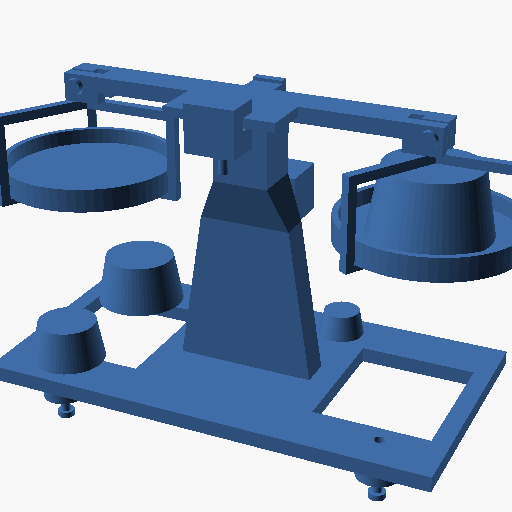

# 玩具托盘天平 · 第二版（新 skill + 工具编组）复跑评审

> 需求输入：`examples/toy-balance2/PROMPT.md`（与旧示例同一份，未改）
> 旧版：`examples/toy-balance/`（2026-10-19，18 个版本含历史 / 35 条接口）
> 本版：2026-10-20 由**干净上下文的子智能体**从零完成（未读旧示例、旧语料、docs、experiments、git）
> 语料位置：`examples/toy-balance2/cad-data/`（预览下拉里的 `examples/toy-balance2`）；仓库根的 `cad-data/` 与 `assembly/` 是指向它的软链接，会话的读写仍落在同一份。旧语料完整备份在 `.tmp-tb2/root-cad-data`。



---

## 1. 结论（三句话）

1. **流程纪律提升了**：25 条接口全过（但见 §4.2——25 条都没声明 tolerance，那不是证据）、STALE 判定逼出一次真实返工、claims 审计把"缺什么证据"点名；旧版没有这些机制（旧版 35/35 靠人工纪律）。
2. **交付证据倒退了**：新版 13 个打印件只有 5 个砝码拿到 printability verdict（8 件拿不到）；旧版 5 类打印件**全部**拿到 verdict（2 ok / 2 check / 1 excluded）。原因不在模型，在工具——`check_printability` 默认 `judge` 必挂、`preflight` 一调就崩（§4.3）。
3. **并且因此漏掉两处硬伤**：(a) 底座是一块 5 mm 厚的板，架在 3 个 Ø14 脚凸台上，板底 z=15 离热床 7 mm，朝下悬垂 **8264.8 mm²**（翻转/侧放都 ≥3314 mm²，必须加支撑）；这个数字被工具记进了 r018/r024/r030 的 run 摘要（评审复测又写了 r049–r051），却没有回到 agent 的决策里，BUILD 写的是"立在 3 个脚凸台上（接触面积 360 mm²，建议加 brim）"。(b) 调零滑块夹紧螺钉在 manifest 里没转 180°（装反），头埋进夹爪、螺纹朝下悬在夹爪下方，**25/25 的 coaxial 接口查不出来**（§4.1b）。**旧版底座悬垂 981.3 mm²、可平放打印。**

---

## 2. 需求对照

| 需求（PROMPT.md） | 本版回答 | 证据 | 判定 |
|---|---|---|---|
| 主体 FDM 打印 | 13 个打印件（含 5 砝码） | v001–v029 | ⚠ 底座需要支撑（§4.1） |
| 底座可调平 | 3 只 M3×16 脚钉，螺母坑 5.63 A/F，外露 2–15.5 mm | I11–I13/I21–I23，r044 | ✅ |
| 横梁可调零 | C 形滑块跨 36×17×3 滑轨，行程 ±10 mm | v021 + I9，r044 | ✅ |
| 外购件只用常见 M3 | 7 螺钉 + 5 螺母，仅 M3 | §BOM | ✅ |
| 5 个 1:2:4:8:16 砝码 | 严格相似锥台，体积比 16.000 : 8.000 : 4.000 : 2.000 : 1.000 | 我独立量的 STL（§3） | ✅ |
| 最大者占托盘面积一半 | 1143.272 / 2286.544 = **0.50000** | list_features v008 f64 / v007 f261 | ✅ |
| 桌面量级 | 177.5 × 80.0 × 115.0 mm，约 198 g | v030 + 我的质量核算 | ✅ |

---

## 3. 我的独立复测（不引用子智能体结论）

用 trimesh / manifold3d 直接读 STL，与工具链无关：

| # | 复测项 | 结果 |
|---|---|---|
| 1 | 5 砝码体积比 | 19527.08 : 9763.54 : 4881.77 : 2440.89 : 1220.44 = **16.000 : 8.000 : 4.000 : 2.000 : 1.000** |
| 2 | 最大砝码底面积 / 托盘内底面积 | 1143.272 / 2286.544 = **0.50000**（要求 0.5 ±2%） |
| 3 | 两盘等高 | panL / panR 装配后 z 均为 **74.0–81.5**，无高低差 |
| 4 | 25 件干涉 | 300 对布尔求交：**只有 2 处设计内自攻过盈** 13.521 / 37.639 mm³（Ø3 杆在 Ø2.5 预孔），其余 0；与 r045 的 "干涉 2" 一致 |
| 5 | 打印件质量 | 152 137.7 mm³ × 1.24 = **188.65 g**；加钢制 M3（≈1256 mm³ × 7.85）**≈ 198.5 g**（不是 190.1 g，见 §4.7.2） |
| 6 | **底座悬垂** | 8264.8 mm² @ z=15（`n.z < -sin45°` 且离床 >0.8 mm）；翻转 X/Y 后 8285.2 mm²，绕 X 转 90° 后 3314.3 mm²——**没有不加支撑的姿态** |
| 7 | 运动 | r102（r013 的 24 位姿重跑）：754 步 / 0.377 s，0→10.8°，**采样 24/24、0 关节漂移**；r101 是无转动副的诊断（见 BUILD §7） |
| 8 | 装配契约 | 我重跑 `check_assembly`（r054）：**25/25 通过，13 未声明邻接**——但 25 条全部无 tolerance，I3/I4 的 116 mm 轴偏移也报 pass（§4.2）。**2026-10-28 复跑 r104：25 条全部改判 skipped，不再假绿** |

> 旁注：两盘在 `whole-front.png` 里看着不等高，是渲染透视造成的；装配位姿的 z 完全相同（74.0–81.5），不是设计错误。

---

## 4. 明显错误（按严重度）

### 4.1 设计/装配：两处硬伤

**(a) 底座不可无支撑打印（严重）**

- 底板 150 × 80 × 5，z 15–20；下面只有 3 个 Ø14 脚凸台（z 8–15，接触面积 378.7 mm²）。
- 板底 z=15 是**整面朝下**，离热床 7 mm → 8264.8 mm² 悬垂；两个减重窗还把它切成更薄的框。
- 任何翻转/侧放姿态都不低于 3314 mm²；打印需要满板支撑，或把脚凸台拆成独立件，或把底板落到床上（那样三点调平就失效，需要另做方案）。
- 对比：旧版底座 981.3 mm²，且是 Ø16 沉孔桥接（≤16 mm，profile 的 `bridgeMaxMm=20` 内），可平放打印。

**(b) 调零滑块夹紧螺钉装反（轻，但证据链有意义）**

- 设计意图（BUILD §2）：M3×8 **从下往上**穿过下夹爪的 Ø2.5 自攻孔，尖端顶住滑轨底面夹紧。
- 实际装配：`sscrew` 在 manifest 里没有 180° 旋转，world z = **92–102**；滑块下夹爪在 **100–107**，滑轨底面在 108。结果：Ø5.5 螺钉头（z 100–102）**埋在夹爪里**，Ø3 螺纹（92–100）**悬在夹爪下方**，根本没碰到滑轨。
- 数字对得上：滑块↔螺钉的 37.639 mm³ 干涉 = Ø5.5 头 2 mm 减去 Ø2.5 孔 ≈ 37.7 mm³——它不是"自攻过盈"，是**头埋进夹爪**。
- 为什么 25/25 没发现：I18 是 `coaxial`，只比较两条轴线是否共线，不约束轴向位置；没有一条"螺钉头承面 ↔ 夹爪底面 distance=0"的接口。正确装配应是 `rot [180,0,0], translate [0,-19,100]`（头 98–100、杆 100–108）。
- 这条恰好证明：**接口条数不是证据**；`coaxial` 过了，不等于螺钉坐到了该坐的位置。

### 4.2 工具：`check_assembly` 的无 tolerance 假绿（严重，也是 25/25 的真相）

- 新清单 25 条接口**没有一条**声明 `tolerance`；旧规则 `in_range = tolerance ? ... : true` 把"没有判据"直接当"在范围内"→ **pass**。
- 直接证据：I3/I4 把 `beam.左叉孔`（x=−58）配到 `stirrupL.吊眼`（x=+58），测得 **116 mm 轴偏移**，r044/r054 的原文仍是 `verdict: pass`；2026-10-28 的 r104 已按“缺判据不是通过”改判 `skipped`。
- 所以 25/25 不是"25 条被验证"，而是"25 条没有被判据约束"。旧示例 35/35 的每条都带 tolerance（±0.25、±0.5…），两者不可比。
- 修复（已改）：无 tolerance → `skipped`，detail 写明 `add tolerance {min,max}; a missing criterion is NOT a pass`；`skipped` 也计入 `overallStatus`（→ `check`，不再是 `pass`）。修后本清单应为 **0 pass / 25 skipped**。
- 同一条病根：**把"缺失"当"通过"**。printability 的 `judge` 是"缺字段就崩"，这里是"缺判据就绿"——方向相反，性质相同。

### 4.3 工具：`check_printability` 三种模式三种挂法（全部可复现）

| 模式 | 报错 | 复现 |
|---|---|---|
| `judge`（默认） | `missing required property "value.attention"` | `check_printability(v001, mode=judge)` → 必挂；**默认模式对所有零件不可用** |
| `both` / `scan`（有悬垂区域） | `"value.attention.layers[1].regions[0].triangles" is not a declared property` | `check_printability(v021, mode=both)` |
| `both` / `scan`（部分件） | `value is not lossless JSON` | `check_printability(v001, mode=both)`；最可能是 `atMm` 里的 `-0.0`（与 c77494d 修过的 stress `-0` 同类，未能直接取证到内存值） |

- 净效果：v001/v003/v007/v021/v022/v029 都拿不到 verdict；只有无悬垂区域的 5 个砝码能在 `both` 模式下通过（r053 复现 v008 = ok）。
- 而且**失败的调用仍然写 run**：r049/r050/r051 是同一个 v001 的三次失败调用，摘要都写着"悬垂 8264.8mm²"——数字在语料里，但回不到调用者。

### 4.4 工具：`preflight` 一调用就崩

`preflight(claims=[...])` → `userExecute is not a function`。源码原因：`src/host/tools.ts:4708` 把回调写成 `async run(...)`，而 `defineTool` 只认 `options.execute`（`dsh-tools/lib/index.js:839`）。这是最新一次提交（0415448）引入的，整个"交付前必跑"入口完全不可用。

### 4.5 工具：文件级 `$fn` 被 `-D '$fn=64'` 覆盖

`compile.ts:376` 用 `openscad -D '$fn=64'`；`-D` 的优先级高于源文件顶部的 `$fn=6`。实测：`$fn=6; cylinder(d=6.35,h=2.4)` 输出 66 面（圆），螺母体积 56.71 mm³ 而不是六角的 43.7 mm³。子智能体是靠 10.18 mm³ 的邻接干涉才发现的，渲染完全看不出来。已用 v023（把 `$fn=6` 写到调用处）修正。

### 4.6 工具/文档：装配清单没有 schema 文档

- `check_assembly` 的工具描述和 `cad-assembly` skill 都没给节点/接口格式；空清单只回 `Cannot read properties of undefined (reading 'id')`（我已复现）。
- 子智能体花了 **16 次 run / 约 10 轮**反推 `schemaVersion:1`、`root.kind:"assembly"`、`root.interfaces`、端点 `"节点id.datum"`、`severity`、`params.distanceMm`。
- 修法：skill 里放一份 20 行最小清单 + 一句端点语法；校验器在 `root.kind` 错时直接说"必须是 assembly"。

### 4.7 工具/工作流：`merge_parts` 的研究件被审计当成可打印零件

v026（横梁组件）、v030（整机）是合并研究件，但 `delivery_audit` 的"每个 part 都要有 printability run"规则把它们算进去 → 2 条 blocked。这两条不是设计缺陷，是工具没有"研究件/可打印件"的区分。

### 4.8 子智能体的叙述错误（小）

1. **"`merge_parts` 被登记成 physics run"** —— 不成立。`merge_parts` 不写 run；r001–r004 的 `physics` 是早期 `simulate_physics` 尝试（摘要"稳态穿透 25 mm"）。这是把两件事混了。
2. **"整机 190.1 g"** —— 190.1 是 v030 合并体积 × PLA 密度，把 12 个钢制 M3 也按 PLA 算了；实际约 **198.5 g**。
3. **刀口角度前后不一致** —— §2/§5 用 `list_features` 的 12.9°（面法向）推 17.1° 余量，§3 参数表却写"刀口 30° 含角"；按 30° 含角算余量应是 15°，不是 17.1°。

---

## 5. 新 skill / 工具编组：能力到底有没有提升

### 5.1 帮到的

| 机制 | 实际作用 |
|---|---|
| 路由器 skill（先选组、再选工具） | 子智能体第一步就 `skill("cad-toolbox")`，随后按需加载另外 4 本；工具调用顺序基本符合"instrument → assembly → simulate → deliver" |
| `check_assembly` 未声明邻接 | 开发中抓出 5 个真缺陷（螺母圆柱化 10.18×3、指针键 5.29、滑块螺钉 21.17、吊架横臂 504、吊篮竖腿 45.90×2），最终版全部修掉（我复测 0 残留） |
| `simulate_motion` STALE | r005 引用的 v019 被 v026 取代后判 STALE；r013 后来因单采样被 r102 取代 |
| profile 的 `unevaluable/notApplicable` | 明确说 tolMm / surfaceRaUm 没有需求可比，阻止把 `not-excluded` 读成"能打" |
| `delivery_audit` claims | 点出 2 blocked / 2 warn，缺口可执行 |

### 5.2 没帮到 / 反而添乱的

- **`scan_attention` 一次未用**（会话统计 0 次）。路由器把它列为"该往哪看"的首选，但本轮的 5 个缺陷都是靠 `check_assembly` 的邻接体积发现的。旧版在 10-19 已经用过它（v077 顶尖 4 处凹口）。检测组在这轮是空的。
- **"工具编组"只到文档层，没有真正裁花名册**：profile 配了 `toolScope: preset`，但没有 `presetGroups`，52 个工具全部可见；本轮测到的是 skill 的路由表 + `preflight`，不是按组过滤的工具集。
- **`preflight` 是这轮新增的"一键交付"，但它崩了**，所以"门没人忘"的目标没有实现——恰恰是门坏了。
- **重试成本**：26 次 `check_printability`、28 次 `check_assembly`、16 次 schema 探针 run；`delivery_audit` 自己报了"10 组重复 run / 16 次无新信息"。

### 5.3 与旧示例的量化对比

| 维度 | 旧版（10-19，无新 skill/编组） | 新版（10-20，新 skill/编组） |
|---|---|---|
| 现行版本 / run | 18 / 13（示例快照；完整语料 36 / 74） | 30 / 54 |
| 打印件 / 外购件 | 11 / 10 | 13 / 12 |
| 整机包络 / 质量 | 176×100×156 mm / ≈447 g 打印 | 177.5×80×115 mm / ≈198.5 g |
| 装配契约 | 35/35（每条有 tolerance），硬冲突 0 | 25/25（**无一条有 tolerance**，属空绿），硬冲突 0 |
| 运动证据 | 14° 工作行程，0 干涉 0 漂移 | 10.8° 工作行程，0 干涉 0 漂移 |
| printability verdict | **5 类全部拿到**（2 ok / 2 check / 1 excluded） | **5 个 ok**（只有砝码；其余 8 件拿不到） |
| 底座悬垂 | 981.3 mm²（≤16 mm 桥接） | **8264.8 mm²（必须支撑）** |
| 交付审计 | 0 blocked | 2 blocked（合并研究件） |
| 发现的工具缺口 | 5 条（G1–G5，后来多数已修） | 4 类新 bug（printability 三模式、preflight、$fn、清单文档） |

**判断**：新编组让"过程"更可审计，但没有让"结果"更可信；在打印这一项上是明显退步。**根因是交付门的两个工具坏了，agent 只能用壁厚射线替代，而壁厚恰好测不出悬垂。**

---

## 6. 信息隔离是否成立

子智能体的 25 次 bash / 1 次 read 全部核对过：只读了 `PROMPT.md`（当时目录名还是 boy-balance2），只列过 skill/schema 目录，没有读 `examples/toy-balance/`、任何旧 `cad-data/`、`docs/`、`experiments/`、`HARNESS.md`，没有用 git。隔离成立。

一处副作用要说明：我禁止它浏览 `cad-data/`（防旧语料泄露），也把**本轮 run 报告**一起禁掉了——所以 r018 里那行"悬垂 8264.8mm²"它看不到。这是实验设计的一个混杂因素；工具坏了是主因，但"run 数字没有回到 agent"这一点被我的隔离规则放大了。

---

## 7. 文件与复现

| 文件 | 说明 |
|---|---|
| `PROMPT.md` | 需求（唯一输入） |
| `BUILD.md` | 子智能体的原报告（路径已改为 toy-balance2；§8 打印结论需按本文件 §4.1 修正） |
| `renders/whole-iso.png` / `whole-front.png` / `beam-unit-detail.png` | 整机与细节渲染 |
| `examples/toy-balance2/assembly/assembly.json` | 25 接口装配契约（根 `assembly/` 是软链接） |
| `examples/toy-balance2/cad-data/` | 30 个版本 / 54 run（r049–r054 为本评审的复测 run；根 `cad-data/` 是软链接） |

复现（工作目录 = 仓库根）：

```bash
check_assembly(manifestPath="assembly/assembly.json", adjacencyThresholdMm=0.75)  # → 25 skipped (缺 tolerance), 13 undeclared；r104
simulate_motion(...)     # r102 的 parts/joints 见 BUILD.md §7 → 10.8°, 24 位姿
check_printability(versionId="v008", mode="both", profileIds=["fdm-pla-0.4"])      # → ok（唯一能用的路径）
check_printability(versionId="v001", mode="judge", profileIds=["fdm-pla-0.4"])     # → 复现 missing attention
preflight(claims=[...])                                                            # → 复现 userExecute
```

> 旧语料备份：`.tmp-tb2/root-cad-data`（36 版本 / 74 run，未还原）。

---

## 8. 评审之后的修复（代码已改；运行中的会话需重启才生效）

这轮评审不只是给了结论，还改了五处"把缺失当通过 / 当崩溃"的地方：

| # | 位置 | 修改 | 验证 |
|---|---|---|---|
| 1 | `dsh-cad-harness/src/host/manifest.ts` + `schemas/assembly-manifest.schema.json` | 校验器改为返回 `path / expected / got / hint`；空清单不再 `Cannot read properties`；错误里带**最小可运行清单**、端点语法、`kind` 判别字段提示、schema 路径 | `node scripts/accept-manifest-errors.mjs` → ALL PASS |
| 2 | `src/host/tools.ts` preflight | `run` → `execute`，补 `project = await allStores(exec)`；声明 `profileIds` 时显式列入 `unevaluable`（这一版不套用声明档） | `tsc --noEmit` 通过；工具可执行性待重启验证 |
| 3 | `python/cad_worker/worker.py` + `src/host/assembly-check.ts` | **无 tolerance → `skipped`**（不再 `pass`），detail 写明补 `{min,max}`；`skipped` 也计入 `overallStatus` | `accept-check-assembly-parity.mjs` → OK；`accept-assembly.mjs` → ALL PASS |
| 4 | `src/host/tool-scope.ts` | 补上分组提交漏掉的 `CadToolGroup` 类型 | `tsc --noEmit` 通过 |
| 5 | `skills/cad-assembly/SKILL.md` | 加 20 行最小清单 + 四条易错点 + "读错误里的路径，不要猜形状" | — |
| 6 | `src/host/tools.ts` + `inspect.ts` | `check_printability` 三种 mode 的字段不再静态 `required`（judge/scan/both 都能过 schema）；attention 的 regions 放开附加证据字段；`-0` 在源头归一 | `accept-printability-parity.mjs` all checks passed |
| 7 | `src/host/tools.ts` | `simulate_stress` 的 `verdict`/`delivery`/`attention` 同样去 `required`（默认 judge 之前也是坏的） | `tsc --noEmit` 通过 |
| 8 | `src/host/tools.ts` | `analyze`：未知版本带可用 id；角扫描失败写 `notMapped`；`sourceVersionIds`/`subject` 移到 `run.commit` | `accept-analyze.mjs` OK |
| 9 | `src/host/tools.ts` | `versionNotFound()` 统一 8 个"未知版本"报错（说明 vNNN 是版本号，pNNN/rNNN 不是）；mode/bodyType 加 enum | `tsc --noEmit` 通过 |
| 10 | `skills/cad-toolbox/SKILL.md` | "报错怎么读"四条：invalid arguments / unknown version / returned invalid output / 清单 path | — |

`lib/` 已用 `node esbuild.mjs` 重新构建，但**正在运行的 DSH web 进程仍持有旧模块**（`patchReload: startup`）。要看到上面这些行为，需要重启**进程**（只开新会话不够——工具注册在进程里）；重启后本清单的 25 条应从 `25 pass` 变成 `0 pass / 25 skipped`（因为一条 tolerance 都没有）。

> 这也是一条可直接写进 DESIGN 的结论：**"缺字段 → 崩"和"缺判据 → 绿"是同一种病的两面**。工具对自己知道的契约必须自描述；对不知道的判据必须拒绝给绿。
