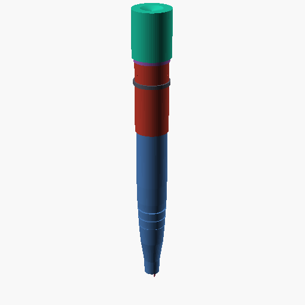

# 双色按压圆珠笔（Two-color click ballpoint pen）

> 需求：[PROMPT.md](PROMPT.md)
> 项目：`examples/two-color-click-pen`（DSH 面板里选择这个目录）
> 装配契约：[assembly/assembly.json](assembly/assembly.json)
> 凸轮定时证据：[evidence/cam_timing.json](evidence/cam_timing.json)（脚本 [evidence/cam_timing.py](evidence/cam_timing.py)）
> 整机渲染：[renders/whole-iso.png](renders/whole-iso.png)、[renders/whole-front.png](renders/whole-front.png)、[renders/state1-iso.png](renders/state1-iso.png)



## 0. 一句话结论

一支 **148 mm 长、最大 Ø19.9 mm** 的双色按压圆珠笔：按一次黑色笔芯伸出 4 mm；再按一次黑色缩回、红色伸出 4 mm；第三次两根都缩回，循环回黑。

**机构已经画到可装配、可复跑的程度：**
- 状态 0 / 1 / 2 的装配均为 **0 干涉、0 过紧**（`validate_assembly` r047 / r048 / r049，阈值 0 mm，功能接触按 0 计）；
- 转子在轴承内 120° 分度：**r050 运动学 24/24 位姿、0 干涉、0 关节漂移**；
- 凸轮定时从交付 STL 反算：三个状态的笔尖位置与设计一致，黑/红滑架与对方轨道的**最小间隙 0.5 mm**，无碰撞（`cam_timing.json`）。

**但这不是“可以开模/可以交付”的结论：**
1. 交付审计仍被 **r053（转子 0.36 mm）** 和 **r052（按钮 0.289 mm）** 的 minWall 阻断：这两处都是**锐边切向读数**，不是壁厚——顶环本体 0.4、按钮裙边 0.4、转子两条环 1.6 都已加厚；顶环 0.40 正好在阈值边（注塑 profile 判 not-excluded，FDM 屏幕判 excluded）。下一步是给按钮爪底和黑轨道顶边倒 0.2–0.4 mm 圆角，让屏幕不再把锐边当薄壁。
2. 按钮—棘爪的弹性接触、球柱塞保持力、板簧刚度**没有实测**；r050 只证明转子在轴承里的回转，不证明“按一次一定走 120°”。
3. 两支笔芯并列，各自穿过前笔杆端部一个 Ø2.4 孔（中心距 3.2 mm），书写点距笔轴线 **1.6 mm**；单孔笔尖需要可弯曲导尖或旋转笔尖，本版没有做。
4. 没有书写、墨水、跌落、寿命测试；也没有注塑模具（只做零件几何与装配）。

---

## 1. 需求 → 设计

| 需求（[PROMPT.md](PROMPT.md)） | 本设计回答 | 证据 |
|---|---|---|
| 一次按压弹出黑色 | 状态 0：黑笔芯 rear 96、tip −4（伸出 4 mm） | `cam_timing.json` state0；r047 |
| 再按一次黑收回、红弹出 | 状态 1：黑 rear 104/tip +4，红 rear 96/tip −4 | state1；r048 |
| 第三次两根都收回 | 状态 2：黑 rear 104/tip +4，红 rear 108/tip +8 | state2；r049 |
| 可以使用弹簧 | 1 只按钮压簧（外购）+ 1 片 PP 回位板簧（打印/注塑） | BOM §3 |
| 其他塑料（注塑） | 前/后笔杆、转子、保持环、顶环、按钮、笔夹、两根滑架、板簧，共 10 件 | §3；§5 |
| 笔芯/弹簧可外购 | 2 支 Ø2.4×100 细笔芯、1 只按钮压簧、1 只 M3 弹簧柱塞 | §3 |

### 1.1 三个状态的数值

| 状态 | 转子角 | 黑 rear / tip | 红 rear / tip | 可见 |
|---|---:|---:|---:|---|
| 0（第 1 次按后） | 0° / 360° | 96 / **−4（出 4）** | 108 / +8 | 黑 |
| 1（第 2 次按后） | 120° | 104 / +4 | 96 / **−4（出 4）** | 红 |
| 2（第 3 次按后） | 240° | 104 / +4 | 108 / +8 | 都缩回 |
| 3（第 4 次按后） | 360° | 96 / −4 | 108 / +8 | 黑（回到状态 0） |

> 表中 rear/tip 都是世界 z（笔尖在 z=0，向后为正）。数值来自 `evidence/cam_timing.json`，不是手填。

---

## 2. 机构原理（为什么三次是这样）

### 2.1 按压分度

- 按钮（v066）下端有 **3 个驱动爪**（100°/220°/340°），行程 **4 mm**。
- 转子（v085）上端是 **3 齿棘轮**（122–127 mm，3×120°）。按下时爪压在齿的斜面上，把转子推 120°；松开时按钮压簧把按钮顶回，爪从齿的台阶上滑过。
- 后笔杆 +Y 侧有一只 **外购 M3 弹簧球柱塞**（v073），球头压进转子外圆的 3 个定位凹坑（90°/210°/330°），所以三个分度位置有保持力。
- 按钮压簧（v072）自由长 30 mm，安装长 28 mm，k≈0.5 N/mm；安装力约 1 N，按到底约 2 N（**假设值**，未实测）。

### 2.2 双凸轮轨道（本设计的关键）

转子下面不是一条凸轮，而是**两条不同半径、不同高度的轨道**：

| 轨道 | 半径 | z 范围 | 从动件 |
|---|---:|---:|---|
| 黑（外） | 6.3 mm（5.5–7.1） | 96–104 mm，低肋顶 104.5 | 黑滑架的外臂，pad 顶 = 黑笔芯 rear |
| 红（内） | 3.6 mm（2.8–4.4） | 104.5–116.5 mm | 红滑架的 8.5 mm 立柱，柱顶 = 红笔芯 rear + 8.5 |

两条轨道都是 120° 谷 + 240° 平台，但**谷的相位差 60°**：
- 状态 0：黑在谷（rear 96），红在平台（rear 108）；
- 状态 1：黑在平台（104），红在谷（96）；
- 状态 2：两条都在平台（104 / 108）。

**为什么这样分层：** 如果两条轨道同半径，红滑架的臂必须跨过黑轨道，过渡时臂会切进黑凸轮（早期版本确实出现了 −2.8 mm 的碰撞）。把黑轨道放到外半径、红轨道放到内半径并把红从动件抬高 8.5 mm 后：
- 红臂只到 r=5.0，够不到外轨道内缘 r=5.5；
- 黑臂在 r=3.6 处从红轨道**下方**通过，最小间隙 **0.5 mm**（`cam_timing.json` 的 `minBlackArmUnderRedTrackClearanceMm`）。

### 2.3 回位

- 两根笔芯的滑架由前笔杆腹板下方的一片 **0.8 mm PP 板簧**（v070）顶住；板簧两根推杆分别顶在黑滑架（+4.8）和红滑架（−5.0）的臂下表面。
- 凸轮向下压，板簧向上顶；笔芯缩回/伸出的位置由凸轮型面决定。
- 板簧的 k 没有实测；按 0.8×13×4 的悬臂估算，8 mm 行程约 3–4 N（**估算，不是实测**）。

### 2.4 笔尖

- 两支笔芯在 x=±1.6 mm 并列，各自穿过前笔杆端部的 Ø2.4 孔；孔中心距 3.2 mm。
- 黑 tip 在状态 0 为 −4 mm，红 tip 在状态 1 为 −4 mm；另一支缩回 4/8 mm，不会与伸出的那支相撞（两孔分离）。
- **代价**：书写点距笔轴线 1.6 mm，不是单孔笔尖。要做单孔，需要在前端加可弯曲导尖或旋转笔尖。

---

## 3. BOM

### 3.1 塑料件（10 件，PP 注塑/打印）

| 零件 | 版本 | 数量 | 体积 mm³ | 说明 |
|---|---|---:|---:|---|
| 前笔杆 | v061（源 v048） | 1 | 4 436.7 | 双孔笔尖、握持槽、导向隔板、弹簧座、后插接环 |
| 后笔杆 | v062（源 v050） | 1 | 1 886.9 | 直筒、柱塞座、顶环卡扣槽、转子保持环卡孔 |
| 旋转凸轮 | v085（源 v081） | 1 | 1 433.5 | 黑/红双轨道、3 齿棘轮、中央弹簧孔 |
| 转子保持环 | v064（源 v051） | 1 | 29.8 | 7.25–7.70 环 + 3 卡扣 |
| 顶环 | v083（源 v079） | 1 | 192.9 | 卡扣、外法兰、按钮上挡 |
| 按钮 | v084（源 v082） | 1 | 3 462.7 | 外帽、裙边、内钩、3 驱动爪 |
| 笔夹 | v071（源 v059） | 1 | 101.4 | C 形抱箍 110–112、立片到 120 |
| 黑色滑架 | v068（源 v046） | 1 | 41.4 | 半壳抱箍 + 外臂到 r=6.3 |
| 红色滑架 | v069（源 v047） | 1 | 48.4 | 半壳抱箍 + 内立柱 8.5 + 推点 |
| 回位板簧 | v070（源 v057） | 1 | 79.3 | 0.8 mm 叶片 + 两根推杆 |
| **合计** | | **10** | **≈ 11 713** | |

> 体积是 `validate_assembly`/`measure_part` 的网格值；v061–v085 是加 datum 的副本，几何与源版本逐字节一致。

### 3.2 外购件（4 件）

| 规格 | 用途 | 数量 | 模型 |
|---|---|---:|---|
| Ø2.4×100 细笔芯（黑/红各 1，0.7 mm 球） | 书写 | 2 | v067（role=stock） |
| 压缩弹簧 自由长 30、OD 5.4、线径 0.6、k≈0.5 N/mm | 按钮回位 | 1 | v072（role=stock） |
| M3 弹簧球柱塞，球 Ø1.5，轻载 | 转子定位 | 1 | v073（role=stock） |

> 另有两支 **已不使用的** 旧版笔芯回位压簧（v028/v033），保留为历史版本并标为 stock；当前设计用板簧 v070 代替。

---

## 4. 装配与运动证据

### 4.1 静态三状态（`validate_assembly`）

- **r047**（状态 0）：14 件、91 对、**0 干涉、0 过紧**（阈值 0 mm；12 个功能接触按 0 计）。
- **r048**（状态 1，转子 120°）：13 件、78 对、0 干涉、0 过紧。
- **r049**（状态 2，转子 240°）：13 件、78 对、0 干涉、0 过紧。
- 状态 1/2 不含板簧（板簧是柔性件，静态姿态会变）；板簧只在状态 0 的 r047 里。

### 4.2 转子分度运动（`simulate_motion`）

- **r050**：后笔杆 + 转子 + 顶环 + 笔夹，转子 120° 分度，**24/24 位姿、0 干涉、0 关节漂移**。
- 这证明转子在 7.7 mm 轴承孔里能转 120°，**不证明**按钮/棘爪的力与相位；按钮—棘爪的弹性接触仍需样机。

### 4.3 凸轮定时（`evidence/cam_timing.py` → `cam_timing.json`）

从交付的 rotor v085 STL 竖直投射射线，取最低命中面作为凸轮表面，181 个角度：

| 检查 | 结果 |
|---|---|
| 状态 0/1/2 黑 tip | −4 / +4 / +4 mm |
| 状态 0/1/2 红 tip | +8 / −4 / +8 mm |
| 黑/红滑架与对方轨道最小间隙 | **0.5 mm** |
| 是否有碰撞 | **否** |
| 凸轮型面与解析式最大偏差 | **0.400 mm**（2° 扇区分段造成的台阶；三个状态都在平台上，偏差 0） |

> 0.4 mm 是“射线打在扇区侧面”的采样台阶，不是凸轮功能误差；如果要更平滑，把 2° 分段改成 1°（本版没做）。

### 4.4 装配契约（`check_assembly`）

- 17 个接口：**16 pass + 1 intent**（按钮压簧：安装 28 mm / 自由 30 mm → δ2 mm × 0.5 = 1 N，在 2.5 N 预算内）。
- 0 hard violation；**15 个 undeclared** 是功能接触/间隙（凸轮 pad、板簧推杆、卡扣、棘爪间隙），没有全部写成接口。
- `judgement = difficult`（intent + undeclared），不是 `not-excluded`。

---

## 5. 可制造性筛查（PP 注塑 profile）

声明 profile `injection-pp`：`wallMin=0.4`、`featureMin=0.4`、`gapMin=0.1`、`draftMin=1°`（网格工具不测拔模，报 unevaluable）；`overhang` 对注塑不适用。

| 零件 | 版本 | 结果 | 最薄 / 位置 | 备注 |
|---|---|---:|---|---|
| 前笔杆 | v061 | not-excluded | 0.412 @ 握持槽 z=40.7 | 245 mm² 悬垂是 FDM 屏幕的伪影 |
| 后笔杆 | v062 | not-excluded | 0.499 @ 卡扣槽 | 拔模 1.27° 余量 0.27°，difficult |
| 转子 | v085 | **excluded** | **0.36** @ 黑轨道顶边（环已 1.6） | thinArea 4.37%；r053 |
| 保持环 | v064 | not-excluded | 0.449 | — |
| 顶环 | v083 | difficult | 0.40 @ 卡扣/本体（阈值边） | thinArea 79.4%；r051；注塑 profile 判 not-excluded |
| 按钮 | v084 | **excluded** | **0.289** @ 爪底边（裙边已 0.40） | thinArea 30.9%；r052 |
| 笔夹 | v071 | not-excluded | 0.689 | — |
| 黑滑架 | v068 | not-excluded | 0.519 | — |
| 红滑架 | v069 | not-excluded | 0.519 | — |
| 板簧 | v070 | not-excluded | 0.600 | 0.8 mm 叶片 |

**结论：** 10 件里 **7 件 not-excluded/difficult**；顶环 0.40 正好在阈值边（注塑 profile 判 not-excluded，FDM 屏幕判 excluded）；按钮 0.289、转子 0.36 是锐边读数，仍 `excluded`。交付审计 `delivery_audit` 仍被 **r053（转子）** 阻断。

**关于那个可见的环：** 你说得对，黑/红凸轮环原来 0.8 mm 纯属“先保机构”的取舍，不是功能需要。现在两条环都加到 **1.6 mm**（黑 5.5–7.1、红 2.8–4.4），从动半径和型面高度不变；转子的 `thinAreaPct` 从 **48.38% 降到 4.37%**。现在 minWall 0.36 在**黑轨道顶边**（切向读数），0.289 在**按钮爪底边**；两者都不是 0.8/0.15 那种真薄壳。下一步是给这两条锐边倒圆，而不是继续加厚环。 `measure_thickness` 在这两个屏幕坐标上射线完全不穿材料（警告 “ray runs close to tangent”），说明屏幕取的是锐边，不是壁；实际凸轮环 1.6、按钮爪 1.2、平台肋 0.5。

### 5.1 下一版必须先改的三处

1. **顶环 0.40 → 0.50 mm（可选）**：0.40 正好在 FDM 屏幕阈值上；加 0.1 会让 thinArea 明显下降，外径从 18.9 增到 19.1。
2. **按钮爪底 0.289 / 黑轨道顶边 0.36**：给这两条锐边加 0.2–0.4 mm 圆角/倒角；不要再加厚凸轮环（1.6 已经够），倒圆后重跑 r047–r050。
3. **前笔杆握持槽 0.41 mm**：把槽底半径从 6.8 改到 7.0（槽深 0.5），或取消最上面一道槽。

---

## 6. 限制与未验证项

- **没有样机**：按钮—棘爪的弹性、球柱塞保持力、板簧 k、摩擦、回弹都没有实测；r050 只覆盖转子轴承。
- **没有连续三次按压的运动仿真**：三状态是静力学 0 干涉；按钮在行程中的接触（尤其是下止点与顶环上端面）没有作为 green motion 证据。
- **单孔笔尖未实现**：1.6 mm 偏心书写点；单孔需要导尖/旋转笔尖。
- **注塑模具未做**：没有浇口、顶出、冷却、分型面；拔模只声明 1°，工具不测。
- **没有书写/墨水/寿命/跌落测试**。
- **0.4 mm 凸轮采样台阶**：三个状态在平台上，不受影响；过渡段有 0.4 mm 的采样偏差。

---

## 7. 文件与复跑

```
examples/two-color-click-pen/
├─ README.md                 本文件
├─ PROMPT.md                 用户需求
├─ scad/                     13 个 part 的 OpenSCAD 源（与版本几何一致）
├─ assembly/assembly.json    14 节点 / 17 接口装配契约
├─ evidence/
│  ├─ cam_timing.py          凸轮定时/间隙脚本（run_python 运行）
│  └─ cam_timing.json        181 个角度的结果
├─ renders/
│  ├─ whole-iso.png          状态 0 整机
│  ├─ whole-front.png
│  ├─ whole-side.png
│  ├─ state1-iso.png         状态 1（红出）
│  └─ state2-iso.png         状态 2（全缩）
└─ cad-data/                 DSH 语料（gitignored）：versions / runs / datums
```

复跑（面板中选择 `examples/two-color-click-pen`，或在本目录用 CAD 工具）：

```text
check_assembly({manifestPath:"assembly/assembly.json"})
validate_assembly({parts:[...14 件...], clearanceThreshold:0})
simulate_motion({parts:[rear,rotor,cap,clip], ...})   # r050
run_python({script:"evidence/cam_timing.py"})
check_printability({versionId:"v085", profilesJson:[...injection-pp...]})
delivery_audit({manifestPath:"assembly/assembly.json", claims:[...]})
```

> 所有 run 号（r050/r047/r048/r049/r053/r018/r019…）都在 `cad-data/runs/` 里；`cad-data/` 被 `.gitignore` 排除，克隆仓库只得到文档、SCAD、装配与渲染。

---

## 8. 版本说明

- v001–v060 是建模迭代（早期 4.8/6.8 同层轨道、线圈簧、交叉臂碰撞等），保留在 `cad-data/versions/`。
- **v061–v085 是最终几何的 datum 副本**：`set_datums` 复制网格、不改几何；装配契约指向这些版本。
- 早期 `validate_assembly` r001–r006 是旧几何/旧轨道，已被 r047–r049 取代；`delivery_audit` 的 `stale-evidence` 警告指的就是这些历史 run，不是当前装配。
- v077 是棘轮外缘 0.5mm 倒角实验，OpenSCAD 布尔把网格裂成 64 体；v078 恢复 v076 几何；随后 v079–v085 继续加厚顶环/按钮/棘轮底环，装配最终引用 v085。
- v086 把平台肋抬到 104.8 后不水密；v087 降到 104.6 水密，但 0.36 仍落在齿边；v088 恢复 v085（1 体、1433.5 mm³）。装配仍引用 v085，二者几何一致。
