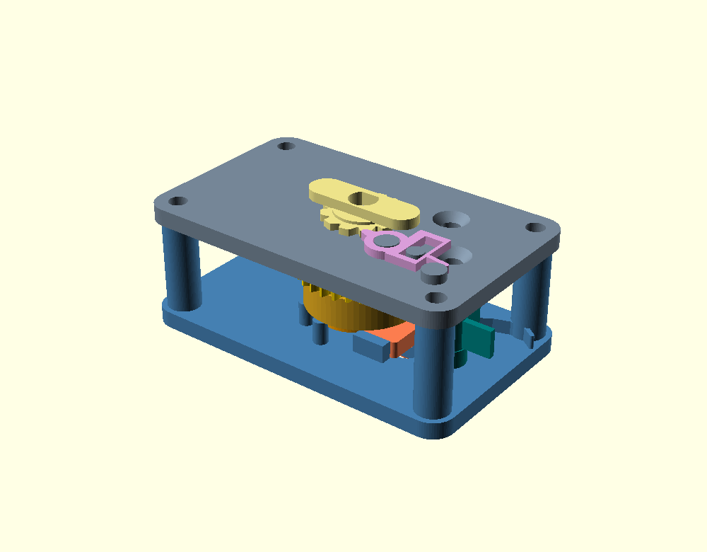
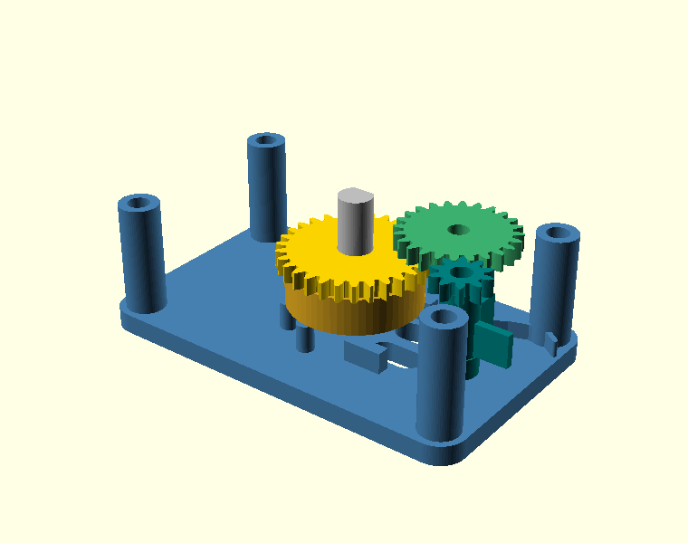
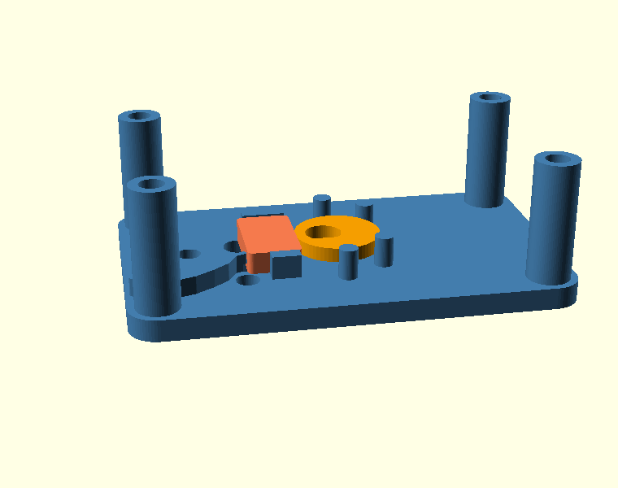

# 发条青蛙 · 机芯（Wind-up Frog Movement）

> 需求输入：[PROMPT.md](PROMPT.md)
> 装配契约：[assembly/assembly.json](assembly/assembly.json)（检查报告 r062）
> 数值证据：[evidence/gear_mesh.json](evidence/gear_mesh.json)、[evidence/cam_slider.json](evidence/cam_slider.json)、[evidence/envelope.json](evidence/envelope.json)
> 本文所有尺寸、间隙、行程都带版本号（`vNNN`）、run 号或 `evidence/` 脚本输出；拿不到的写"未测，因为…"。



## 0. 使用的模型与工具链

| 环节 | 使用的模型 / 工具 |
|---|---|
| 需求理解、结构方案、OpenSCAD 参数化建模、检查编排、本文撰写 | **DeepSeek-V4.1-Flash**（`deepseek-v4.1-flash`），运行在 **DeepSeek Harness** 的 CAD 工具链上 |
| 几何编译/登记 | `generate_part` → **OpenSCAD 2026.09.23**（Manifold 后端）+ **BOSL2**（渐开线齿轮） |
| 数值证据 | 本机固定版本 Python 3.13（trimesh / manifold3d / numpy），脚本见 `evidence/` |
| 渲染 | 同一批交付 STL 用 OpenSCAD 渲出，**没有使用任何图像生成模型** |

> 版本登记说明（2026-11-01 更新）：仓库根现在是 **workspace 容器**（`cad-workspace.json`），
> 不再是 CAD 项目，也没有活跃 `cad-data/`。本目录是 frog 的**唯一**语料
> （44 个版本 / 59 个 run / 14 个零件，含 project.json）；面板的「项目」下拉里选
> **examples/windup-frog · 14零件/44版**。根里的 frog 副本已删除，7 个校准/简易版本已迁到
> `docs/archive/cad-calibration-2026-11-01/`。
>
> **新规则（2026-11-01）**：新示例应先在目标目录 `init_project`，再开新会话；未标记子目录的
> 首次 CAD 写会被 fail-closed 拒绝，不会再“先写根、再复制/搬家”。本目录还保存提示词、源码、
> 装配契约、证据与渲染，便于独立阅读与复跑。

## 1. 一句话结论

一台 **60 × 36 × 24.2 mm**（含上弦钥匙到 26.0 mm；含向下的输出销到 28.0 mm）的发条青蛙机芯：
外购发条装进 φ20 发条盒，经 **30T→10T、24T→10T 两级增速（总比 7.2:1）** 驱动风轮；
发条盒轴上的 **R6 / e2 偏心凸轮** 推动直线滑块，两只 φ4 输出销行程 **4.000 mm**，从底板长孔伸到下方接后腿；
12 件装配 **0 干涉**（r051），装配契约 **14/14 通过**（r062）；凸轮—滑块在 **2 个周期、98 次位姿检查中 0 干涉**（r060）。

**但这不是"能直接装进壳里"的结论：**
1. 逐件打印性用 `fdm-pla-0.4` 判，**7/11 件 `excluded`、1 件 `difficult`（悬垂）、3 件 `not-excluded`**，见证是齿轮齿顶（0.72 mm 齿顶平台）、
   0.8 mm 回位簧片、0.6 mm 卡簧唇边、1.2 mm 薄板、D 面尖角这类**功能薄特征**，不是结构壁（§5.1 逐条回答）。
2. 打印方向（盒盖/齿轮B/钥匙翻面）**在示例的 run 里没有声明**：旧版 `check_parts` 没有把
   `printOrientationDeg` 传下去（`[0,0,90]` 与不旋转相同是假阴性——z 轴旋转本来就不改变悬垂）；
   2026-10-31 已接线并写入 report。r052–r059 仍是接线前跑的，所以翻面要在切片时人工确认——
   这是证据缺口，不是工具缺口。
3. 发条扭矩、跳高、跳频、运行时间**未测**：没有发条参数、没有空气阻力/摩擦模型（§6）。

## 2. 需求 → 设计

| 需求（PROMPT.md） | 本机回答 | 证据 |
|---|---|---|
| 巴掌大青蛙、机芯 ≤ 60×36×26 | 本体 **60×36×24.2**；钥匙顶 26.0；输出销向下到 −2（进腿） | `evidence/envelope.json`；v050 合并体 |
| 只画内部机械结构 | 机芯 + 上弦钥匙 + 后腿输出销；不画壳/腿/脚 | 本目录 |
| 外购发条、可更换 | φ20 盒，内腔 φ17，卡簧盖，发条外端卡槽；参考几何 v026 | §4；v043/v044/v026 |
| 单向上弦、不回弹 | 12 齿棘轮（与钥匙一体）+ 棘爪（转轴 + 导向长孔止挡 + 0.8 mm 簧片） | §3；v040/v047；锁止力矩未测 |
| 两级增速 + 风轮 | 30/10 × 24/10 = **7.2:1**，10T 用 BOSL2 自动变位，实际中心距 14.2719 / 12.1692 | `evidence/gear_mesh.json` |
| 凸轮—滑块—输出销 ≥4 mm | R6、e2，理论/实测行程 **4.000 mm**；销 x 11.5→15.5，y ±3.2 | `evidence/cam_slider.json` |
| 回位簧 | 底板整体悬臂簧（0.8 × 2.6 × ≈20），估算 0.50 N @ 4 mm，弯曲应力 36 MPa | 同上（估算，非实测） |
| M3 轴、不用轴承/胶 | A 轴打印轴（φ5），B/C 用 M3 沉头螺钉，孔为打印滑动轴承 | §4 |
| 每件打印性 | 11 件各跑 `fdm-pla-0.4`，8 件 excluded（1 件 difficult），逐条回答 | §5.1 |
| 运动/干涉时间线 | 凸轮—滑块 2 周期 0 干涉，行程 4.000，关节漂移 0 | r060 |
| 装配契约 | 14 个接口全部 pass；9 个未声明近邻均为功能接触 | r062 |

## 3. 机构原理

**储能与调速链**：外购发条（内端挂 φ5 上弦轴、外端挂盒壁卡槽）→ 发条盒（v043）
→ 盒盖上的 30T 齿轮（v044）→ 10T 小齿轮（v045 的复合齿轮 B 下层）
→ 同轴 24T 大齿轮（v045 上层）→ 风轮轴上的 10T（v046）→ 风轮两片竖叶片。

- 总增速 **30/10 × 24/10 = 7.2**：盒转 1 圈，风轮转 7.2 圈。
- 风轮只是"防飞车"阻尼，**不是走时机构**：没有擒纵、没有空气阻力模型（§6）。
- 为什么小齿轮用了 10T 而不是按 14.0/11.9 的名义中心距：BOSL2 对 10T 自动变位
  （profile shift 0.415），实际中心距 14.2719 / 12.1692。按名义 14.0/11.9 装会**卡死**。

**输出链**：发条盒轴上的凸轮（v049，R6、e2）→ 滑块（v033）的平端面 → 两只 φ4 销。
滑块行程 `s(φ)=e(1−cosφ)`，0…4 mm；销从 x=11.5 到 15.5，y=±3.2，穿底板长孔
（长孔两端圆心就是销的极限位置，各留 0.2）到机芯下方，作为后腿连杆接口。
回位靠底板上的整体悬臂簧（尖端 x=15.8，贴住滑块端面）。

**上弦与锁止**：钥匙（v040）坐在顶板上，与 12 齿棘轮一体，D 孔压配在轴上；
棘爪（v047）绕 P 转，长孔套在 Ø3 导向柱上——负载侧留 0.2 作止挡，上弦侧留 3 mm 让齿通过；
0.8 mm 簧片把爪尖压在棘轮齿顶上。**棘轮齿向与锁止力矩未做动力学验证**（§6）。

## 4. 零件与 BOM

### 4.1 打印件（PLA，1.24 g/cm³【假设】）

| 零件 | 版本 | 体积 mm³ | 说明 |
|---|---|---:|---|
| 机架底板 | v032 | 7 509 | 60×36×3 板 + 4 立柱 + 滑块导轨 + 回位簧 + 4 个发条盒支承柱 |
| 机架顶板 | v034 | 6 241 | 3 mm 板 + A/B/C 轴孔（B/C 沉头）+ 棘爪转轴/导向柱/簧柱 |
| 发条盒 | v043 | 717 | φ20 杯，内腔 φ17，盒底 1.2，卡簧槽，外端卡槽 |
| 发条盒盖 | v044 | 1 158 | 30T 齿轮（m=0.7）+ φ16.6 定位凸台 + φ17.4 卡簧唇边 |
| 上弦轴 | v048 | 394 | φ5×20.6，两处真 D 面（切满整轴宽），发条内端卡槽 |
| 偏心凸轮 | v049 | 189 | R6、e2、2 mm 厚（z 3.6–5.6），真 D 孔 |
| 凸轮滑块 | v033 | 408 | 7.4×12.8×3 板 + 两只 φ4×5.2 输出销（一体，向下伸到 −2） |
| 复合齿轮B | v045 | 649 | 10T（12.9–15.5）+ 24T（16.0–18.6），齿相位 14°，轴孔 3.12 |
| 风轮 | v046 | 374 | 10T + 两片竖叶片（z 7–12），轴孔 3.12，轮毂壁 1.24 |
| 上弦钥匙 | v040 | 351 | 12 齿棘轮 + 21×6 双翼，真 D 孔 Ø5.04 |
| 棘爪 | v047 | 77 | 转轴 + 导向长孔止挡 + 0.8 mm 簧片，板厚 1.4 |
| **打印件合计** | | **18 066** | **≈ 22.4 g** |

外购件：发条 **v026**（参考几何，role=stock，不打印）、M3×25 螺钉 6 只（4 柱 + B/C 两轴，B/C 用沉头）、M3 螺母 6 只。
（螺钉未建模；轴孔 φ3.3，按实物修配。）

### 4.2 运动件与固定件

- 固定在底板：A 轴（上弦轴）、B/C 轴螺钉、棘爪柱在顶板。
- 转动：发条盒+盒盖、复合齿轮 B、风轮、凸轮+上弦轴+钥匙（同一轴）。
- 直线：滑块（导轨 + 回位簧）。
- 摆动：棘爪（只在装配/上弦时动，运动仿真未纳入）。

## 5. 证据

### 5.1 打印性（`fdm-pla-0.4`，run r052–r059；旧版 r033–r043、r046 已被取代）

| 零件 | 版本 | 判定 | 最小壁 / 位置 | 这个数是什么 |
|---|---|---:|---|---|
| 底板 | v032 | difficult / excluded | **0.799** @ 回位簧 | 0.8 mm 悬臂簧，故意做薄；梁估算 36 MPa @4 mm |
| 顶板 | v034 | **not-excluded** | 2.347 | 实心板 + 柱 |
| 发条盒 | v043 | excluded | **0.60** @ 卡簧槽上唇 | 卡簧唇（功能薄环）；盒壁 1.5、盒底已改 1.2 |
| 盒盖 | v044 | excluded | **0.71** @ 30T 齿顶 | 齿顶平台宽 0.71（m=0.7 的正常值），非壁 |
| 上弦轴 | v048 | **not-excluded** | 1.358 | 真 D 面之后的最薄处 |
| 凸轮 | v049 | **not-excluded** | 1.478 | 真 D 孔修掉矩形槽与尖角后，从 excluded 变干净 |
| 滑块 | v033 | difficult / not-excluded | 3.0 / 悬垂 69 mm² | 悬垂是建模姿态下向下的销；打印时翻面 |
| 齿轮B | v045 | excluded | **0.718** @ 24T 齿顶 | 齿顶平台；悬垂 181.6 是 24T 齿轮下表面，翻面打印 |
| 风轮 | v046 | excluded | **0.80** @ 轮毂台阶 | 轴孔收紧后轮毂壁 1.24、薄区从 62.5% 降到 21.0% |
| 钥匙 | v040 | excluded | **0.489** @ 翼/轮毂交界 | 原 0.028 的 D 面尖角随真 D 孔消失；薄区 19.7% |
| 棘爪 | v047 | difficult / excluded | **0.60** @ 簧片根部 | 板厚 1.4；薄区从 67.8% 降到 17.4% |

**判断**：这 7 个 `excluded` 全部来自"薄特征"或"建模姿态的悬垂"，而不是承重框架：
齿顶平台、簧片、卡簧唇、1.2→1.4 mm 板、翼/毂交界。这个屏幕是**检测**（往哪看），不是判定；
要判"能不能打印"还需要打印方向与切片参数——而这一步工具没给出（见 §1 第 2 条）。
底板/回位簧 0.8 mm 是刻意的柔度设计；把簧做厚到 1.2 会把 4 mm 行程的弯曲应力推到 ≈60 MPa。

**结构壁独立抽检**（`measure_thickness` 单条射线，绕开采样屏幕，2026-10-31）：

| 位置 | 实测 | 判断 |
|---|---:|---|
| 底板板厚 | **2.9**（z 0.1→3） | 够 |
| 发条盒侧壁 | **1.5**（r 12.5→14 @ z10） | 够 |
| 发条盒盒底 | **1.2**（z 7.2→8.4，v043） | 已从 1.0 加厚 |
| 棘爪平板 | **1.4**（z 22.7→24.1，v047） | 已从 1.2 加厚 |
| 风轮轮毂 | **1.24**（Ø5.6 − Ø3.12，v046） | 已从 1.175 加厚 |

结论：**结构件现在都 ≥1.2**；剩下的薄特征（齿顶 0.7、簧片 0.8、卡簧唇 0.6、
翼/毂交界的 0.49 采样值）是功能性的，不改。采样屏幕每件约 600–800 个面，
采样点之间的薄特征仍可能漏，所以关键结构壁用单射线复核。

### 5.2 齿轮啮合（`evidence/gear_mesh.py` → `gear_mesh.json`）

- 1 个齿距（主动 30T 转 12°）内 25 个位姿，按实际中心距 14.2719 / 12.1692：
  - A–B（30T–10T）最大干涉 **0.000 mm³**；
  - B–C（24T–10T）最大干涉 **0.00011 mm³**（离散化残差，阈值 1e-3）。
- 齿相位：齿轮B 两轮 14°，风轮 354.4°（−5.6°），所以静态装配即啮合，不是"碰巧"。
- 版本：盒盖 v044、齿轮B v045、风轮 v046（只改了轴孔，齿形/相位不变）。
- 反例：把中心距按名义 14.0/11.9 放，会得到 3.45 / 1.39 mm³ 的干涉（≈半个齿）——这是最早一次扫掠的结果。

### 5.3 凸轮—滑块—输出销（`evidence/cam_slider.py` → `cam_slider.json`）

- 73 个凸轮角（每 5°），滑块位移 `s=2(1−cosφ)`：
  - 行程 **4.000 mm**（面 x 8→12）；销 x 11.5→15.5，y ±3.2；
  - 凸轮（v049，z 3.6–5.6）↔滑块最大干涉 **0.000 mm³**；凸轮↔发条盒 0；滑块↔风轮 0。
- 滑块↔底板 5.1 mm³ 的"干涉"是**回位簧**：刚体模型里簧被压 4 mm 当然重叠；
  这正说明运动仿真不能用来判柔性件（§5.4 把底板拿掉跑）。
- 回位簧：悬臂梁估算 k=0.125 N/mm、4 mm 时 0.50 N、σ=36 MPa（E=3000 MPa 假设）。

### 5.4 运动（simulate_motion，run r060）

- 零件：发条盒 v043（固定）+ 凸轮 v049（2π rad/s 驱动）+ 滑块 v033（±2 mm 正弦，周期 1 s，相位 −90°）。
- **0 事件**，98 次干涉检查（49 位姿 × 2 对），最大采样间隔 14.94°，关节漂移 0；
  滑块行程 **4.000 mm**，周期 0.979 s（与驱动 1 s 的差是采样）。
- 关键：**滑块的运动是"规定"的，不是接触求解出来的**。凸轮—滑块接触不在引擎里；
  真实的耦合由 §5.3 的解析式 `s=2(1−cosφ)` 保证，运动 run 只证明"按这个相位走不会撞"。
- 因为回位簧在刚体模型里会与滑块重叠，运动 run 不含底板——底板/发条盒/风轮与滑块的
  干涉由 §5.3 的脚本覆盖，不用这条 run 冒充。

**为什么之前的 run 几乎看不见**：引擎不能解凸轮接触，滑块只能按正弦规定运动；为了不碰回位簧，
r060 只放了发条盒+凸轮+滑块三件，凸轮还藏在盒里——512 px 关键帧上只剩一个 4 mm 的小方块。

**现在有两个可看的演示**：





- 两张 GIF 都由**交付 STL**离线渲出（24 帧，15°/帧）：齿轮组按 1 : −3 : +7.2 转；
  凸轮转一圈，滑块按 `s=2(1−cosφ)` 走满 4.000 mm，回位簧跟着被压。
- **面板里**：打开 run **r064**（标题 `机构运动 · base + top + drum + lid + gearB + fly + key + click + cam + slider`），
  轨迹回放会显示整机（顶板/发条盒/齿轮都在位），滑块与两只输出销在底板长孔里往复 4 mm。
  r064 用了一块**演示底板 v051**（去掉了回位簧、role=research，不是交付件）——刚体模型里
  回位簧必然与滑块重叠，去掉它才能让整机 run 通过；交付底板仍是 v032。

### 5.5 装配（validate_assembly r051 + check_assembly r062）

- 12 件、66 对、**0 干涉**。**阈值说明**：本设计有大量"有意零间隙"接触（轴承/导轨/啮合/支承），
  所以契约用 `clearanceThreshold=0` 判（gap≥0 即 ok）；把阈值提到 0.05 会把十几对功能接触报"过紧"，
  同一份 run 的数字仍可查。
- 功能接触（0–0.05 mm，完整列表见 r051）：顶板—底板、底板—滑块、顶板—钥匙、发条盒—发条、
  盒盖—齿轮B、上弦轴—钥匙、上弦轴—发条、凸轮—滑块、钥匙—棘爪、齿轮B—风轮、
  上弦轴—凸轮（0.02，D 孔配合）、底板—发条盒（0.05，支承柱）。
- 契约 **14/14 pass**，0 hard violation、0 skipped、9 个未声明近邻（都是上面这些接触/啮合，
  `intersectionVolume` 除 0 外最大 0.0003 mm³）。
- **本轮由检查发现的 7 个真实问题**（前 3 个是上一版，后 4 个是这次截图/复核后修的）：
  1. 发条盒口面 12.8 与 B 小齿轮底面共面（0.22 mm 平面重叠）→ 齿轮上移 0.1；
  2. 齿轮B 的 φ7 轮毂与 30T 齿顶重叠 0.43 → 轮毂 φ7 段上移到 15.5；
  3. 滑块行程末端撞风轮 φ6 轮毂 → 滑块缩短到 7.4，回位簧尖端跟到 15.8；
  4. **D 形孔用立方体切**，切穿棘轮盘/凸轮盘（截图里的矩形槽）→ 改为"圆柱 ∩ 半空间"的真 D 孔；
  5. **轴 D 面只切了半根轴**（x≥4），另一半圆头残留 → 与 D 孔干涉 1.73 mm³ → 切满整轴宽；
  6. **凸轮整体高了 1 mm**（4.6–6.6 而非 3.6–5.6）→ 轴上段圆头顶进凸轮孔上沿 0.80 mm³ → 修正 z；
  7. **转动轴孔 0.25 游隙**会让齿轮中心漂 ±0.125、吃掉 0.06 侧隙 → A 轴 5.12、B/C 3.12、
     凸轮/钥匙 D 孔 5.04（配合面接触）。
- 接口 I14（凸轮—滑块）引用 r060；I11 的容差按"盒口 12.8 / 盖配合面 12.9"写成 0…0.2。

### 5.6 视觉复核（2026-10-31 新规）

11 个打印件都按**精确版本**做了 top+iso 视觉复核，记录在 `versions/<id>/visual-review.json`；
齿轮B 额外加了 z 截面（10T 小齿轮在 24T 下面，顶视/等轴看不到）。`delivery_audit` 的
visual gate 现在是 **11/11 pass、missing 0**。

这不是"看起来没问题"的裁决：记录只证明这些图被渲染、附到模型回复里，并且模型写下了 note。
真正判断形状仍然要靠图和数字；但它堵住了 `v029` 那种"注册时 `views: []`，钥匙顶视图从没进上下文"的路径。
`generate_part({views: []})` 现在会被强制改成 top+iso；交付审计对没有 fresh 记录的打印件直接 blocked。
注意：这些记录在本地 `cad-data/` 里（按仓库规则被 gitignore），clone 后要重新 `review_visual`，
不能把“本地 11/11”当成版本库里的证据。

## 6. 未测与已知问题（必须一起读）

1. **发条**：扭矩—圈数曲线、可用圈数、疲劳**未测**（没有发条实物参数）。本文只保证"盒内腔能放进
   φ16.7×2.8 的参考发条 v026"。
2. **跳**：跳高、跳频、一次上弦能跳几下、运行时间**未测**，因为既没有发条扭矩，也没有腿/地面/摩擦模型。
3. **风轮阻尼**：没有空气阻力模型；7.2:1 只是几何增速比，不等于实际转速。
4. **棘轮**：齿向、锁止力矩、棘爪簧的回位力**未测**；长孔止挡的几何是有的，动力学没有。
5. **材料**：PLA E=3000 MPa、ρ=1.24 g/cm³ 是**假设值**，不是实测；回位簧的 0.50 N / 36 MPa 因此是估算。
6. **打印方向**：盒盖、齿轮B、钥匙应当翻面打印（齿轮面朝下），滑块应当销朝上；
   旧 run 没有声明 `printOrientationDeg`（工具当时没接线，现已修），切片时要人工翻转并加支撑判断。
7. **螺钉长度**：M3×25 是按 22.6 mm 板距估的，未核实沉头深度与螺母位置；按实物修配。
8. **外壳与腿**：本环节不画；输出销、A 轴、钥匙的接口位置由本文给出，外壳的让位/轴承座是下一步。

## 7. 复现

**证据脚本**（用会话的固定 Python）：

```text
run_python(script="examples/windup-frog/evidence/gear_mesh.py")
run_python(script="examples/windup-frog/evidence/cam_slider.py")
run_python(script="examples/windup-frog/evidence/envelope.py")
```

**几何**：`scad/*.scad` 是 `generate_part` 的源（含 `datum_*` 锚点，需由工具链注入前导；
裸 OpenSCAD 编译时要先补空的 `module datum(...)`/`datum_axis(...)` 等存根）。
`scad/full.scad`、`scad/open.scad` 用 `scad/m/*.stl`（交付版本的副本）渲图。

**装配/运动**：

```text
validate_assembly(parts=12 件，clearanceThreshold=0)      → r051（0.05 时会把功能接触报"过紧"）
check_assembly(manifestPath="examples/windup-frog/assembly/assembly.json") → r062
simulate_motion(...凸轮驱动 + 滑块振荡...)                  → r060
```

## 8. 版本清单

| 用途 | 版本 |
|---|---|
| 底板 / 顶板 | v032 / v034 |
| 发条盒 / 盒盖 | v043 / v044 |
| 上弦轴 / 凸轮 / 钥匙 | v048 / v049 / v040 |
| 滑块 / 齿轮B / 风轮 | v033 / v045 / v046 |
| 棘爪 / 发条（stock） | v047 / v026 |
| 演示底板（research，仅运动播放） | v051 |
| 整机合并（research，仅渲染/包络） | v050（12 件，D 孔/凸轮高度/轴孔修正后） |

> 渲染：`renders/whole-iso.png`、`whole-front.png`、`inside-iso.png`、`inside-top.png`。
> 全部由交付 STL 直接渲出，没有图像生成模型参与。

## 9. 交付审计（delivery_audit，示例语料）

2026-11-01 起根 `ToyMarker` 是 workspace，不再有根语料；本示例的 2 条 claim
（`assembly` / `motion`）都有对应的新鲜 run。**在示例语料上**审计：11 件打印件逐件有
printability run，且 11/11 有 fresh 的 visual-review（top+iso；齿轮B 加 z 截面）；
发条声明为 `stock`、整机合并体声明为 `research`；verdict 是 **difficult**（历史 warn），
不是 blocked。根里的 twin 副本和校准/简易件已迁移（校准到
`docs/archive/cad-calibration-2026-11-01/`，frog 副本删除），现在只有一份 frog 语料。

3 条 warn 都可解释：`stale-evidence` 是本次迭代过程的历史 run；`merged-stale v037` 已被 v039 取代；
`versions-never-cited` 是历史版本与 research 合并体。

> 面板：`http://127.0.0.1:4096`。顶部「项目」下拉选 **examples/windup-frog**（14 零件 / 44 版）；
> 根项目和示例项目现在同级列出，没有「跟随会话」选项。根那一份是与旧校准件混在一起的副本。
