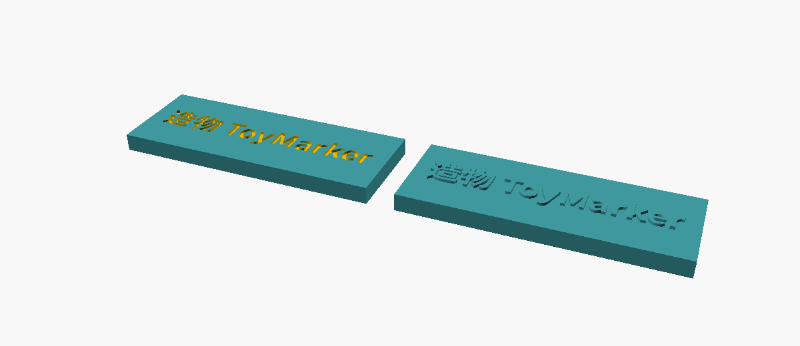
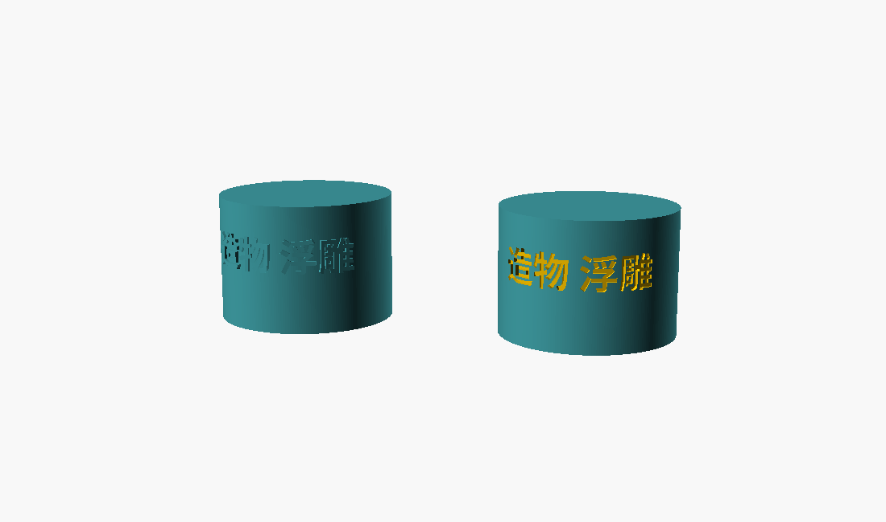
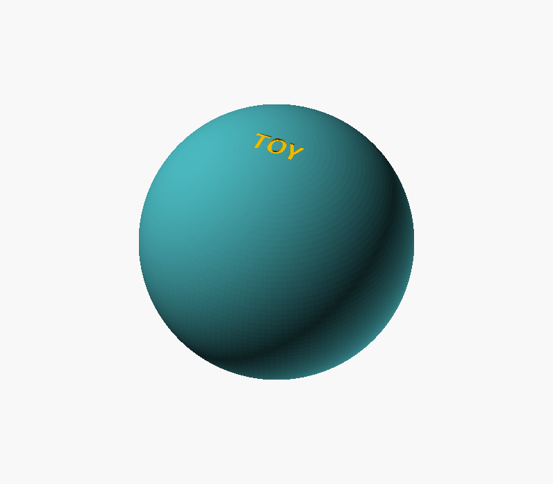

# 实验报告：OpenSCAD 文字与表面浮雕可行性

## 目标

回答两个问题，并用可复现的测量支撑结论：

1. OpenSCAD 对文字（尤其是中文）的支持到什么程度；
2. 能否把文字**刻进**零件表面（凹刻）或**浮出**表面（凸印），包括平面、圆柱面、一般曲面。

## 假设

- 文字本身不是问题（`text()` 是内建函数）；
- 真正的风险在：中文字体解析、曲面包裹后的几何朝向、布尔后的网格质量；
- 深度/尺寸这类"看起来对"的东西必须用数值证伪，不能只看渲染图。

## 方法

**环境**

| 项 | 值 |
|---|---|
| 项目自带快照 | OpenSCAD 2026.09.23（Manifold 后端），`bin/squashfs-root/usr/bin/openscad` |
| 系统版本 | OpenSCAD 2021.01（CGAL），`/usr/bin/openscad` |
| 字体 | fontconfig 2.18.3，共 2009 个 family；中文用 `Noto Sans CJK SC:style=Bold` |
| 检查工具 | `measure.py`：二进制 STL 体积、包围盒、半径、边流形（每条边必须恰好 2 个面） |

**三种几何**

1. `plate.scad` — 平面：`difference()` 减掉挤出的文字（凹刻）+ `union()` 加上（凸印）；
2. `cylinder.scad` — 圆柱面：BOSL2 `path_text()` 沿圆形路径逐字切向排布；
3. `sphere.scad` — 曲面：平底棱柱穿过表面后做差（不是"包裹"，深度沿投影方向）。

**证伪方式**

- 深度：从 STL 顶点里找型腔底面（圆柱看半径 `r_min`，平面看 `z`），与 `R - DEPTH` / `2.5 - DEPTH` 对比；
- 网格：边流形检查（`edges != 2` 必须为 0）；
- 字形朝向：直接看渲染图，并用 `textmetrics` 量出的 advance 交叉核对；
- 可打印性：用 `offset(delta = -t)` 逐级侵蚀文字，看笔画在多大侵蚀下消失。

## 结果

### 1. 文字与字体

- `text()` 在 2021.01 与 2026.09 上都能正常编译；中文需要显式指定字体。
- **默认字体与 `DejaVu Sans` 会把中文渲染成空心方框（tofu），而编译仍然 `Status: NoError`、没有任何警告**——这是最容易"看起来对"的坑（见 `docs` 之外的对比：`中文 A` 前两行是方框，第三行 `Noto Sans CJK SC` 才正确）。
- `textmetrics()` 只在 2026.09 存在，且**默认关闭**：不加 `--enable=textmetrics` 时是 `WARNING: Ignoring unknown function 'textmetrics'`；2021.01 则直接报 `unrecognised option '--enable=textmetrics'`（该函数不存在）。
- 本项目 `dsh-cad-harness/src/host/compile.ts` 只追加 `--backend=Manifold`，**不传 `--enable=textmetrics`**，因此 BOSL2 `path_text(..., textmetrics=true)` 在 harness 内会以 BOSL2 内部断言失败（`convolve` 的参数校验），而不是给出"需要开启 textmetrics"的提示。

### 2. 平面凹刻 / 凸印

`plate.scad`：76×28×5 板，`造物 ToyMarker`，size 6.5，深 0.8。

| 指标 | 实测 | 期望 |
|---|---|---|
| 三角形 | 9680 | — |
| 体积 | 21280.000 mm³ | 2×76×28×5 = 21280（凹刻与凸印恰好抵消） |
| 凹刻底面 z | **1.700** | 2.5 − 0.8 = 1.700 |
| 凸印顶面 z | **3.300** | 2.5 + 0.8 = 3.300 |
| 水密 | 是（`edges != 2 = 0`） | 是 |



### 3. 圆柱面包裹

`cylinder.scad`：R=18、H=26，`造物 浮雕`，size 5.5，深 0.8；两个副本分别凹刻/凸印。

| 指标 | 实测 | 期望 |
|---|---|---|
| 三角形 | 22680 | — |
| 体积 | 52901.921 mm³ | 素圆柱 52937.5 − 字腔 |
| 凹刻 `r_min` | **17.199**（深 0.801） | 18 − 0.8 = 17.200 |
| 凸印 `r_max` | 18.766 | 18.4（中心）+ 平面在边缘的径向偏移 |
| 水密 | 是 | 是 |

**必须 `reverse()` 路径，否则字形是镜像的。** BOSL2 对 `circle()` 取到的法线指向圆心（`path_cut_points` 在 (18,0,0) 处返回 `[-1, 0.0087, 0]`），`frame_map(x=tangent, z=normal)` 于是构造出"从里往外读"的朝向。实测：未反向时文字几何 `z` 落在 `[-10.29, 0]`（基线以下，倒挂），`reverse(path3d(circle(...)))` 后变成 `[0, 10.29]`（正常）。



### 4. 球面 / 一般曲面

`sphere.scad`：R=60，深 1.0，`TOY`，平底棱柱穿过球面后做差。

| 指标 | 实测 | 期望 |
|---|---|---|
| 三角形 | 27078 | — |
| 体积 | 904149.337 mm³ | 素球 904778.7 − 字腔 |
| 凹刻底面 z | **59.000** | 60 − 1.0 = 59.000 |
| 水密 | 是 | 是 |

**平底棱柱能刻到哪里，有一个闭式边界**：字腔只在棱柱还能碰到球面时出现，即

```
|x| < sqrt(2·R·DEPTH − DEPTH²)
```

R=40 / DEPTH=0.8 时半宽只有 8 mm——`TOY` 的 T、Y 两端被截断，看起来像字被"翻"了，很容易误判成镜像 bug；R=60 / DEPTH=1.0 时半宽 10.9 mm，整串才完整。**这个坑我们踩了一次**：R=40 的渲染图看起来是倒着的，实际是两端被裁掉造成的错觉。

另测了"等深度"方案 `difference(sphere, intersection(shell, glyph))`（沿法线取 0.8 深的球壳再求交）：R=40 与 R=60 都产生 **13 条非流形边**（每条边 4 个面），而同样的字用平底棱柱是 0。该方案暂不推荐，除非每一步都做流形检查。



### 5. 版本与性能

同一 `plate.scad`，两个版本产出**完全相同的体积与包围盒**，且都水密：

| 版本 | 后端 | 用时 | 面数 |
|---|---|---|---|
| 2026.09.23 快照 | Manifold | **69 ms** | 9680 |
| 2021.01 系统 | CGAL | 2467 ms | 2450 |

### 6. 可打印性（笔画宽度）

对 `Noto Sans CJK SC:style=Bold` 的 `造物浮雕` 做侵蚀扫描（`offset(delta=-t)`，体积→0 即笔画全被吃掉）：

| 字号 size | 侵蚀 0.30 | 0.40 | 0.45 | 0.50 | 推算最小笔画 |
|---|---|---|---|---|---|
| 5.5 | 25.6 | 3.2 | 0.1 | 0.1 | ≈ 0.8 mm |
| 7 | 69.5 | 35.5 | 19.7 | 6.7 | ≈ 1.0 mm |
| 9 | 154.0 | 108.4 | 86.2 | 64.6 | ≈ 1.3 mm |

即粗体中文字形笔画约为 **0.14 × size**。FDM 单墙 0.6 mm 的下限对应 size ≈ 4.3；凹刻深度 0.6–1.0 mm、凸印高度 0.4–0.6 mm 比较稳妥（后者主要用于换色/描边）。

## 分析

结论：**可行，而且分三档，代价和限制各不相同。**

| 场景 | 做法 | 结论 | 主要限制 |
|---|---|---|---|
| 平面/斜面 | `difference` / `union` + `linear_extrude(text())` | 直接可用 | 无（只要字体对） |
| 圆柱（把文字绕一圈） | BOSL2 `path_text` + `reverse(path)` | 可用，深度精确 | 需 `--enable=textmetrics`，否则要手给 `lettersize` |
| 球面/自由曲面 | 平底棱柱穿面后做差 | 可用、最稳（水密） | 文字宽度 ≤ `2·sqrt(2RD−D²)`，深度沿投影方向而非法线 |
| 任意曲面、等深度 | 壳层 ∩ 字块 | 几何更贴合但**出非流形边** | 需逐次流形检查，暂不推荐 |

中文的正确姿势是**显式写字体**（`font="Noto Sans CJK SC:style=Bold"`），不要依赖默认字体——默认字体下编译成功、模型是方框、没有任何警告，这是本项目"看起来对"风险的典型样本。

## 遇到的问题

1. **默认字体静默 tofu**：中文变方框，退出码 0、`Status: NoError`、无 WARNING。只能靠看图或显式断言字形（如对比 `textmetrics` 的 advance 与预期，或直接渲染检查）。
2. **`path_text` 字形镜像**：BOSL2 圆形路径的法线朝内，必须 `reverse(path)`；否则基线跑到 z<0 且逐字左右反转。
3. **侧面文字的正反**：`rotate([90,0,0])` 实际把文字放在 **−Y** 面；要放在 +Y 面且从外面读得正，需要 `rotate([90,0,180])`。这一条在把文字从顶面搬到侧面时非常容易搞错。
4. **截断伪装成镜像**：平底棱柱在曲面上刻不完整时，被裁掉两端的字看起来像翻转了（R=40 的 `TOY`），第一反应会去查相机/镜像，实际是宽度超了 `2·sqrt(2RD−D²)`。
5. **fontconfig 噪音**：沙箱里 `~/.cache/fontconfig` 不可写，OpenSCAD 每次启动打印 `Fontconfig error: No writable cache directories`。字形解析仍然正常，仅日志噪音；`run.sh` 里已过滤。
6. **harness 未开 textmetrics**：`compile.ts` 只加 `--backend=Manifold`。想让模型里直接用 `path_text(textmetrics=true)`，需要在解析到 2025+ 时补 `--enable=textmetrics`（2021.01 不认识该选项，必须按版本判断）。

## 产物列表

**代码与脚本：**

- `experiments/20261021_openscad_text_engraving/plate.scad` —— 平面凹刻 + 凸印
- `experiments/20261021_openscad_text_engraving/cylinder.scad` —— 圆柱面包裹（BOSL2 `path_text` + `reverse`）
- `experiments/20261021_openscad_text_engraving/sphere.scad` —— 球面平底棱柱凹刻
- `experiments/20261021_openscad_text_engraving/measure.py` —— STL 体积/包围盒/边流形检查
- `experiments/20261021_openscad_text_engraving/run.sh` —— 一键重建 STL、渲染 PNG 并打印实测值

**输出：**

- `plate.stl` / `cylinder.stl` / `sphere.stl` —— 生成的网格（二进制 STL）
- `plate.png` / `cylinder.png` / `sphere.png` —— 渲染图，对应正文三张图
- `measurements.txt` —— `run.sh` 的完整输出（体积、包围盒、水密、深度）

**运行命令：**

```bash
cd experiments/20261021_openscad_text_engraving
./run.sh                                  # 用项目自带快照
CAD_OPENSCAD_BIN=/usr/bin/openscad ./run.sh   # 换成系统 2021.01（无 textmetrics，圆柱那步会失败）
```

**环境依赖：**

- OpenSCAD 2026.09.23（Manifold 后端）+ `--enable=textmetrics`（仅圆柱包裹需要）
- 系统字体：`Noto Sans CJK SC`（`/usr/share/fonts/noto-cjk/`）
- BOSL2：`lib/BOSL2`（仓库需自行放置），`OPENSCADPATH` 指向 **包含** `BOSL2/` 的目录
- Python 3 + numpy（`measure.py`）

## 结论与下一步

- **可行**：平面、圆柱、球面三类表面都实测通过（水密 + 深度精确），中文也正常，前提是显式指定支持中文的字体。
- 圆柱包裹是"真包裹"（每字切向、弧长对齐）；球面/自由曲面目前是"投影凹刻"（平底、深度沿投影方向、宽度受限于 `2·sqrt(2RD−D²)`），够玩具场景用，但不是严格等深。
- 若要在 harness 内直接支持包裹文字，建议给 `compile.ts` 增加版本判断后的 `--enable=textmetrics`（2025+ 才加），否则模型作者只能用 `lettersize` 手工排间距，中文可用（CJK 是等宽的，`lettersize = size/0.72`），中英混排则很难对齐。
